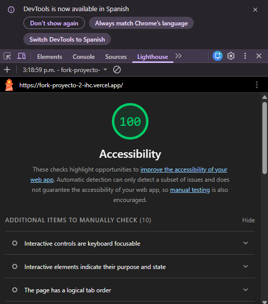
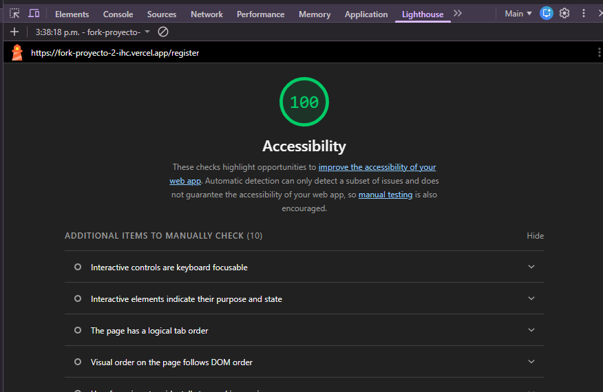
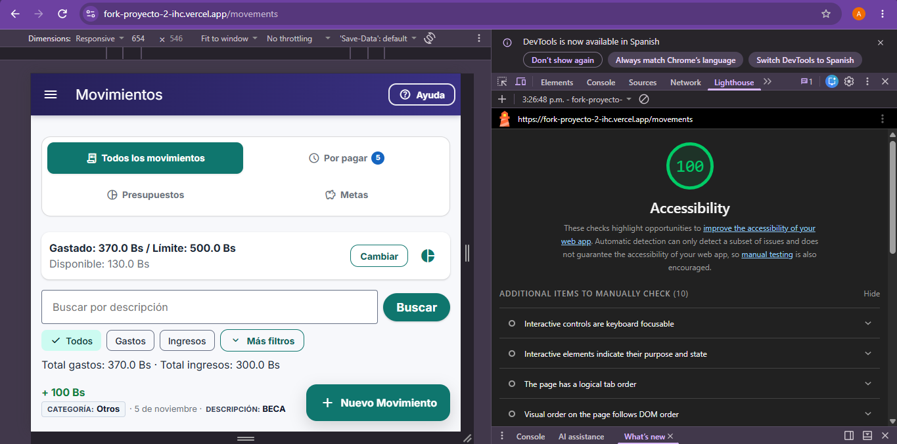
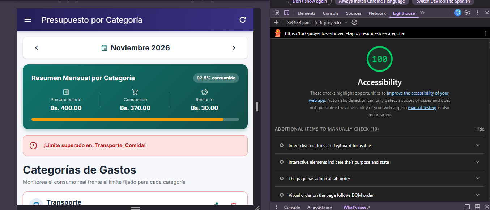
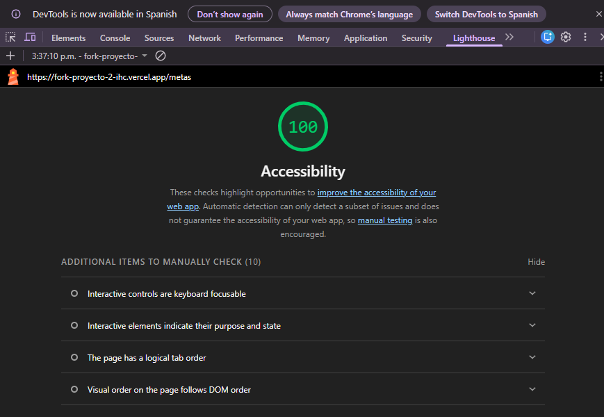
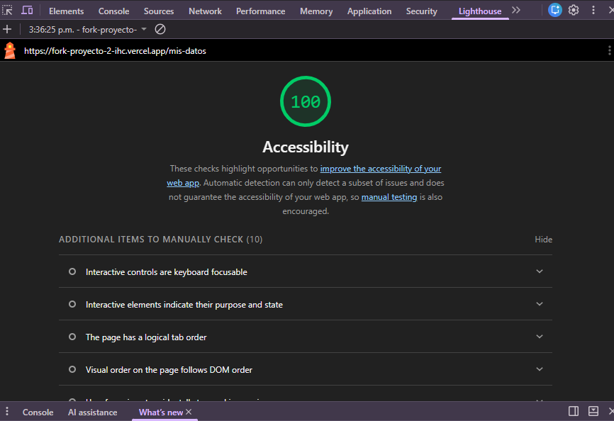
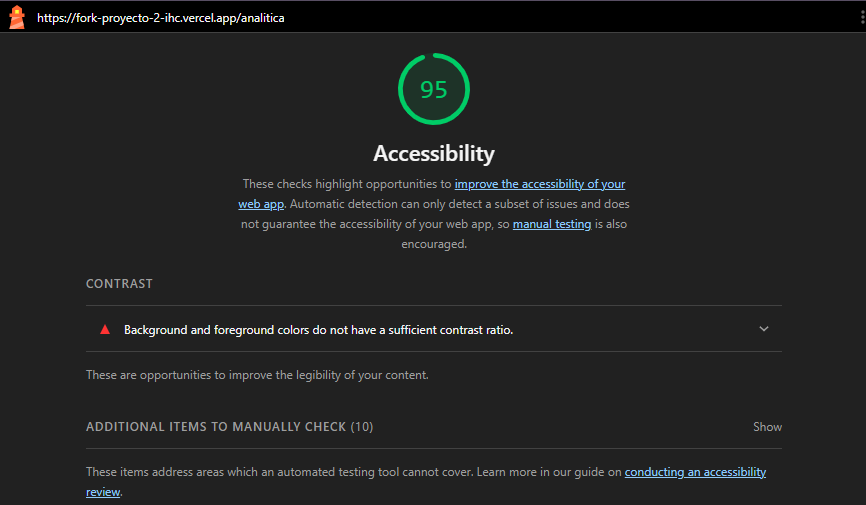
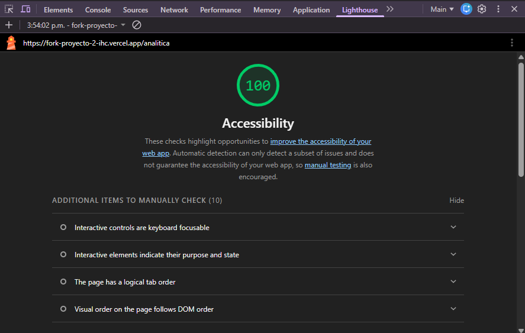

# Accesibilidad · Presupuesto Estudiantil

Revisión hecha el 18/11/2026 sobre la app en la nube: https://fork-proyecto-2-ihc.vercel.app

## 1. Herramientas

| Herramienta | Qué revisa | Dónde |
|---|---|---|
| **Lighthouse** (Chrome DevTools) | Puntaje de accesibilidad de cada pantalla: contraste, etiquetas, nombres de botones, idioma, orden de títulos | Capturas en esta carpeta |
| **axe-core** (dentro de Playwright) | Las mismas reglas WCAG, automáticas en **cada pantalla** cada vez que corren las pruebas E2E | `frontend/e2e/diseno.spec.ts` |
| **Cálculo de contraste WCAG** | Contraste de cada par texto/fondo de la paleta | Tabla de la sección 4 |

## 2. Resultados de Lighthouse

Los 7 reportes completos de Lighthouse están en [reportes-html/](reportes-html/) y [antes/](antes/). Ábrelos en el navegador.

| Pantalla | Puntaje | Reporte | Captura |
|---|---|---|---|
| Inicio (`/`) | **100** | [inicio.html](reportes-html/inicio.html) |  |
| Crear Cuenta (`/register`) | **100** | [registro.html](reportes-html/registro.html) |  |
| Movimientos (`/movements`), sesión de Martita, vista celular | **100** | [movimientos.html](reportes-html/movimientos.html) |  |
| Presupuesto por Categoría | **100** | [presupuesto-categoria.html](reportes-html/presupuesto-categoria.html) |  |
| Metas de Ahorro | **100** | [metas.html](reportes-html/metas.html) |  |
| Mis datos | **100** | [mis-datos.html](reportes-html/mis-datos.html) |  |
| **Analítica** | **95 → 100** | [antes](antes/analitica-95.html) · [después](despues/analitica-100.html) |  |

### Antes y después: Analítica

| | Antes | Después |
|---|---|---|
| **Puntaje** | 95 / 100 | 100 / 100 |
| **Qué detectó Lighthouse** | *Background and foreground colors do not have a sufficient contrast ratio*: los nombres de los eventos de error (`movimiento_rechazado`, `pago_rechazado`, `meta_rechazada`, `cuenta_eliminacion_frenada`…) usaban rojo `#EF4444` sobre blanco, con **3.76 : 1** | Los mismos textos usan `#B91C1C`, con **6.5 : 1** |
| **Interpretación** | El rojo claro se ve bien para personas con buena visión, pero no llega al mínimo AA de 4.5 : 1 para texto normal. Quien tiene baja visión o mira la pantalla con sol no lo lee | Cumple AA. El rojo sigue indicando «error», pero más oscuro |
| **Corrección en el código** | `var(--error-default)` (`#EF4444`) como color de texto | `var(--error-dark)` (`#B91C1C`) en `AnaliticaScreen.vue`. Revisando el resto de la app encontramos el mismo problema en otros lugares y también los corregimos: textos de error en Metas y Movimientos, el aviso rojo de error (texto blanco sobre `#EF4444`) y el botón de peligro (`.btn-danger`) |
| **Captura** |  |  |

El rojo claro `#EF4444` solo se mantiene en **bordes** (por ejemplo, el borde de un campo con error), donde WCAG pide 3 : 1 y lo cumple.

## 3. Interpretación

- **100 / 100 significa que Lighthouse no encontró ningún problema automático:** todos los textos tienen contraste suficiente, los campos tienen su etiqueta, los botones con ícono tienen nombre accesible (por ejemplo, «Abrir menú» y «Mostrar contraseña»), la página declara el idioma y los títulos siguen un orden.
- **Lighthouse avisa que solo detecta una parte de los problemas.** Por eso lista 10 puntos para revisar a mano (sección 5). Los revisamos sobre la app.
- **axe refuerza la revisión automática:** corre en las 10 pantallas principales en cada ejecución de la suite E2E. Si un cambio rompe la accesibilidad, la prueba falla antes de llegar a la nube.

## 4. Contraste AA comprobado

WCAG AA pide **4.5 : 1** para texto normal y **3 : 1** para bordes y elementos gráficos.

| Uso | Colores | Contraste | AA |
|---|---|---|---|
| Texto del botón principal | `#FFFFFF` sobre `#0F766E` | 5.5 : 1 | ✅ |
| Botón al pasar el mouse | `#FFFFFF` sobre `#115E59` | 7.6 : 1 | ✅ |
| Título de la barra | `#FFFFFF` sobre `#262058` | 14.7 : 1 | ✅ |
| Texto normal | `#1F2937` sobre `#F7F8FB` | 13.8 : 1 | ✅ |
| Texto secundario (fechas, ayudas) | `#6B7280` sobre `#FFFFFF` | 4.8 : 1 | ✅ |
| Botón de contorno | `#115E59` sobre `#FFFFFF` | 7.6 : 1 | ✅ |
| Filtro elegido (chip) | `#042F2E` sobre `#CCFBF1` | 12.8 : 1 | ✅ |
| Estado «pendiente» | `#1565C0` sobre `#FFFFFF` | 5.7 : 1 | ✅ |
| Estado «pagado» | `#2E7D32` sobre `#FFFFFF` | 5.1 : 1 | ✅ |
| Mensaje de error | `#B91C1C` sobre `#FFFFFF` | 6.5 : 1 | ✅ |
| Aviso naranja (advertencia) | `#B45309` sobre `#FEF3C7` | 4.51 : 1 | ✅ (justo en el límite) |
| Botón del Inicio | `#FFFFFF` sobre `#1D4ED8` | 6.7 : 1 | ✅ |
| Borde de los campos (no es texto) | `#667085` sobre `#FFFFFF` | 5.0 : 1 | ✅ (pide 3 : 1) |

## 5. Problemas encontrados y corregidos

| # | Problema | Por qué importa | Corrección |
|---|---|---|---|
| 1 | El texto blanco sobre el naranja antiguo (`#EDA558`) no llegaba a 4.5 : 1 | Texto ilegible para personas con baja visión | Con la paleta nueva, los botones son verde agua `#0F766E`: blanco sobre él da 5.5 : 1 |
| 2 | El rojo `#EF4444` se usaba como color de texto: «Disponible: 0 Bs», eventos de error en Analítica, avisos de error y botón de peligro (3.8 : 1 sobre blanco) | No llegaba a AA. Lighthouse bajó Analítica a 95 | Todo texto rojo usa `#B91C1C` (6.5 : 1); si queda poco disponible, naranja `#B45309`. Analítica subió a 100 |
| 3 | El botón «Ayuda» se perdía sobre la barra azul | El usuario no lo encontraba | Borde blanco de 2 px sobre la barra índigo |
| 4 | El contorno de foco era azul sobre la barra azul | Con teclado no se veía dónde estaba el foco | Dentro de la barra, el contorno de foco es blanco |
| 5 | En celular, «CATEGORÍA:» y «DESCRIPCIÓN:» se partían en dos líneas | Lectura difícil | Las etiquetas ya no se cortan (`white-space: nowrap`) |
| 6 | Las pestañas quedaban apretadas en pantallas angostas | Áreas de toque pequeñas | Grilla 2 × 2 en tablet y celular, con 48 px de alto (ley de Fitts) |
| 7 | El código de recuperación necesitaba instrucciones claras | Los lectores de pantalla deben anunciar errores | Campo con etiqueta, teclado numérico (`inputmode`), `autocomplete="one-time-code"`, ayuda conectada con `aria-describedby` y errores con `role="alert"` |

## 6. Revisión manual (lo que Lighthouse pide revisar a mano)

| Punto | Cómo se cumple |
|---|---|
| Los controles se pueden usar con teclado | Todos son `<button>`, `<a>` o `<input>`; con **Tab** se llega a cada uno |
| Los elementos indican su propósito y estado | Pestaña activa (`aria-selected`), campos con error (`aria-invalid`), botones de ícono con `aria-label` |
| Orden lógico con Tab | El orden del código sigue el orden visual: barra → pestañas → contenido → botón flotante |
| El foco se ve | Contorno de 2–3 px en todos los controles (`:focus-visible`), blanco dentro de la barra |
| Áreas de toque | Botones de al menos 44 px; lo comprueba la prueba «botones fáciles de tocar» de `diseno.spec.ts` |
| Movimiento reducido | En las páginas públicas, el desplazamiento suave (por ejemplo, «Ver Cómo Funciona») solo se activa si el sistema no pide reducir el movimiento (`prefers-reduced-motion`) |

## 7. Cómo repetir la revisión

1. Abre la app en Chrome → **F12** → pestaña **Lighthouse** → marca solo **Accessibility** → **Analyze page load**.
2. Para las pantallas con sesión, primero inicia sesión (por ejemplo, Martita) y después corre Lighthouse en esa pestaña.
3. Pruebas automáticas: `cd frontend && pnpm test:e2e diseno` (axe en cada pantalla).
