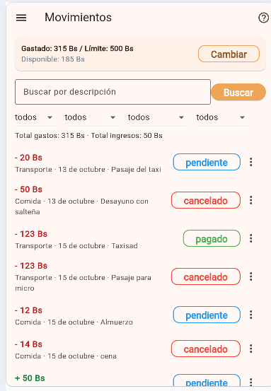
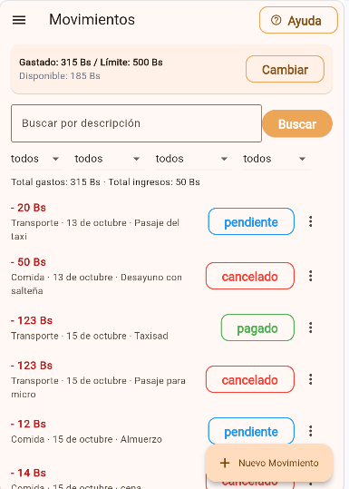
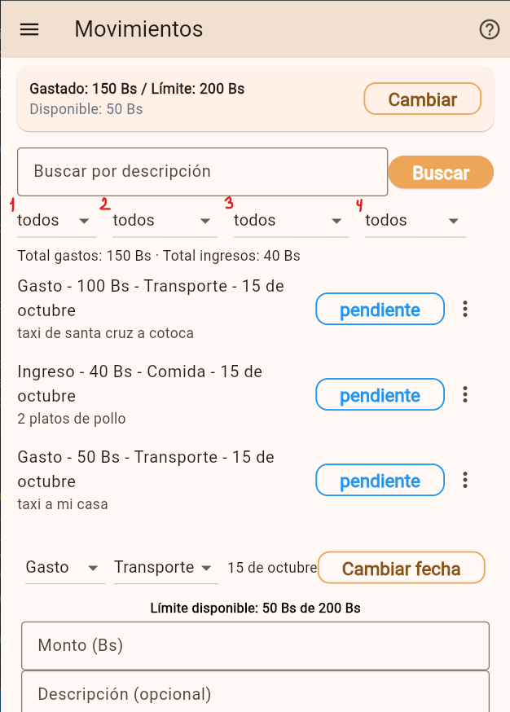
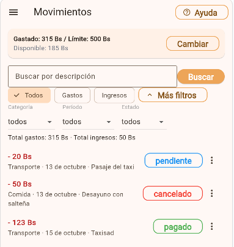

# Decisiones de Interacción — Presupuesto Estudiantil

**Clase 16 · Interacción Humano-Computador**

**Funcionalidad evaluada:** gestión y registro de movimientos financieros (registrar gasto, categorías, límite y disponible) en `MovementsScreen`.

Se documentan **tres decisiones**, una por principio (Fitts, Hick y carga cognitiva), cada una con **captura antes**, **captura después** y **referencia al código**.

## Resumen

| Principio | Decisión | Estado |
|---|---|---|
| **Fitts** | La acción de registrar pasó a un `FloatingActionButton` grande y accesible | Corregido. |
| **Hick** | Filtros ordenados por prioridad + revelación progresiva ("Más filtros") | Corregido. |
| **Carga cognitiva** | Filas con jerarquía tipográfica y montos diferenciados | Corregido. |

---

## 1. Fitts — alcanzar la acción

**Antes:** el formulario y el botón principal de registro estaban al fondo de una lista con scroll, obligando a recorrer una distancia innecesaria para alcanzarlos.

**Captura — antes**

**Decisión:** se ancló la acción principal en un `FloatingActionButton.extended` ("Nuevo Movimiento") y el formulario pasó a un modal, dejando la acción grande (tamaño) y cerca del pulgar (distancia).

**Código:** [`FloatingActionButton.extended`](../lib/screens/movements_screen.dart#L1042-L1055) · [`_abrirModalFormulario()`](../lib/screens/movements_screen.dart#L1005-L1040)

**Captura — después**

**Estado:** Corregido.

---

## 2. Hick — elegir

**Antes:** cuatro menús de filtro (Tipo, Categoría, Periodo y Estado) competían a la vez, sumando 17 opciones y aumentando el tiempo de decisión.

**Captura — antes**

**Decisión:** se dio prioridad al filtro más usado (Tipo) como chips rápidos y el resto quedó detrás de "Más filtros" (revelación progresiva). No se escondió todo: se organizaron las opciones y se muestra cada decisión en el momento adecuado.

**Código:** [`_panelFiltros()`](../lib/screens/movements_screen.dart#L297-L358) · estado `_mostrarFiltrosPersonalizados` ([`L40`](../lib/screens/movements_screen.dart#L40))

**Captura — después**

**Estado:** Corregido.

---

## 3. Carga cognitiva — comprender

**Antes:** cada movimiento se mostraba como una línea de texto concatenada (`Gasto - 50.0 Bs - Comida - 15 oct`), sin jerarquía visual, obligando a interpretar cuatro datos de golpe.

**Captura — antes**

**Decisión:** se separó la información con **jerarquía tipográfica** y **montos diferenciados**: el monto va como título en negrita y con color/signo (`- 50 Bs` para gasto, `+ 200 Bs` para ingreso), y categoría, fecha y descripción pasan al subtítulo. También se evita el decimal sobrante (`50.0` → `50`) para un escaneo más rápido.

**Código:** [fila del movimiento](../lib/screens/movements_screen.dart#L1072-L1097)

**Captura — después**

**Estado:** Corregido.
