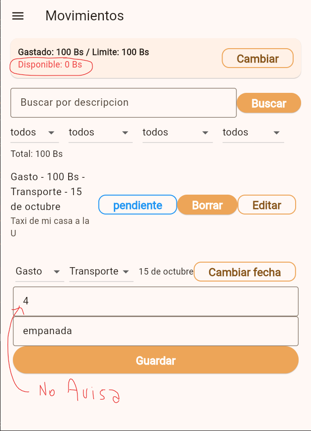

# Evaluación Heurística H1–H10 — Presupuesto Estudiantil

**Funcionalidad evaluada:** configurar el límite mensual y registrar un gasto (flujo: definir/cambiar límite → registrar gasto → visualizar la lista y el total con búsqueda y filtros). Incluye un caso permitido y un caso bloqueado.

**Repositorio:** <https://github.com/ihc-team/Project2-IHC>

## Resumen

| # | Heurística | Estado | Severidad |
|---|------------|:------:|:---------:|
| H1 | Visibilidad del estado del sistema | 🛠️ Corregida | 3 (Mayor) |
| H2 | Relación entre el sistema y el mundo real | 🛠️ Corregida | 2 (Menor) |
| H3 | Control y libertad del usuario | 🛠️ Corregida | 3 (Mayor) |
| H4 | Consistencia y estándares | 🛠️ Corregida | 2 (Menor) |
| H5 | Prevención de errores | ❌ No cumple | 2 (Menor) |
| H6 | Reconocer antes que recordar | ❌ No cumple | 2 (Menor) |
| H7 | Flexibilidad y eficiencia de uso | ✅ Cumple | 0 |
| H8 | Diseño estético y minimalista | ❌ No cumple | 2 (Menor) |
| H9 | Reconocer, diagnosticar y recuperarse de errores | ❌ No cumple | 3 (Mayor) |
| H10 | Ayuda y documentación | ❌ No cumple | 2 (Menor) |

**Resultado:** 1 cumple (H7), 4 corregidas (H1–H4) y 5 por corregir.

---

## H1 — Visibilidad del estado del sistema

- **Estado:** 🛠️ Corregida
- **Pantalla / flujo:** Movimientos → guardar un gasto / definir el límite.
- **Qué ocurría:** Al presionar "Guardar", la app ejecutaba llamadas asíncronas a Supabase (`_service.create` o `saveMonthLimit`) sin activar un indicador de carga (`CircularProgressIndicator`) ni deshabilitar los botones. La persona no sabía si la acción fue recibida y podía pulsar varias veces, provocando registros duplicados.
- **Corrección aplicada:** Se agregó el estado `_guardando`. Mientras se guarda, el botón "Guardar" queda deshabilitado y muestra un `CircularProgressIndicator`, y `_save()` ignora envíos repetidos. El diálogo del límite usa el mismo patrón con `StatefulBuilder`.
- **Código:** [`_save()`](../lib/screens/movements_screen.dart#L465-L510) · [botón "Guardar"](../lib/screens/movements_screen.dart#L821-L836) · [`_dialogoCambiarLimite()`](../lib/screens/movements_screen.dart#L338-L421) en `movements_screen.dart`.
- **Severidad:** 3 (Mayor)

**Evidencia — antes**

**Evidencia — después**

---

## H2 — Relación entre el sistema y el mundo real

- **Estado:** 🛠️ Corregida
- **Pantalla / flujo:** Movimientos → panel de filtros, indicador "Total".
- **Qué ocurría:** El indicador "Total" sumaba todos los montos de la lista filtrada sin distinguir ingreso de gasto y sumando también los cancelados (ej: 100 Bs de ingreso y 40 Bs de gasto se mostraban como "Total: 140 Bs"). No decía qué representaba y contradecía la tarjeta superior.
- **Corrección aplicada:** El total ahora se muestra separado y en lenguaje del dominio: **"Total gastos: X Bs · Total ingresos: Y Bs"**, y ambos excluyen los movimientos cancelados.
- **Código:** [indicador "Total"](../lib/screens/movements_screen.dart#L285) · [`calcularTotalGastos()`](../lib/utils/movimientos_filtros.dart#L11-L16) · [`calcularTotalIngresos()`](../lib/utils/movimientos_filtros.dart#L19-L24).
- **Severidad:** 2 (Menor)

**Evidencia — antes**

**Evidencia — después**

---

## H3 — Control y libertad del usuario

- **Estado:** 🛠️ Corregida
- **Pantalla / flujo:** Movimientos → botón de cambio de estado en la lista.
- **Qué ocurría:** Un solo toque llevaba de "pagado" a "cancelado" sin diálogo de confirmación ni opción de deshacer, y una vez cancelado no había retorno (`siguienteEstado` retorna `null`). Un toque accidental anulaba el movimiento de forma permanente.
- **Corrección aplicada:** Antes de cancelar se muestra un diálogo de confirmación ("¿Seguro que quieres cancelar este movimiento? Esta acción no se puede deshacer."). Si la persona no confirma, el movimiento queda igual.
- **Código:** [`_cambiarEstado()`](../lib/screens/movements_screen.dart#L587-L619) · [botón de estado](../lib/screens/movements_screen.dart#L668) · [`siguienteEstado()`](../lib/utils/estado_movimiento.dart#L8).
- **Severidad:** 3 (Mayor)

**Evidencia — antes**

**Evidencia — después**

---

## H4 — Consistencia y estándares

- **Estado:** 🛠️ Corregida
- **Pantalla / flujo:** Múltiples pantallas (`movements_screen.dart`, `login_screen.dart`, `register_screen.dart`, `reset_password_screen.dart`, `change_password_screen.dart`, `home_screen.dart`).
- **Qué ocurría:** La misma acción usaba dos términos ("Borrar" en la lista, "Eliminar" en el modal); la moneda aparecía como "bs" y "Bs"; y palabras iguales se escribían con y sin tilde entre pantallas ("Iniciar Sesión"/"Iniciar Sesion", "descripcion", "Categoria", "Limite", "Correo electronico", "vacio", "accion").
- **Corrección aplicada:** Se unificó: (1) la acción de eliminar → **"Eliminar"** en botón y modal; (2) la moneda → **"Bs"** en todas las pantallas; (3) la ortografía → acentos consistentes en los textos visibles ("Iniciar Sesión", "Correo electrónico", "descripción", "categoría", "límite", "vacío", "acción", "búsqueda", "mínimo", "numérico", "válido").
- **Código:** [botón "Eliminar"](../lib/screens/movements_screen.dart#L684) y [modal "Eliminar"](../lib/screens/movements_screen.dart#L550) · [SnackBar "Bs"](../lib/screens/movements_screen.dart#L454) · [AppBar "Iniciar Sesión"](../lib/screens/login_screen.dart#L47) y [botón "Iniciar Sesión"](../lib/screens/login_screen.dart#L121).
- **Severidad:** 2 (Menor)

**Evidencia — antes**

**Evidencia — después**

---

## H5 — Prevención de errores

- **Estado:** ❌ No cumple
- **Pantalla / flujo:** Movimientos → formulario de gasto, campo de monto.
- **Qué ocurre:** El formulario permite escribir un monto superior al límite disponible del mes sin advertirlo ni validar en tiempo real mientras se tipea. La comprobación se dispara recién al presionar "Guardar".
- **Consecuencia:** No previene el error antes de que ocurra: la persona ingresa todos los datos para luego recibir un bloqueo reactivo mediante un SnackBar.
- **Código:** [campo de monto](../lib/screens/movements_screen.dart#L754-L774) · [`_validarSiExcedioLimiteMensual()`](../lib/screens/movements_screen.dart#L405-L441).
- **Severidad:** 2 (Menor)

**Evidencia — antes**

**Evidencia — después**

> Pendiente: guardar la captura en `docs/evidencias/H5/despues/`.

---

## H6 — Reconocer antes que recordar

- **Estado:** ❌ No cumple
- **Pantalla / flujo:** Movimientos → formulario de ingreso de movimiento.
- **Qué ocurre:** El formulario de creación de gasto no muestra cuánto límite mensual queda disponible. Como el formulario está al pie de la lista, al hacer scroll la tarjeta superior queda fuera de vista.
- **Consecuencia:** Obliga a la persona a retener en su memoria la cifra de dinero disponible para calcular mentalmente si el gasto que ingresa será admitido o superará el tope.
- **Código:** [`_tarjetaResumenLimite()`](../lib/screens/movements_screen.dart#L291-L325) · [formulario de movimiento](../lib/screens/movements_screen.dart#L640-L803).
- **Severidad:** 2 (Menor)

**Evidencia**

> Pendiente: guardar capturas en `docs/evidencias/H6/` (antes y después).

---

## H7 — Flexibilidad y eficiencia de uso

- **Estado:** ✅ Cumple
- **Pantalla / flujo:** Movimientos → búsqueda y filtros.
- **Comprobación:** La búsqueda se ejecuta directamente con la tecla Enter/Search del teclado; los 4 filtros (tipo, categoría, periodo, estado) se combinan libremente; y cada chip permite quitar un filtro con un toque sin resetear el resto.
- **Observación (no afecta la heurística):** el formulario al final del scroll resta velocidad a usuarios frecuentes con listas extensas.
- **Código:** [`_chipsFiltros()`](../lib/screens/movements_screen.dart#L151-L218) · [acción de teclado en búsqueda](../lib/screens/movements_screen.dart#L233) · [`showDateRangePicker`](../lib/screens/movements_screen.dart#L115-L120).
- **Severidad:** 0 (Cumple)

**Evidencia**

> Pendiente: guardar capturas en `docs/evidencias/H7/`.

---

## H8 — Diseño estético y minimalista

- **Estado:** ❌ No cumple
- **Pantalla / flujo:** Movimientos → elementos de la lista (`ListTile`).
- **Qué ocurre:** Dentro de `trailing` de cada movimiento se incrustan en fila tres botones completos con texto (`OutlinedButton` de estado, `ElevatedButton` "Borrar" y `OutlinedButton` "Editar").
- **Consecuencia:** Sobrecarga visual que compite con la información del movimiento. Además, "Borrar" resalta con fondo sólido dándole más peso que "Editar", y en pantallas estrechas comprime el título con riesgo de desbordamiento horizontal.
- **Código:** [`ListTile`](../lib/screens/movements_screen.dart#L609-L637).
- **Severidad:** 2 (Menor)

**Evidencia**

> Pendiente: guardar capturas en `docs/evidencias/H8/` (antes y después).

---

## H9 — Reconocer, diagnosticar y recuperarse de errores

- **Estado:** ❌ No cumple
- **Pantalla / flujo:** Login y Registro → envío de credenciales incorrectas.
- **Qué ocurre:** Ambas pantallas capturan los errores con un bloque `catch (_)` que solo vacía los campos (`_emailController.text = ""; _passwordController.text = "";`) sin desplegar ningún mensaje que explique qué falló.
- **Consecuencia:** El usuario queda sin saber si la contraseña fue errónea, si el usuario no existe o si falló la conexión. No hay diagnóstico ni salida, y además pierde lo tipeado y debe reescribirlo.
- **Código:** [`_handleLogin()`](../lib/screens/login_screen.dart#L31-L34) · [`_handleRegister()`](../lib/screens/register_screen.dart#L32-L35).
- **Severidad:** 3 (Mayor)

**Evidencia**

> Pendiente: guardar capturas en `docs/evidencias/H9/` (antes y después).

---

## H10 — Ayuda y documentación

- **Estado:** ❌ No cumple
- **Pantalla / flujo:** Movimientos y Menú (`app_drawer.dart`).
- **Qué ocurre:** En ninguna parte de la interfaz hay un botón de ayuda, `Tooltip` o ícono informativo (`?`) que explique qué es el "Límite mensual", qué pasa al superarlo (bloquea nuevos gastos) o cómo funciona el flujo de estados de los movimientos.
- **Consecuencia:** El estudiante novato no tiene guía dentro de la app para entender las reglas del límite, y debe descubrirlas por ensayo y error.
- **Código:** [resumen de límite](../lib/screens/movements_screen.dart#L291-L334) · [`_dialogoCambiarLimite()`](../lib/screens/movements_screen.dart#L337-L402) · [drawer](../lib/widgets/app_drawer.dart#L25-L47).
- **Severidad:** 2 (Menor)

**Evidencia**

> Pendiente: guardar capturas en `docs/evidencias/H10/` (antes y después).

---

## Evidencias pendientes

| Heurística | Antes | Después |
|------------|:-----:|:-------:|
| H1 | ✅ | ⏳ |
| H2 | ✅ | ⏳ |
| H3 | ✅ | ⏳ |
| H4 | ✅ | ⏳ |
| H5 | ✅ | ⏳ |
| H6 | ⏳ | ⏳ |
| H7 | ⏳ | — |
| H8 | ⏳ | ⏳ |
| H9 | ⏳ | ⏳ |
| H10 | ⏳ | ⏳ |
