# Evaluación Heurística H1–H10 — Presupuesto Estudiantil

**Funcionalidad evaluada:** configurar el límite mensual y registrar un gasto (flujo: definir/cambiar límite → registrar gasto → visualizar la lista y el total con búsqueda y filtros). Incluye un caso permitido y un caso bloqueado.

**Repositorio:** <https://github.com/ihc-team/Project2-IHC>

## Resumen

| # | Heurística | Estado | Severidad |
|---|------------|:------:|:---------:|
| H1 | Visibilidad del estado del sistema | 🛠️ Corregida | 3 (Mayor) |
| H2 | Relación entre el sistema y el mundo real | 🛠️ Corregida | 2 (Menor) |
| H3 | Control y libertad del usuario | 🛠️ Corregida | 3 (Mayor) |
| H4 | Consistencia y estándares | 🛠️ Corregida | 2 (Menor) |
| H5 | Prevención de errores | 🛠️ Corregida | 2 (Menor) |
| H6 | Reconocer antes que recordar | ❌ No cumple | 2 (Menor) |
| H7 | Flexibilidad y eficiencia de uso | ✅ Cumple | 0 |
| H8 | Diseño estético y minimalista | ❌ No cumple | 2 (Menor) |
| H9 | Reconocer, diagnosticar y recuperarse de errores | ❌ No cumple | 3 (Mayor) |
| H10 | Ayuda y documentación | ❌ No cumple | 2 (Menor) |

**Resultado:** 1 cumple (H7), 5 corregidas (H1–H5) y 4 por corregir.

---

## H1 — Visibilidad del estado del sistema

- **Estado:** 🛠️ Corregida
- **Pantalla / flujo:** Movimientos → guardar un gasto / definir el límite.
- **Qué ocurría:** Al presionar "Guardar", la app ejecutaba llamadas asíncronas a Supabase (`_service.create` o `saveMonthLimit`) sin activar un indicador de carga (`CircularProgressIndicator`) ni deshabilitar los botones. La persona no sabía si la acción fue recibida y podía pulsar varias veces, provocando registros duplicados.
- **Corrección aplicada:** Se agregó el estado `_guardando`. Mientras se guarda, el botón "Guardar" queda deshabilitado y muestra un `CircularProgressIndicator`, y `_save()` ignora envíos repetidos. El diálogo del límite usa el mismo patrón con `StatefulBuilder`.
- **Código:** [`_save()`](../lib/screens/movements_screen.dart#L465-L510) · [botón "Guardar"](../lib/screens/movements_screen.dart#L821-L836) · [`_dialogoCambiarLimite()`](../lib/screens/movements_screen.dart#L338-L421) en `movements_screen.dart`.
- **Severidad:** 3 (Mayor)

**Evidencia — antes**

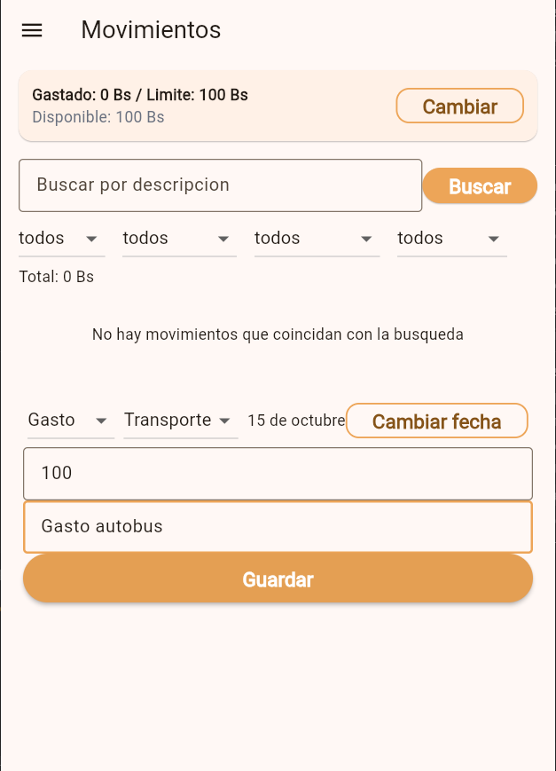
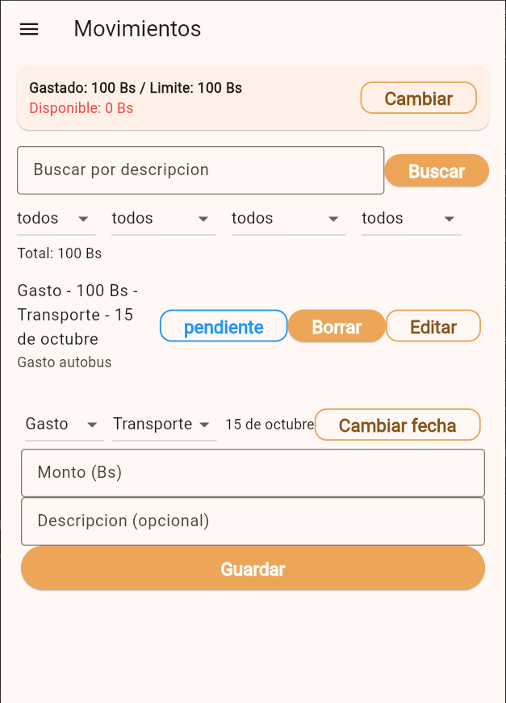

**Evidencia — después**

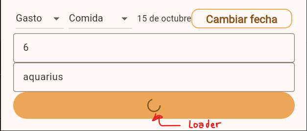
---

## H2 — Relación entre el sistema y el mundo real

- **Estado:** 🛠️ Corregida
- **Pantalla / flujo:** Movimientos → panel de filtros, indicador "Total".
- **Qué ocurría:** El indicador "Total" sumaba todos los montos de la lista filtrada sin distinguir ingreso de gasto y sumando también los cancelados (ej: 100 Bs de ingreso y 40 Bs de gasto se mostraban como "Total: 140 Bs"). No decía qué representaba y contradecía la tarjeta superior.
- **Corrección aplicada:** El total ahora se muestra separado y en lenguaje del dominio: **"Total gastos: X Bs · Total ingresos: Y Bs"**, y ambos excluyen los movimientos cancelados.
- **Código:** [indicador "Total"](../lib/screens/movements_screen.dart#L285) · [`calcularTotalGastos()`](../lib/utils/movimientos_filtros.dart#L11-L16) · [`calcularTotalIngresos()`](../lib/utils/movimientos_filtros.dart#L19-L24).
- **Severidad:** 2 (Menor)

**Evidencia — antes**

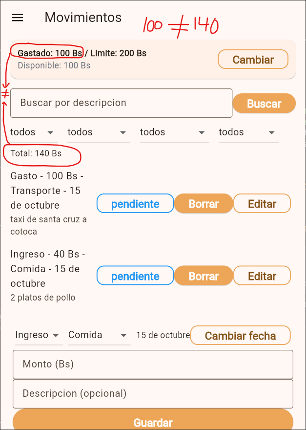

**Evidencia — después**

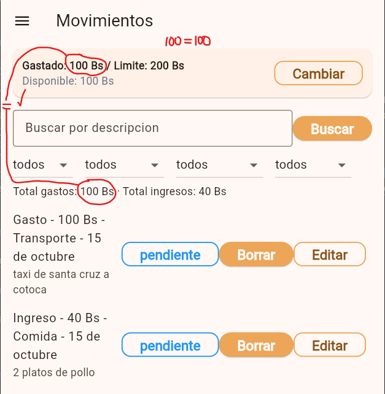

---

## H3 — Control y libertad del usuario

- **Estado:** 🛠️ Corregida
- **Pantalla / flujo:** Movimientos → botón de cambio de estado en la lista.
- **Qué ocurría:** Un solo toque llevaba de "pagado" a "cancelado" sin diálogo de confirmación ni opción de deshacer, y una vez cancelado no había retorno (`siguienteEstado` retorna `null`). Un toque accidental anulaba el movimiento de forma permanente.
- **Corrección aplicada:** Antes de cancelar se muestra un diálogo de confirmación ("¿Seguro que quieres cancelar este movimiento? Esta acción no se puede deshacer."). Si la persona no confirma, el movimiento queda igual.
- **Código:** [`_cambiarEstado()`](../lib/screens/movements_screen.dart#L587-L619) · [botón de estado](../lib/screens/movements_screen.dart#L668) · [`siguienteEstado()`](../lib/utils/estado_movimiento.dart#L8).
- **Severidad:** 3 (Mayor)

**Evidencia — antes**

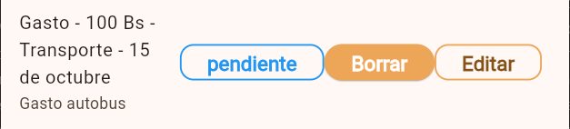
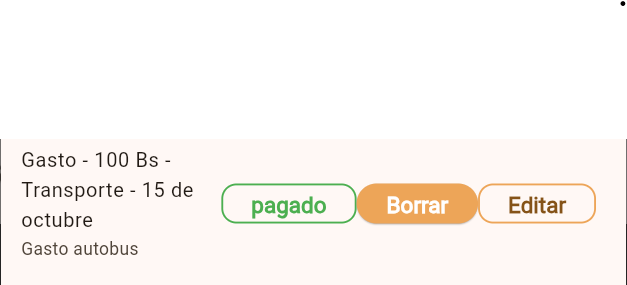
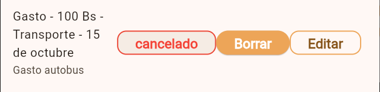

**Evidencia — después**

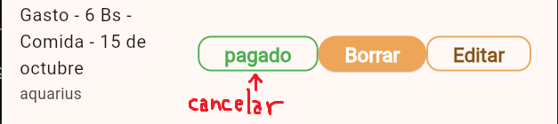
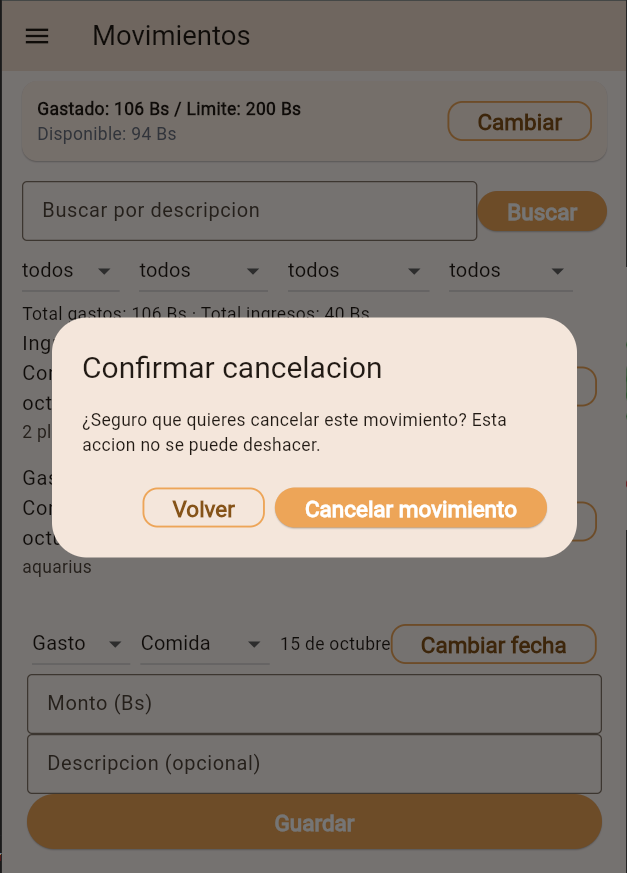
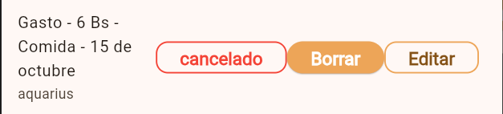

---

## H4 — Consistencia y estándares

- **Estado:** 🛠️ Corregida
- **Pantalla / flujo:** Múltiples pantallas (`movements_screen.dart`, `login_screen.dart`, `register_screen.dart`, `reset_password_screen.dart`, `change_password_screen.dart`, `home_screen.dart`).
- **Qué ocurría:** La misma acción usaba dos términos ("Borrar" en la lista, "Eliminar" en el modal); la moneda aparecía como "bs" y "Bs"; y palabras iguales se escribían con y sin tilde entre pantallas ("Iniciar Sesión"/"Iniciar Sesion", "descripcion", "Categoria", "Limite", "Correo electronico", "vacio", "accion").
- **Corrección aplicada:** Se unificó: (1) la acción de eliminar → **"Eliminar"** en botón y modal; (2) la moneda → **"Bs"** en todas las pantallas; (3) la ortografía → acentos consistentes en los textos visibles ("Iniciar Sesión", "Correo electrónico", "descripción", "categoría", "límite", "vacío", "acción", "búsqueda", "mínimo", "numérico", "válido").
- **Código:** [botón "Eliminar"](../lib/screens/movements_screen.dart#L684) y [modal "Eliminar"](../lib/screens/movements_screen.dart#L550) · [SnackBar "Bs"](../lib/screens/movements_screen.dart#L454) · [AppBar "Iniciar Sesión"](../lib/screens/login_screen.dart#L47) y [botón "Iniciar Sesión"](../lib/screens/login_screen.dart#L121).
- **Severidad:** 2 (Menor)

**Evidencia — antes**

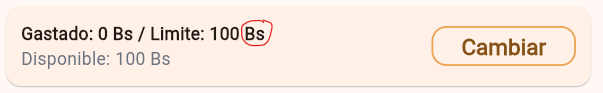
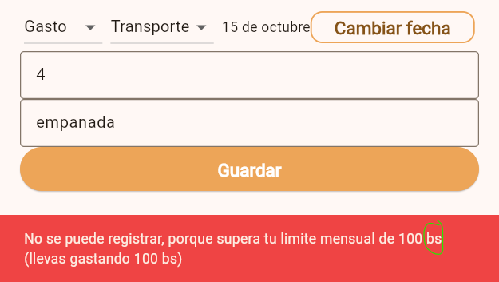

**Evidencia — después**

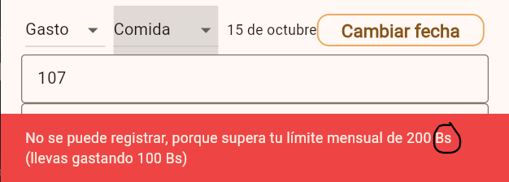
---

## H5 — Prevención de errores

- **Estado:** 🛠️ Corregida
- **Pantalla / flujo:** Movimientos → formulario de gasto, campo de monto.
- **Qué ocurría:** El formulario permitía escribir un monto superior al límite disponible del mes sin advertirlo; la comprobación se disparaba recién al presionar "Guardar" (bloqueo reactivo con SnackBar).
- **Corrección aplicada:** Al tipear el monto, `_avisoMontoExcedido()` calcula el disponible del mes y muestra un aviso en rojo debajo del campo ("Supera tu límite mensual. Disponible: X Bs de Y Bs.") antes de guardar. Se mantiene la validación final al guardar.
- **Código:** [campo de monto](../lib/screens/movements_screen.dart#L851-L883) · [`_avisoMontoExcedido()`](../lib/screens/movements_screen.dart#L91-L115) · [`_validarSiExcedioLimiteMensual()`](../lib/screens/mo## H6 — Reconocer antes que recordar

- **Estado:** 🛠️ Corregida
- **Pantalla / flujo:** Movimientos → formulario de ingreso de movimiento.
- **Qué ocurría:** El formulario de creación de gasto no mostraba cuánto límite mensual quedaba disponible, obligando al usuario a desviar la atención a la tarjeta superior o memorizar la cifra disponible antes de ingresar el monto.
- **Corrección aplicada:** Se implementó `_indicadorLimiteForm()` directamente dentro del formulario (justo encima del campo de monto), mostrando en vivo el texto informativo del límite disponible del mes (`Límite disponible: X Bs de Y Bs`) cada vez que se selecciona el tipo "Gasto".
- **Código:** [`_indicadorLimiteForm()`](../lib/screens/movements_screen.dart#L117-L153) · [formulario en `movements_screen.dart`](../lib/screens/movements_screen.dart#L900-L960).
- **Severidad:** 2 (Menor)

**Evidencia — antes**

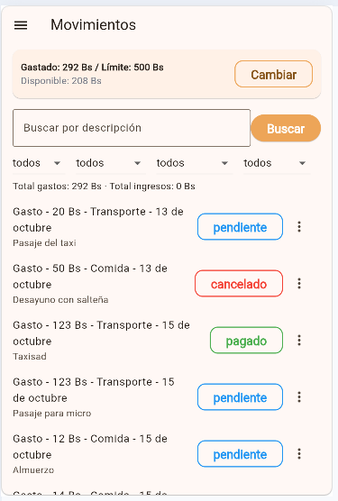
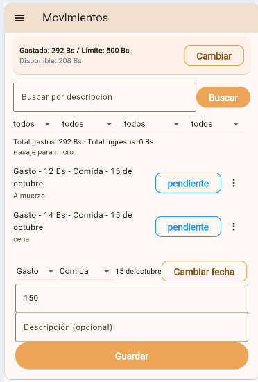

**Evidencia — después**

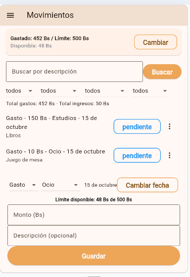

---

## H7 — Flexibilidad y eficiencia de uso

- **Estado:** ✅ Cumple
- **Pantalla / flujo:** Movimientos → búsqueda y filtros.
- **Comprobación:** La búsqueda se ejecuta directamente con la tecla Enter/Search del teclado; los 4 filtros (tipo, categoría, periodo, estado) se combinan libremente; y cada chip permite quitar un filtro con un toque sin resetear el resto.
- **Observación (no afecta la heurística):** el formulario al final del scroll resta velocidad a usuarios frecuentes con listas extensas.
- **Código:** [`_chipsFiltros()`](../lib/screens/movements_screen.dart#L226-L285) · [acción de teclado en búsqueda](../lib/screens/movements_screen.dart#L288-L305) · [`showDateRangePicker`](../lib/screens/movements_screen.dart#L190-L205).
- **Severidad:** 0 (Cumple)

**Evidencia**

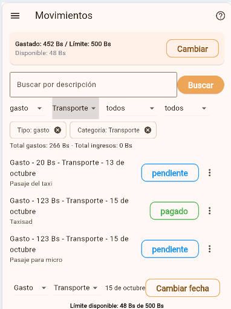
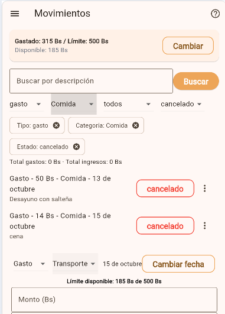
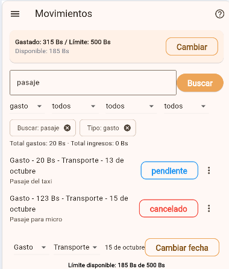

---

## H8 — Diseño estético y minimalista

- **Estado:** 🛠️ Corregida
- **Pantalla / flujo:** Movimientos → elementos de la lista (`ListTile`).
- **Qué ocurría:** Dentro de `trailing` de cada movimiento se incrustaban en fila tres botones completos con texto (`OutlinedButton` de estado, `ElevatedButton` "Eliminar" y `OutlinedButton` "Editar"), generando sobrecarga visual, jerarquía invertida y riesgo de desbordamiento horizontal.
- **Corrección aplicada:** Se reemplazaron los botones de texto de "Editar" y "Eliminar" por un menú de opciones emergente `PopupMenuButton` con ícono de tres puntos (`Icons.more_vert`), manteniendo el botón de estado visible y reduciendo drásticamente la carga visual y el riesgo de desbordamiento.
- **Código:** [`ListTile` en `movements_screen.dart`](../lib/screens/movements_screen.dart#L700-L765).
- **Severidad:** 2 (Menor)

**Evidencia — antes**

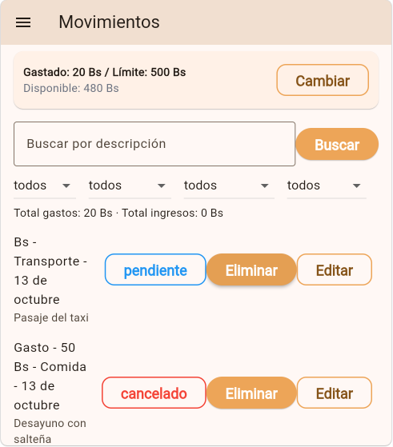

**Evidencia — después**

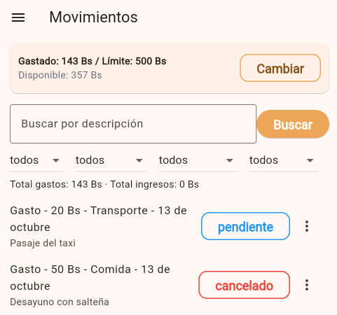
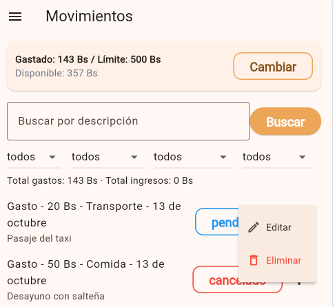

---

## H9 — Reconocer, diagnosticar y recuperarse de errores

- **Estado:** 🛠️ Corregida
- **Pantalla / flujo:** Login y Registro → envío de credenciales incorrectas o correo repetido.
- **Qué ocurría:** Ambas pantallas capturaban los errores con un bloque `catch (_)` que solo vaciaba los campos (`_emailController.text = ""; _passwordController.text = "";`) sin desplegar ningún mensaje que explique qué falló.
- **Corrección aplicada:** Se eliminó el vaciado de campos para preservar el correo tipeado y se capturan las excepciones de autenticación (`on AuthException catch (e)` y `catch (_)`), mostrando un `SnackBar` en color rojo con un mensaje claro y constructivo (credenciales incorrectas, correo ya registrado o fallo de conexión).
- **Código:** [`_handleLogin()`](../lib/screens/login_screen.dart#L21-L58) · [`_handleRegister()`](../lib/screens/register_screen.dart#L21-L57).
- **Severidad:** 3 (Mayor)

**Evidencia — antes**

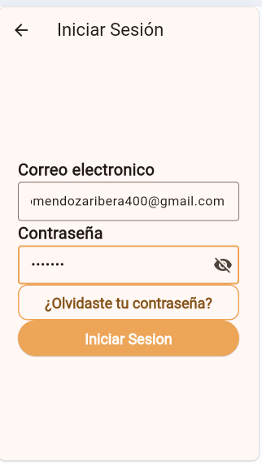
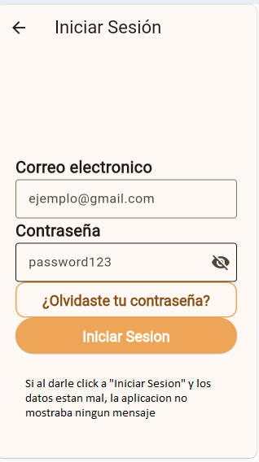
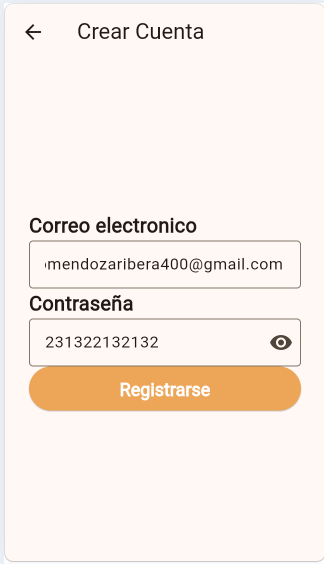
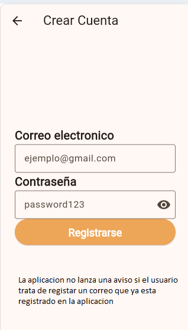

**Evidencia — después**

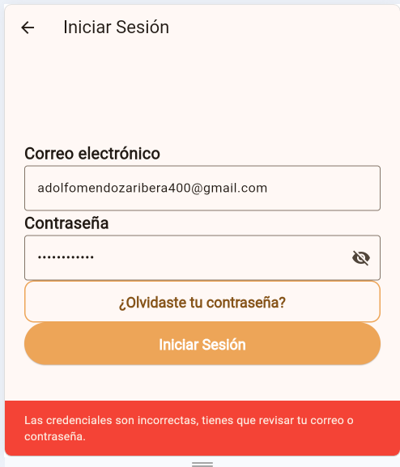
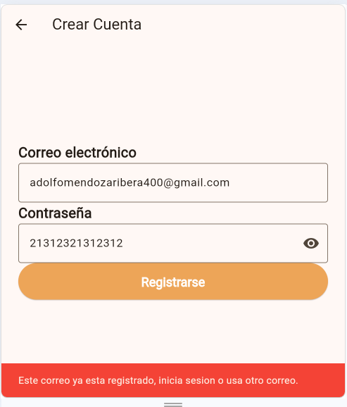

---

## H10 — Ayuda y documentación

- **Estado:** 🛠️ Corregida
- **Pantalla / flujo:** Movimientos (AppBar) y Menú lateral (`app_drawer.dart`).
- **Qué ocurría:** En ninguna parte de la interfaz había un botón de ayuda, `Tooltip` o ícono informativo (`?`) que explicara qué es el "Límite mensual", qué pasa al superarlo (bloquea nuevos gastos), qué diferencia un gasto de un ingreso o cómo funciona el flujo de estados de los movimientos.
- **Corrección aplicada:** Se implementó un botón con ícono de ayuda (`IconButton` con `Icons.help_outline` y `Tooltip: 'Ayuda'`) en el `AppBar` de Movimientos que abre un diálogo modal (`AlertDialog`) con explicaciones concisas sobre gastos e ingresos, el límite mensual y los estados de los movimientos (`pendiente`, `pagado`, `cancelado`). También se añadió un acceso a "Ayuda" en el menú lateral (`AppDrawer`).
- **Código:** [`_mostrarDialogoAyuda()` y AppBar](../lib/screens/movements_screen.dart#L709-L770) · [Ayuda en `AppDrawer`](../lib/widgets/app_drawer.dart#L39-L61).
- **Severidad:** 2 (Menor)

**Evidencia — antes**

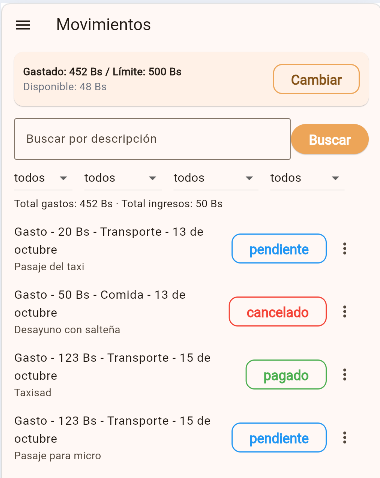
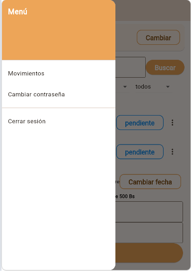

**Evidencia — después**

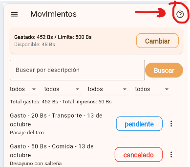
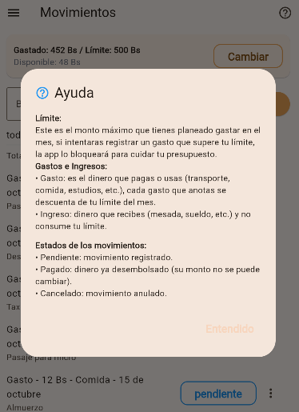
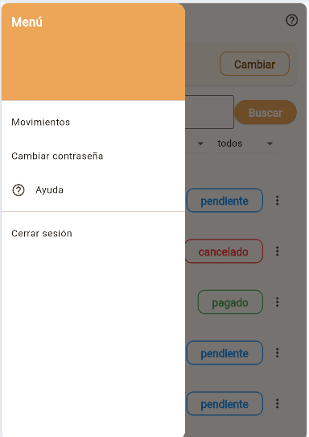
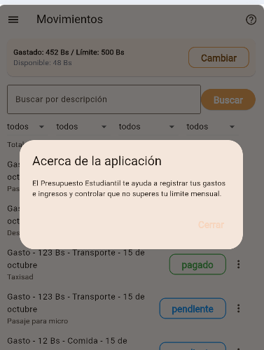

---

## Evidencias pendientes

| Heurística | Antes | Después |
| ---------- | :---: | :-----: |
| H1         |   ✅   |    ✅    |
| H2         |   ✅   |    ✅    |
| H3         |   ✅   |    ✅    |
| H4         |   ✅   |    ✅    |
| H5         |   ✅   |    ✅    |
| H6         |   ✅   |    ✅    |
| H7         |   ✅   |    —    |
| H8         |   ✅   |    ✅    |
| H9         |   ✅   |    ✅    |
| H10        |   ✅   |    ✅    |

