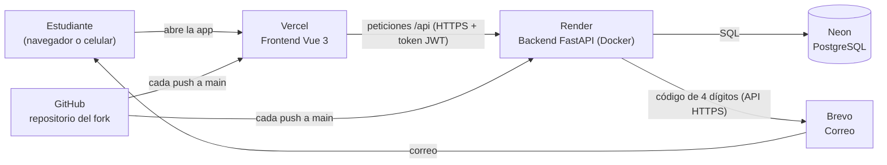

# Informe final · Presupuesto Estudiantil

**Materia:** Interacción Humano-Computador (IHC) · Semestre II-2026
**Autora del fork:** Carmen Jenifer Aranibar Fernandez
**Proyecto original:** Céspede Rodas Sebastian y Mendoza Ribera Adolfo
**App en la nube:** https://fork-proyecto-2-ihc.vercel.app · **Repositorio:** https://github.com/Carmen21-A/FORK-PROYECTO2-IHC

---

## 1. Problema

Los estudiantes universitarios manejan poco dinero, que llega de forma irregular (mesada, becas, trabajos cortos), y lo gastan en cosas pequeñas y frecuentes: pasajes, comida, fotocopias. Como cada gasto es chico, no lo anotan, y a fin de mes no saben **en qué se fue el dinero** ni **cuánto les queda**.

Las apps de finanzas que existen están pensadas para adultos con sueldo fijo: piden cuentas bancarias, tienen demasiadas opciones y usan lenguaje técnico. El estudiante las abandona en pocos días.

**Presupuesto Estudiantil** resuelve esto con una app web simple: anotar un gasto toma segundos, la app avisa **antes** de pasarse del límite y muestra el dinero por categoría y por meta de ahorro.

## 2. Usuario

| | |
|---|---|
| **Quién es** | Estudiante universitario de 18 a 25 años, en Bolivia, que maneja sus gastos en bolivianos (Bs) |
| **Qué dinero tiene** | Mesada, beca o trabajos ocasionales; montos pequeños |
| **En qué gasta** | Transporte (micro, taxi), comida, materiales de estudio, salidas |
| **Dónde la usa** | En el celular, entre clases, y en la computadora para revisar el mes |
| **Qué necesita** | Registrar rápido, ver cuánto le queda, que la app le avise sin regañarlo y poder irse cuando quiera con sus datos |

**Personas usadas en las pruebas:** *Martita*, una estudiante con límite mensual de 500 Bs, presupuesto de transporte y metas de ahorro, y *Pablo*, que recién empieza y tiene la cuenta vacía.

## 3. Funcionalidades por tarea

| Tarea | Funcionalidad | Evidencia |
|---|---|---|
| **Tarea 1** · Acceso | Registro, inicio y cierre de sesión, sesión que sigue al recargar, rutas privadas y recuperación de contraseña | [task-01-access.md](task-01-access.md) |
| **Tarea 2** · Estados | Movimiento pendiente → pagado → cancelado, con pruebas | [task-02-state-tests.md](task-02-state-tests.md) |
| **Tarea 3** · Ciclo completo | Crear, editar y eliminar; no se edita el monto de un movimiento pagado | [task-03-state-tests.md](task-03-state-tests.md) |
| **Tarea 4** · Límite y filtros | Límite mensual con bloqueo si se supera; búsqueda y filtros por tipo, categoría, periodo y estado | [task-04-limite-mensual.md](task-04-limite-mensual.md), [task-04-search-filters.md](task-04-search-filters.md) |
| **Tarea 5** · Presupuesto por categoría | Presupuesto mensual por categoría con estados óptimo / alerta (80 %) / excedido | [task-05-presupuesto-categoria.md](task-05-presupuesto-categoria.md) |
| **Tarea 6** · E2E y gastos recurrentes | Toda la app con pruebas E2E; gastos semanales o mensuales que se generan al pagarlos | [../evidencias/tarea-6.md](../evidencias/tarea-6.md) |
| **Tarea 7** · Mejora por feedback | Cambios pedidos en el feedback de otro grupo y una funcionalidad nueva | [../evidencias/tarea-7.md](../evidencias/tarea-7.md) |
| **Tarea 8** · Metas de ahorro | Metas con fondos disponibles: asignar, retirar y transferir; el dinero reservado no se puede gastar | [../evidencias/tarea-8.md](../evidencias/tarea-8.md) |
| **Tarea 9** · Analítica y aviso | Eventos de inicio, éxito, error y bloqueo en cada flujo; aviso **antes** de superar el presupuesto de una categoría | [../evidencias/tarea-9.md](../evidencias/tarea-9.md) |
| **Tarea 10** · Mis datos | Ver y descargar los datos (JSON o CSV) y eliminar la cuenta con una confirmación honesta | [../evidencias/tarea-10.md](../evidencias/tarea-10.md) |
| **Cierre** | Nuevo diseño de inicio, login y registro; recuperación con código de 4 dígitos; paleta única; despliegue en la nube | README del repositorio |

Las clases también dejaron cambios en la app: arquitectura de información con pestañas por intención (Clase 20), analítica (Clase 21), revisión de patrones oscuros (Clase 22) e inventario de tokens (Clase 23).

## 4. Decisiones justificadas

| Decisión | Por qué |
|---|---|
| **Migrar de Flutter + Supabase a Vue + FastAPI + PostgreSQL** | Una app web se abre con un enlace, sin instalar nada, que es lo que pide la entrega «app en la nube». Con un backend propio, las reglas (límite, presupuesto, metas) se validan en el servidor y no solo en la pantalla |
| **Avisar antes de superar el presupuesto, en vez de bloquear** | El estudiante a veces **necesita** gastar de más (por ejemplo, un pasaje urgente). La app explica cuánto se pasaría y le deja decidir con dos botones iguales: «Volver y ajustar» y «Guardar y exceder» (prevención de errores, H5, sin quitar el control, H3) |
| **Botones del mismo tamaño y mensajes sin culpa** | En la Clase 22 vimos que destacar la opción que conviene a la app es un patrón oscuro. Por eso las confirmaciones (eliminar, cancelar, exceder) muestran ambas opciones iguales y explican la consecuencia |
| **Recuperar la contraseña con un código de 4 dígitos en vez de un enlace** | El enlace llevaba a `localhost` y no abría desde el celular. Además había un error de zona horaria (La Paz, UTC-4) que hacía que el enlace naciera vencido. El código se escribe en la misma pantalla, sirve 15 minutos y se bloquea tras 5 intentos |
| **Eliminar la cuenta borra todo, pero antes ofrece descargar** | Es la regla de la app para la Tarea 10: la salida debe ser tan fácil como la entrada, sin perder los datos |
| **Pestañas por intención** (Todos, Por pagar, Presupuestos, Metas) | El usuario no piensa en pantallas sino en lo que quiere hacer: «¿qué me falta pagar?». La pestaña «Por pagar» responde eso directamente (Clase 20) |
| **Paleta con un papel para cada color** | Verde agua = acciones; índigo = barra y menú; azul y gris = datos (pendiente, categorías); rojo = error; verde = éxito; naranja = advertencia. Si los botones fueran azules, se confundirían con «pendiente» y los datos dejarían de resaltar |
| **Contraste AA y áreas táctiles de 44 px** | Revisado con axe en cada pantalla y con pruebas de tamaño de botón (ley de Fitts) |
| **Analítica sin datos personales** | Los eventos cuentan acciones (se inició, se guardó, se bloqueó) pero nunca guardan el correo, los montos ni el texto que escribe el usuario |
| **Nube gratuita: Vercel + Render + Neon + Brevo** | Vercel sirve la página rápido; Render corre el backend con su Dockerfile; Neon da PostgreSQL gratis y sin vencimiento. Render bloquea el correo por SMTP en el plan gratis, así que el código se envía por la API de Brevo (HTTPS) |

## 5. Mapa de conexión

| Parte | Dónde vive | Qué hace |
|---|---|---|
| Frontend | `frontend/` → Vercel | Pantallas en Vue 3. `src/design_system/tokens.css` tiene los mismos nombres de color que Figma |
| Backend | `backend/` → Render | API REST: autenticación, movimientos, límites, presupuestos, metas, historial, analítica y cuenta |
| Base de datos | `database/init/001_esquema.sql` → Neon | Tablas: usuarios, movimientos, límites, presupuestos, metas, historial, eventos y códigos de recuperación |
| Correo | Brevo | Envía el código para recuperar la contraseña |
| Pruebas | `backend/tests`, `frontend/tests`, `frontend/e2e` | pytest (86), Vitest (81) y Playwright E2E con axe (88) |

## 6. Comparación: con IA y sin IA

En este proyecto usé un asistente de IA (Claude Code) para programar, probar y desplegar.

| Aspecto | Sin IA | Con IA |
|---|---|---|
| **Velocidad** | Una funcionalidad grande (por ejemplo, recuperar con código) toma días: backend, frontend, base de datos y pruebas | Se hace en una sesión, con sus pruebas incluidas |
| **Pruebas** | Se suelen escribir pocas o al final | Cada cambio vino con pruebas; la suite E2E creció a 88 casos y se corría completa antes de subir |
| **Errores difíciles** | El enlace de recuperación «no funcionaba» y no se sabía por qué | La IA encontró la causa real: la zona horaria de La Paz hacía que el enlace naciera vencido. Además agregó una prueba para que no vuelva a pasar |
| **Despliegue** | Configurar nube, base de datos y correo sin experiencia toma mucho tiempo | Guiado paso a paso, y la IA comprobó cada paso: salud del backend, CORS, registro e inicio de sesión reales |
| **Decisiones de diseño** | Las tomo yo | **También las tomé yo**: la IA propone, pero yo elegí la paleta, el diseño del inicio, qué mostrar en cada pantalla y cuándo algo «se veía mal» |
| **Riesgos** | Menos código, pero más tiempo | La IA puede equivocarse: en Figma tapó una pantalla con su fondo y hubo que corregirlo. **Siempre hay que revisar** lo que hace, con fotos y pruebas |
| **Aprendizaje** | Se aprende haciendo todo a mano | Se aprende revisando y preguntando el porqué de cada cambio; hay que tener cuidado de no aceptar todo sin entenderlo |

**Conclusión:** la IA acelera mucho la parte técnica (código, pruebas, despliegue), pero el **criterio de diseño centrado en el usuario** sigue siendo humano: decidir qué es honesto, qué es claro y qué necesita el estudiante. La IA sirve como herramienta, no como reemplazo del diseñador.

## 7. Resultados

| Entrega | Estado |
|---|---|
| Repositorio del fork con README e instrucciones verificadas | ✅ |
| App en la nube con usuarios de prueba (Martita y José) | ✅ |
| Tokens en el código con los mismos nombres que en Figma | ✅ `tokens.css` y [evidencias/clase-23.md](../evidencias/clase-23.md) |
| Pruebas automatizadas | ✅ pytest 86 (100 % cobertura) · Vitest 81 (100 % de líneas) · E2E 88 — [reportes](../reportes/README.md) |
| Accesibilidad (contraste AA) | ✅ axe en cada pantalla dentro de `e2e/diseno.spec.ts` |

## 8. Pantallas en Figma

> Espacio reservado para las capturas del sistema de diseño y de las pantallas en Figma.

**Enlace al archivo de Figma:** [https://www.figma.com/design/jsgAZTQJxWdZGsgzzknWwB/PRESUPUESTO-ESTUDIANTIL](https://www.figma.com/design/jsgAZTQJxWdZGsgzzknWwB/PRESUPUESTO-ESTUDIANTIL)

### Sistema de diseño
- Logo: _(captura)_
- Paleta de colores: _(captura)_
- Tipografía: _(captura)_
- Componentes con variantes y estados: _(captura)_

### Pantallas
- Inicio, Iniciar Sesión y Crear Cuenta: _(captura)_
- Movimientos: _(captura)_
- Presupuesto por Categoría: _(captura)_
- Metas de Ahorro: _(captura)_
- Mis datos: _(captura)_
- Flujos (camino feliz y validación): _(captura)_
