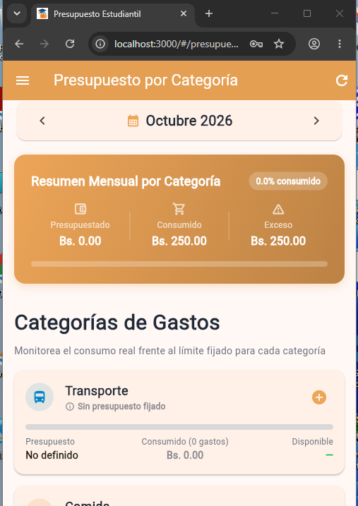
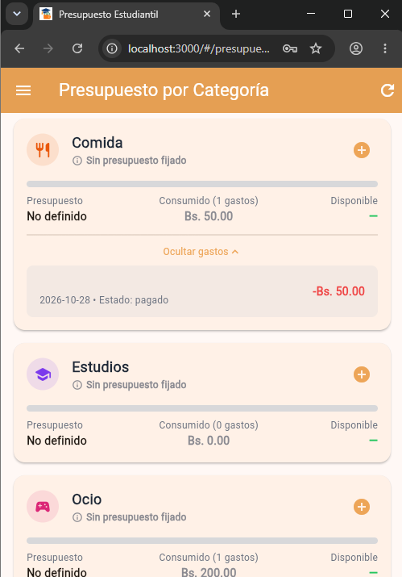

# Task 05 — Crear presupuesto mensual por categoría y mostrar cuánto se consumió

## Descripción de la tarea

Permite a los estudiantes definir un presupuesto mensual límite para cada una de las categorías de gastos (`Transporte`, `Comida`, `Estudios`, `Ocio`, `Otros`) y visualizar en tiempo real:
1. Cuánto se ha consumido de cada categoría con respecto a su límite asignado.
2. Saldo disponible o exceso por categoría.
3. Indicadores visuales y alertas (verde para consumo normal, ámbar para alerta >= 80%, rojo para presupuesto superado).
4. Desglose detallado de los movimientos que componen el gasto de cada categoría en el mes seleccionado.

---

### Capturas de pantalla de la interfaz funcionando

#### 1. Vista principal de Presupuestos por Categoría

> **Figura 1:** Pantalla con la tarjeta de resumen mensual ejecutivo (`Resumen Mensual por Categoría`), las métricas de gasto, barra de consumo global y el listado de categorías disponibles.

#### 2. Detalle desplegable de gastos de una categoría

> **Figura 2:** Detalle interactivo que permite ver las transacciones individuales de gasto asociadas a una categoría (ej. Comida con fecha, estado pagado y monto).

---