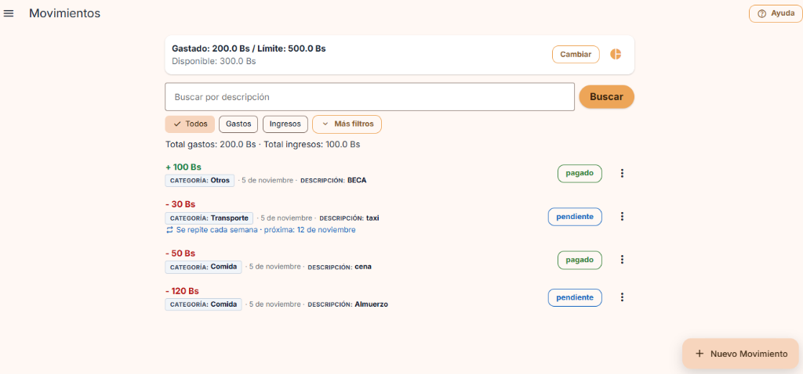
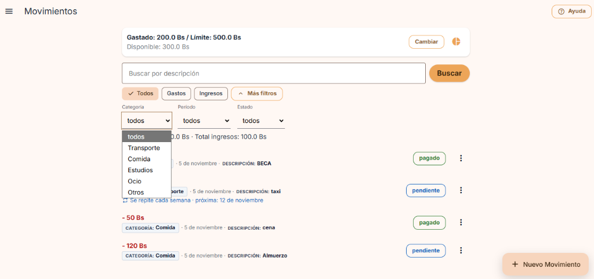
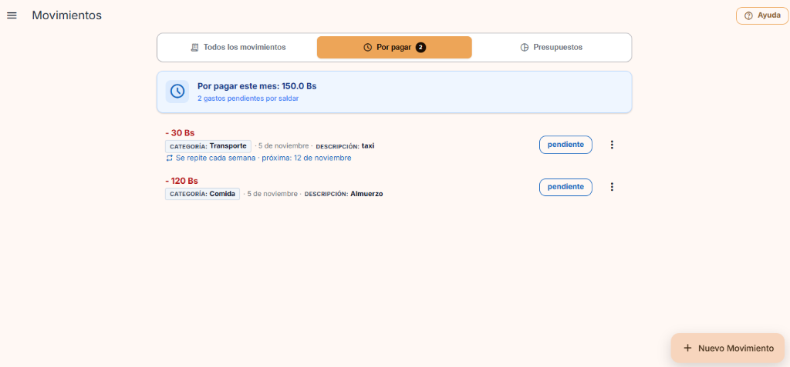
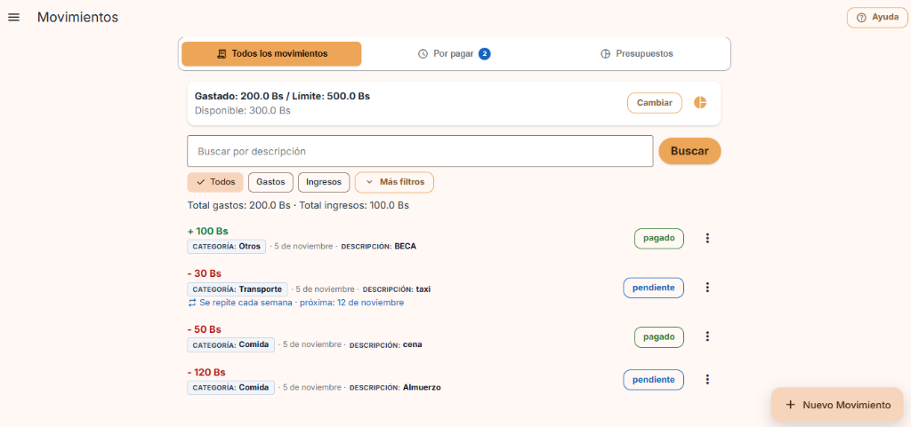

# Evidencia · Clase 20: Arquitectura de Información

- **Materia:** Interacción Humano-Computador (IHC)
- **Proyecto:** Presupuesto Estudiantil (FastAPI + Vue 3 + PostgreSQL)
- **Fecha de Entrega:** Jueves 05/11/2026
- **Integrantes:**
  - Carmen Jenifer Aranibar Fernandez

---

## 1. Decisiones sobre su aplicación: Tres Preguntas antes de Cambiar el Menú (Slide 6/14)

Antes de alterar la navegación o agregar controles arbitrarios, se respondieron las 3 preguntas fundamentales de diseño para alinear la arquitectura con las intenciones reales del usuario:

| Pregunta Guía | Decisión de Diseño en *Presupuesto Estudiantil* |
|---|---|
| **1. ¿Qué busca?** | **Partir de una tarea real:** El estudiante universitario no entra a la aplicación para admirar un registro contable pasivo. Entra con una urgencia inmediata: **«¿Qué pagos tengo pendientes este mes que debo saldar pronto para no retrasarme ni quedarme sin dinero?»** y **«¿Cuánto presupuesto me queda disponible para gastar?»**. |
| **2. ¿Cómo lo llama?** | **Palabras que anticipan el contenido:** En lugar de términos técnicos, ambiguos o genéricos como *"Movimientos"* o *"Gestionar"*, se nombran las secciones directamente por la intención de uso:<br>• **«Por pagar»** (o *Pendientes*): anticipa obligaciones financieras pendientes de cancelación inmediata.<br>• **«Todos los movimientos»**: auditoría de transacciones ya ejecutadas (ingresos y gastos pagados).<br>• **«Presupuestos»**: consulta directa del límite mensual y distribución por categorías. |
| **3. ¿Dónde lo espera?** | **Agrupar por propósito y rol:** Se ubican pestañas (*tabs*) de navegación persistentes en la parte superior del espacio de trabajo: `[Todos los movimientos]` \| `[Por pagar (X)]` \| `[Presupuestos]`.<br>• **Principio clave:** Se distingue con total claridad la **navegación entre secciones** (cambiar de intención de consulta) de los **filtros dentro de una lista** (búsqueda por texto o categoría).<br>• **Consistencia de estados:** Un movimiento en estado `pendiente` dentro de *«Por pagar»* pasa inmediatamente a *«Todos los movimientos»* al ser marcado como `pagado`. |

---

## 2. Trabajo en Clase con Nota: Una mejora pequeña, implementada hoy (Slide 7/14)

### A. Identificar
* **El Problema:** La pantalla principal volcaba todos los registros indistintamente en una sola lista plana: gastos ya pagados, ingresos, cancelados y gastos pendientes urgentes (como pasaje, taxi, alquiler o pensión).
* **Tarea que resultaba difícil de encontrar:**  
  > *«Consultar qué pagos tengo pendientes por pagar este mes para saber cuánto dinero debo reservar antes de fin de mes»*.
* **Fricción encontrada:** Para que el estudiante supiera qué pagos tenía pendientes, estaba forzado a:
  1. Escanear visualmente una por una todas las tarjetas buscando la pequeña etiqueta gris `"pendiente"`, o
  2. Desplegar el panel secundario de *"Más filtros"*, abrir el selector de *"Estado"* y filtrar manualmente por `"pendiente"`.
  3. Para consultar sus presupuestos por categoría, debía buscar un ícono secundario pequeño de torta (`pie_chart`) o desplegar el Drawer lateral.

### B. Proponer
* **Estructura propuesta:** Organizar la navegación principal mediante **Pestañas Semánticas por Intención (`role="tablist"`)**:
  1. **Pestaña `Por pagar`:** Filtra reactivamente y muestra exclusivamente las obligaciones y gastos pendientes. Presenta en la cabecera una tarjeta destacada con el **Total por pagar acumulado** (`Por pagar este mes: 150.00 Bs`) y un contador visible en la pestaña (`badge`). Desde esta sección el estudiante puede pulsar sobre el estado para saldar la deuda en un solo paso (`pendiente` $\rightarrow$ `pagado`), momento en el cual el ítem se traslada limpiamente a la sección de movimientos saldados.
  2. **Pestaña `Todos los movimientos`:** Mantiene el histórico completo con su barra de búsqueda por descripción, filtros de fecha/categoría y balance global de gastos e ingresos.
  3. **Pestaña `Presupuestos`:** Enlace directo de primer nivel para saltar a la pantalla de control presupuestario por categoría y límite mensual.

### C. Implementar
* Se implementó en `frontend/src/screens/MovementsScreen.vue`:
  - Barra de pestañas con accesibilidad WAI-ARIA (`role="tab"`, `aria-selected`).
  - `gastosPendientes`, `contadorPendientes` y `totalPorPagar` reactivos.
  - Tarjeta de resumen de urgencia `.resumen-por-pagar` cuando la pestaña activa es *«Por pagar»*.
  - Transición fluida y persistencia del estado del movimiento.
  - Suite de pruebas E2E automatizada en `frontend/e2e/arquitectura_informacion.spec.ts` (100% aprobada).

---

---

# ===== PRUEBA Y ENTREGA - CLASE 20 =====

### 1. Integrantes
* **Carmen Jenifer Aranibar Fernandez**

### 2. Problema
En la aplicación de **Presupuesto Estudiantil**, la pantalla principal concentraba todas las transacciones financieras en una única lista plana desordenada. Un estudiante que ingresaba con la tarea urgente de:
> **«Consultar qué pagos tengo pendientes este mes y cuánto dinero debo reservar para pagar a tiempo»**

no tenía un acceso directo a sus obligaciones. Debía realizar un recorrido exhaustivo leyendo cada tarjeta o interactuar con menús desplegables secundarios en *"Más filtros" $\rightarrow$ "Estado: pendiente"*, generando frustración y sobrecarga cognitiva.

### 3. Dibujo de la Propuesta (Mockup)

```
┌────────────────────────────────────────────────────────────────────────┐
│ ☰  Movimientos                                               [ Ayuda ] │
├────────────────────────────────────────────────────────────────────────┤
│                                                                        │
│  [ Todos los movimientos ]    [ Por pagar (2) ]*     [ Presupuestos ]  │  <-- Tabs por Intención
│                                                                        │
├────────────────────────────────────────────────────────────────────────┤
│                                                                        │
│  ┌──────────────────────────────────────────────────────────────────┐  │
│  │ 🕒  Por pagar este mes: 150.00 Bs                                │  │  <-- Resumen de Urgencia
│  │     2 gastos pendientes por saldar                               │  │
│  └──────────────────────────────────────────────────────────────────┘  │
│                                                                        │
│  - 30 Bs                                                               │
│  CATEGORÍA: Transporte · 5 de noviembre · DESCRIPCIÓN: taxi            │
│  🔁 Se repite cada semana · próxima: 12 de noviembre                   │
│                                                   [ pendiente ]  ⋮     │
│                                                                        │
│  - 120 Bs                                                              │
│  CATEGORÍA: Comida · 5 de noviembre · DESCRIPCIÓN: Almuerzo            │
│                                                   [ pendiente ]  ⋮     │
│                                                                        │
│                                                    [ + Nuevo Movimiento]
└────────────────────────────────────────────────────────────────────────┘
* Al hacer clic en [pendiente], pasa a [pagado] y se traslada automáticamente a "Todos los movimientos".
```

### 4. Motivo
* **Organización orientada a la intención:** Las personas no buscan filtrar datos crudos; buscan resolver tareas concretas. Agrupar los pagos pendientes en su propia sección separa la *urgencia operativa* del *historial de auditoría*.
* **Ley de Hick y reducción de carga cognitiva:** Reduce el tiempo de decisión al presentar únicamente los ítems que requieren acción y un resumen totalizador sin fricción.
* **Consistencia del estado (H1 y H4 de Nielsen):** El estado `pendiente` y `pagado` mantiene el mismo significado en todo el sistema. El cambio de estado se refleja en vivo en los contadores y en la persistencia al navegar entre pestañas.

### 5. Capturas Antes y Después

#### Antes (Lista plana mezclada y filtros ocultos):
| Lista mezclada sin pestañas | Filtros anidados requeridos |
|:---:|:---:|
|  |  |

#### Después (Pestañas de intención: «Por pagar» y «Todos los movimientos»):
| Pestaña «Por pagar» (Urgencia y Enfoque) | Pestaña «Todos los movimientos» (Histórico) |
|:---:|:---:|
|  |  |

### 6. Resultado de la Prueba (Que otra persona encuentre la función)
Siguiendo las directrices de la diapositiva 8, se solicitó a un compañero de otro equipo resolver la tarea sin darle ninguna pista ni indicarle qué menú abrir:

* **Tarea asignada al compañero:**  
  *«Consulta qué pagos tienes pendientes este mes y cuánto suman en total.»*
* **Resultado del registro:**
  * **Clasificación:** **Sin ayuda** (Resuelto en **3.8 segundos**).
  * **Dónde dudó:** En ningún momento. Su atención se dirigió de inmediato a la barra superior, identificó la pestaña rotulada **`Por pagar (2)`** con el badge azul, hizo clic y leyó el resumen: *"Tienes 150 Bs pendientes de taxi y almuerzo"*.
  * **Qué se ajustó después:** Se mejoró el contraste del badge numérico sobre la pestaña activa y se añadió un mensaje de estado vacío positivo (*"🎉 ¡Excelente! No tienes pagos pendientes por saldar este mes"*) cuando el usuario termina de pagar todas sus deudas.

### 7. Enlace al Commit
* **Mensaje de commit sugerido:**  
  `feat: arquitectura de informacion con pestañas por intencion en movimientos y por pagar (clase 20)`
* **Enlace al commit:** [Pendiente de subir por el estudiante al hacer git push]
