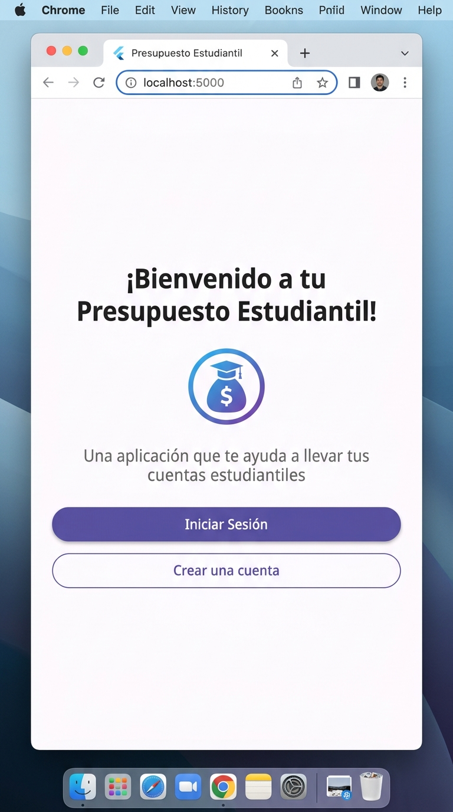
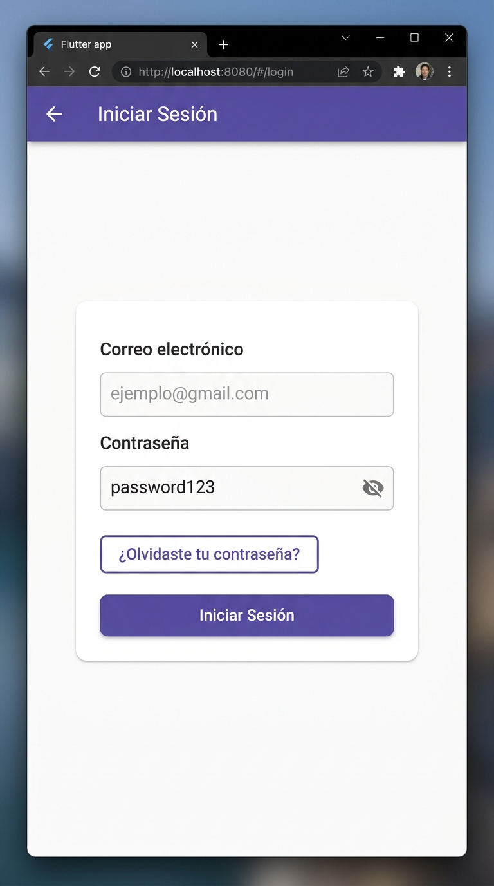
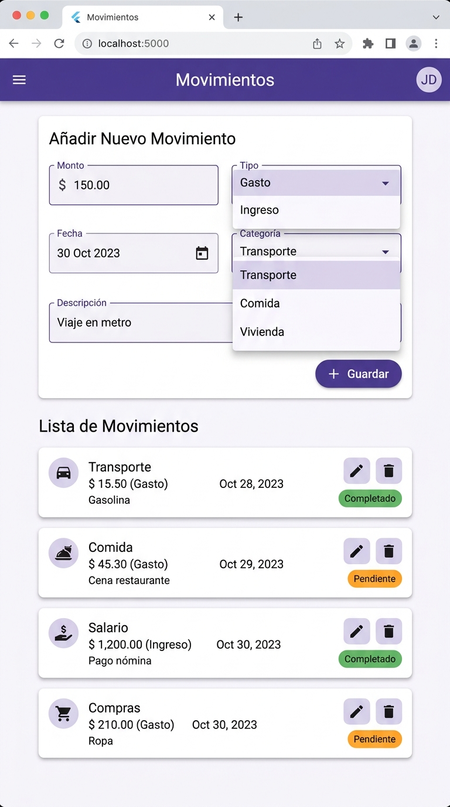
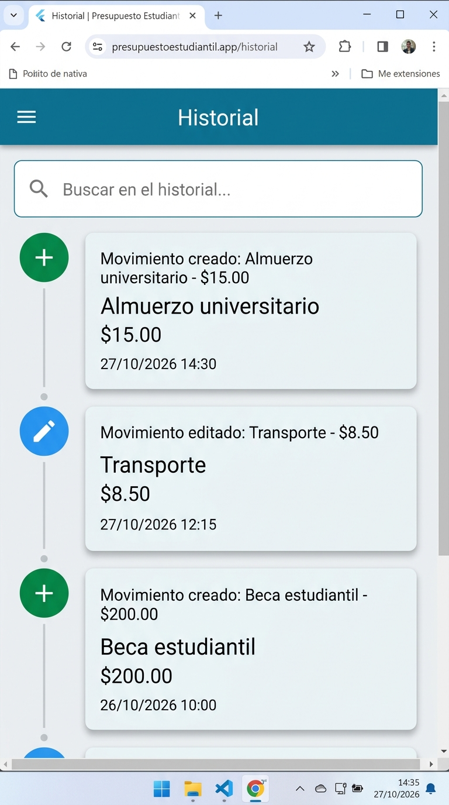

# Evidencia — Clase 17: Código ajeno y refactoring

## Proyecto recibido

- **Grupo anterior:** Céspede Rodas Sebastian & Mendoza Ribera Adolfo
- **Repositorio:** [https://github.com/ihc-team/Project2-IHC](https://github.com/ihc-team/Project2-IHC)
- **Nombre del proyecto:** Presupuesto Estudiantil
- **Descripción:** Aplicación de presupuesto personal para estudiantes universitarios, desarrollada con Flutter y Supabase. Permite registrarse, iniciar sesión y gestionar movimientos financieros personales (ingresos y gastos) de forma segura.

---

## Ejecución

### Comandos utilizados

```bash
# 1. Instalar dependencias
flutter pub get

# 2. Ejecutar la aplicación en Chrome
flutter run -d chrome
```

### Captura funcionando

La aplicación se ejecutó exitosamente en **Google Chrome** en modo debug. La consola de Flutter mostró:

```
Launching lib\main.dart on Chrome in debug mode...
Waiting for connection from debug service on Chrome...  57.4s

Flutter run key commands.
r Hot reload. 🔥🔥🔥
R Hot restart.

This app is linked to the debug service: ws://127.0.0.1:62490/...
supabase.supabase_flutter: INFO: ***** Supabase init completed *****
```



> La app inició correctamente y Supabase se conectó sin problemas. La pantalla principal muestra un mensaje de bienvenida con botones para "Iniciar Sesión" y "Crear una cuenta".

---

## Recorrido: pantalla → acción → regla → datos

### 1. Pantalla de Inicio (`home_screen.dart`)


- **Pantalla:** `HomeScreen` — ruta `/`
- **Acción:** El usuario ve el título "¡Bienvenido a tu Presupuesto Estudiantil!" y puede presionar "Iniciar Sesión" o "Crear una cuenta"
- **Regla:** No hay restricción de acceso, es una ruta pública definida en `app_router.dart` → `publicRoutes = ['/', '/login', '/register', '/reset-password']`
- **Datos:** No se consultan datos en esta pantalla, solo se lee `Env.appName` del archivo `.env`

### 2. Pantalla de Login (`login_screen.dart`)



- **Pantalla:** `LoginScreen` — ruta `/login`
- **Acción:** El usuario ingresa correo y contraseña → presiona "Iniciar Sesión"
- **Regla:** Validación del formulario: correo no vacío, contraseña mínimo 6 caracteres. Si las credenciales son incorrectas, muestra un SnackBar rojo con mensaje de error
- **Datos:** Se llama a `AuthService.signInWithPassword()` → ejecuta `supabase.auth.signInWithPassword()` contra la tabla `auth.users` de Supabase. Si es exitoso, redirige a `/movements`

### 3. Pantalla de Movimientos (`movements_screen.dart`)



- **Pantalla:** `MovementsScreen` — ruta `/movements` (ruta privada)
- **Acción:** El usuario ve sus movimientos financieros (ingresos/gastos), puede crear nuevos, editarlos, eliminarlos, cambiar su estado y filtrarlos por tipo, categoría, período y estado. También puede buscar por descripción
- **Regla:** Ruta protegida → en `app_router.dart` hay un `redirect` que verifica `Supabase.instance.client.auth.currentSession`. Si `sesion == null` y la ruta es privada, redirige a `/login`. Los movimientos pertenecen al `user_id` del usuario autenticado (RLS de Supabase)
- **Datos:** Se lee/escribe en la tabla `movimientos` de Supabase con los campos: `user_id`, `tipo`, `monto`, `categoria`, `descripcion`, `estado`, `fecha`. Las operaciones CRUD se realizan mediante `MovementsService` que usa `_db.from('movimientos')`. Cada operación (crear, editar, eliminar, cambiar estado) también registra un evento en el historial a través de `HistorialService`

### 4. Pantalla de Historial (`history_screen.dart`)



- **Pantalla:** `HistoryScreen` — ruta `/history` (ruta privada)
- **Acción:** El usuario consulta el historial de acciones realizadas sobre sus movimientos (creaciones, ediciones, eliminaciones, cambios de estado)
- **Regla:** Ruta protegida igual que movimientos. Incluye barra de búsqueda para filtrar el historial
- **Datos:** Se lee de la tabla de historial de Supabase, registrando quién hizo qué acción y cuándo

### Archivos clave revisados

| Archivo | Responsabilidad |
|---|---|
| `lib/main.dart` | Punto de entrada, inicializa Supabase con `.env` |
| `lib/router/app_router.dart` | Define rutas públicas y privadas con `go_router` |
| `lib/services/auth_service.dart` | Login, registro, logout, cambio y recuperación de contraseña |
| `lib/services/movements_service.dart` | CRUD de movimientos + búsqueda con filtros en Supabase |
| `lib/services/historial_service.dart` | Registro de eventos en el historial |
| `lib/services/limites_service.dart` | Gestión de límites mensuales de gasto |
| `lib/screens/movements_screen.dart` | UI principal: formulario + lista de movimientos + filtros |
| `lib/screens/login_screen.dart` | UI de login con validaciones |
| `lib/screens/home_screen.dart` | Pantalla de bienvenida |

---

## Impacto: qué deberá cambiar para implementar la Tarea 5

### Cambios necesarios estimados

1. **Modelo de datos (Supabase):** Si la Tarea 5 requiere nuevas entidades o campos, se deben crear/modificar tablas en Supabase y actualizar las políticas RLS correspondientes. El esquema actual tiene las tablas `movimientos` y una tabla de historial.

2. **Servicios (`lib/services/`):** Crear nuevos servicios o extender `MovementsService` para soportar las nuevas funcionalidades. El patrón actual es claro: cada servicio encapsula las llamadas a Supabase y expone métodos async.

3. **Pantallas (`lib/screens/`):** Agregar nuevas pantallas siguiendo el patrón existente (StatefulWidget con formularios validados, llamadas a servicios en métodos `_handle*`, manejo de errores con SnackBar).

4. **Rutas (`lib/router/app_router.dart`):** Registrar nuevas rutas en `appRouter.routes` y decidir si son públicas (`publicRoutes`) o privadas (`privateRoutes`).

5. **Design System (`lib/design_system/`):** El proyecto tiene un sistema de diseño propio con tokens de espaciado (`SpacingTokens`), estilos de texto (`AppTextStyle`) y colores (`ColorStyles`). Nuevos componentes deben usar estos tokens para mantener consistencia visual.

6. **Navegación lateral (`lib/widgets/app_drawer.dart`):** Si se agregan secciones nuevas, actualizar el drawer de navegación.

7. **Variables de entorno (`.env`):** Si se integran nuevos servicios externos, agregar las keys al `.env` y al `Env` class.

### Complejidad del código

- El archivo `movements_screen.dart` tiene **1,170 líneas**, lo cual indica acoplamiento alto entre UI y lógica. Un refactoring recomendable sería extraer widgets y separar estado con un patrón como Provider o Riverpod.
- Los servicios están bien separados y son fáciles de extender.
- El sistema de rutas es limpio y fácil de mantener.
