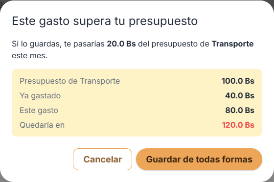
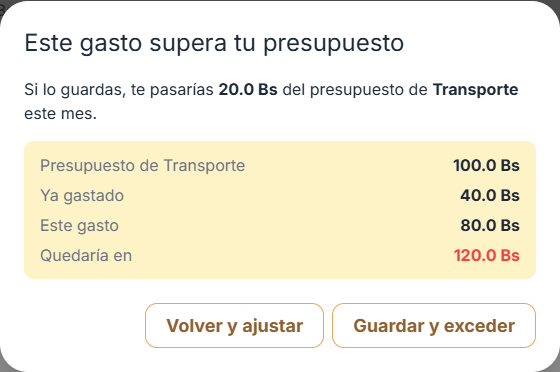

# Clase 22 · Patrones oscuros

Integrantes: Carmen Jenifer Aranibar Fernandez

Modalidad: con IA

## 1. Patrón encontrado

**Tipo (de los seis):** 2 · Confirmaciones engañosas (aviso que empuja hacia una opción y la acompaña con un reproche).

**Dónde:** pantalla *Movimientos*, diálogo «Este gasto supera tu presupuesto» (aviso de límite de la Tarea 9) · `frontend/src/screens/MovementsScreen.vue:1087-1090`

**Checklist usada:** los seis patrones de la clase (diapositivas 4/16 y 5/16). Recorrimos con ella los flujos de Presupuesto Estudiantil, empezando por los dos lugares que indica la tabla (9/16): **primer ingreso** y **aviso de límite**.

| # | Patrón (checklist) | Qué encontramos en Presupuesto Estudiantil |
|---|---|---|
| 1 | Opciones preseleccionadas | ✅ Sin patrón: no hay casillas marcadas por defecto; un gasto nuevo es «no se repite». |
| 2 | Confirmaciones engañosas | ❌ **Aviso de límite** (corregido hoy): el botón que hace pasar el presupuesto era el destacado. También en eliminar/cancelar movimiento (ver sección 6). |
| 3 | Urgencia, culpa o escasez falsas | ❌ **Aviso de límite** (corregido hoy): «Guardar **de todas formas**» suena a reproche. También «llevas gastando» (ver sección 6). |
| 4 | Datos expuestos sin necesidad | ✅ Sin patrón: cada usuario ve solo sus movimientos, y la analítica no guarda `user_id` ni correo. |
| 5 | Salir más difícil que entrar | ❌ Crear cuenta toma 1 toque, pero **no existe forma de eliminar la cuenta** (ver sección 6). «Cerrar sesión» sí está a mano en el menú. |
| 6 | Permisos sin explicar | ✅ Sin patrón: en el **primer ingreso** la app no pide ningún permiso (ubicación, notificaciones, etc.). |

Elegimos corregir el **aviso de límite** porque es el lugar que indica la tabla y ahí se juntan dos patrones (2 y 3).

**Por qué es un patrón oscuro (a quién beneficia y qué no ve el usuario):**

- El botón que **hace pasar el presupuesto** («Guardar de todas formas») era el **botón principal**: relleno, con color y sombra. La salida segura («Cancelar») era un botón de borde, más débil a la vista.
- Por costumbre, el usuario toca el botón destacado sin leer. Entonces el diseño lo **empuja a pasarse del presupuesto**, que es justo lo contrario de lo que la app promete: ayudar al estudiante a cuidar su dinero.
- El texto «**de todas formas**» suena a reproche: guardar se presenta como una desobediencia, no como una decisión válida.
- Los botones no dicen la consecuencia: «Cancelar» no aclara que el formulario se conserva para ajustar el monto, y «Guardar…» no dice que la categoría **queda excedida**.

Pregunta para decidir (diapositiva 3): *¿el usuario elegiría esto si entendiera todo lo que pasa?* El usuario sí puede querer pasarse (es su decisión, H3), pero no porque un botón más llamativo lo lleve ahí.

## 2. Antes



```html
<!-- frontend/src/screens/MovementsScreen.vue (antes) -->
<template #acciones>
  <button class="btn btn-outlined" @click="cancelarAvisoPresupuesto">Cancelar</button>
  <button class="btn btn-elevated" @click="confirmarAvisoPresupuesto">Guardar de todas formas</button>
</template>
```

## 3. Después



```html
<!-- frontend/src/screens/MovementsScreen.vue (después) -->
<template #acciones>
  <!-- Clase 22: consecuencia clara y botones iguales (ninguna opción empuja a pasarse) -->
  <button class="btn btn-outlined" @click="cancelarAvisoPresupuesto">Volver y ajustar</button>
  <button class="btn btn-outlined" @click="confirmarAvisoPresupuesto">Guardar y exceder</button>
</template>
```

**Commit:** [`a2ce7f5`](https://github.com/Carmen21-A/FORK-PROYECTO2-IHC/commit/a2ce7f5) · `fix(etica): aviso de presupuesto con botones iguales y sin culpa`

Qué cambió:

| Antes | Después | Por qué |
|---|---|---|
| «Guardar de todas formas» destacado (`btn-elevated`) | «Guardar y exceder» con el mismo estilo (`btn-outlined`) | Ninguna opción pesa más que la otra. |
| «Cancelar» | «Volver y ajustar» | Dice lo que pasa: vuelve al formulario con los datos para cambiar el monto. |
| «de todas formas» (reproche) | «y exceder» (consecuencia) | Texto neutral: informa, no culpa. |
| — | Se mantiene el foco inicial en «Volver y ajustar» | Si el usuario presiona Enter sin leer, no se pasa del presupuesto. |

La regla de la Tarea 9 **no cambia**: el backend sigue respondiendo `409` hasta que el usuario confirma, y el diálogo sigue mostrando el número exacto (*te pasarías 20.0 Bs*). No se agregó ningún «¿Seguro?» extra.

## 4. Principio aplicado

- **Nielsen #5 · Prevención de errores:** *los botones dicen lo que hacen y lo irreversible no se destaca*. El después nombra la consecuencia («Guardar y **exceder**», «Volver y **ajustar**») y la acción que rompe el presupuesto ya no es el botón principal.
- **Nielsen #3 · Control y libertad:** las dos salidas están igual de a mano y sin confirmación con culpa. El estudiante decide si se pasa o no, y la interfaz no decide por él.
- **Honestidad · La interfaz dice la verdad:** el aviso y los botones salen del dato real (presupuesto, ya gastado, quedaría en, exceso) y no usan reproches.

## 5. Prueba

- **Nombre:** `el aviso de presupuesto muestra las dos opciones iguales y sin culpa`
- **Archivo:** `frontend/e2e/etica.spec.ts` (Playwright)
- **Qué verifica:** con un gasto de 80 Bs en Transporte (40 + 80 = 120 de 100) aparece el aviso y:
  1. muestra el número exacto (*te pasarías 20.0 Bs*);
  2. los dos botones tienen **la misma clase** (mismo peso visual);
  3. existen «Volver y ajustar» y «Guardar y exceder», y el texto **no** contiene «de todas formas»;
  4. la opción segura («Volver y ajustar») recibe el foco al abrir.

**Resultado:**

| Código | Resultado |
|---|---|
| Antes | ❌ **Falla**: `Expected: "btn btn-outlined"`, `Received: "btn btn-elevated"` (los botones no son iguales). |
| Después | ✅ **Pasa**. |

Si alguien vuelve a poner `btn-elevated` en «Guardar y exceder» o vuelve a escribir «de todas formas», la suite lo avisa.

Se corrió la suite completa para confirmar que la corrección no rompe nada:

- E2E: **74 pruebas pasan** (`pnpm test:e2e`). Se actualizaron los nombres de los botones en `aviso_presupuesto.spec.ts` y `analitica_flujos.spec.ts`.
- Backend: **52 pruebas pasan** (`pytest`).

Comando para correr solo esta prueba:

```bash
cd frontend
pnpm exec playwright test e2e/etica.spec.ts
```

## 6. Otros que encontramos

Patrones que vimos y que no corregimos hoy:

1. **Confirmaciones de acciones irreversibles con el botón peligroso destacado.** En «Confirmar cancelacion» (`MovementsScreen.vue:1103`) y en «Eliminar movimiento» (`MovementsScreen.vue:1060`), la acción que **no se puede deshacer** usa `btn-elevated` (el botón principal). Además, en el diálogo de eliminar, el botón de salir se llama «Cancelar», y «cancelar» en la app también significa *anular un movimiento*. Eso es confuso (Nielsen #5).
2. **Salir más difícil que entrar (patrón 5).** Registrarse toma 1 toque («Crear una cuenta» en la pantalla de inicio), pero la app **no tiene ninguna opción para eliminar la cuenta**, ni en la interfaz ni en la API (`backend/app/routers/auth.py` solo tiene registro, login, perfil y contraseña). Lo honesto sería tener «Eliminar mi cuenta» en el menú, con la consecuencia explicada y sin pasar por soporte.
3. **Mensaje de límite mensual con tono de reproche.** `MovementsScreen.vue:368`: «No se puede registrar… (**llevas gastando** X Bs)». Sería más neutral decir: «Tu límite del mes es X Bs y te quedan Y Bs disponibles».
