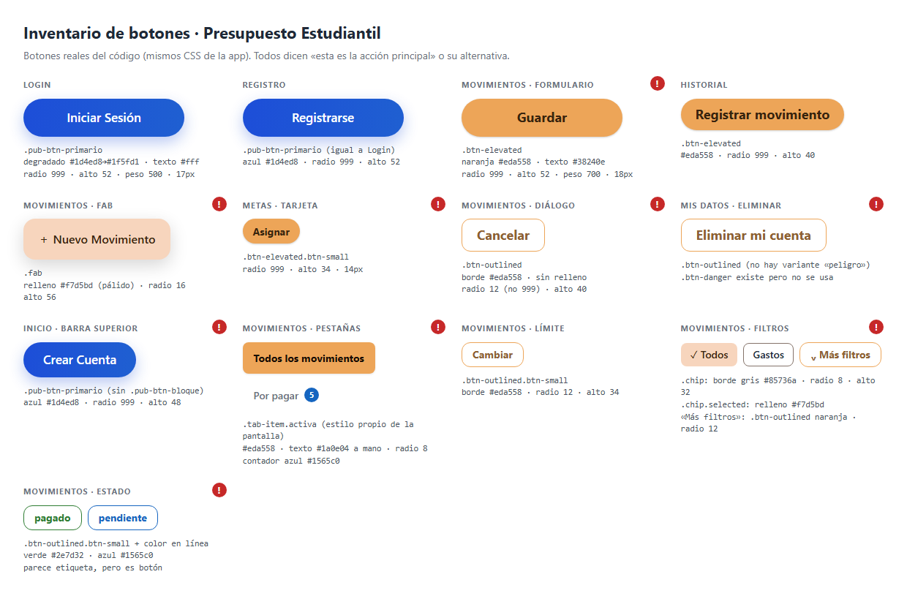

# Clase 23 · Inventario y tokens

Integrantes: Carmen Jenifer Aranibar Fernandez

Modalidad: con IA

## 1. Inventario



Los trece botones son reales: se dibujaron con los mismos CSS de la app (`frontend/src/design_system/tokens.css`, `theme/appTheme.css` y `theme/paginasPublicas.css`). Todos dicen «esta es la acción principal» (o su alternativa), pero no se ven iguales.

| Pantalla | Botón | Clase | Color | Radio | Alto | Texto |
|---|---|---|---|---|---|---|
| Login | Iniciar Sesión | `.pub-btn-primario` | degradado azul `#1d4ed8 → #1f5fd1`, texto blanco | 999 | 52 | 17px · peso 500 |
| Registro | Registrarse | `.pub-btn-primario` | igual que Login | 999 | 52 | 17px · peso 500 |
| Movimientos (formulario) | Guardar | `.btn-elevated .btn-block` | naranja `#eda558`, texto `#38240e` | 999 | 52 | 18px · peso 700 |
| Historial | Registrar movimiento | `.btn-elevated` | naranja `#eda558` | 999 | 40 | 18px · peso 700 |
| Movimientos | Nuevo Movimiento (FAB) | `.fab` | naranja pálido `#f7d5bd` | 16 | 56 | — |
| Metas (tarjeta) | Asignar | `.btn-elevated .btn-small` | naranja `#eda558` | 999 | 34 | 14px |
| Movimientos (diálogo) | Cancelar | `.btn-outlined` | borde `#eda558`, sin relleno | **12** | 40 | 18px |
| Mis datos | Eliminar mi cuenta | `.btn-outlined` | borde naranja (igual que Cancelar) | 12 | 40 | 18px |
| Inicio (barra superior) | Crear Cuenta | `.pub-btn-primario` | azul `#1d4ed8`, texto blanco | 999 | **48** | 17px · peso 500 |
| Movimientos (pestañas) | Todos los movimientos / Por pagar | `.tab-item.activa` (estilo propio de la pantalla) | naranja `#eda558`, texto `#1a0e04` escrito a mano; contador azul `#1565c0` | **8** | ~42 | 14px · peso 700 |
| Movimientos (límite) | Cambiar | `.btn-outlined .btn-small` | borde `#eda558` | 12 | 34 | 14px |
| Movimientos (filtros) | Todos / Gastos / Ingresos | `.chip` / `.chip.selected` | borde **gris** `#85736a`; seleccionado relleno `#f7d5bd` | **8** | 32 | 14px · peso 500 |
| Movimientos (filtros) | Más filtros | `.btn-outlined .btn-small` | borde **naranja** `#eda558` | 12 | 34 | 14px |
| Movimientos (lista) | pagado / pendiente | `.btn-outlined .btn-small` + color en línea (`:style`) | verde `#2e7d32` / azul `#1565c0` | 12 | 34 | 14px |

**Diferencias que encontramos:**

1. **Tono:** la acción principal es **azul** en Login, Registro y «Crear Cuenta» (`#1d4ed8`, peso 500) y **naranja** en el resto de la app (`#eda558`, peso 700). Al pasar del registro a la app, «el botón» cambia de color y de grosor de letra.
2. **Radio:** cinco radios distintos. El botón relleno es una píldora (`999px`), el FAB tiene **16px**, el de borde **12px**, y las pestañas y los chips **8px**. En la fila de filtros, «Todos / Gastos» (8) y «Más filtros» (12) quedan uno al lado del otro con esquinas distintas.
3. **Relleno y borde:** el FAB «Nuevo Movimiento» y el chip seleccionado usan un naranja **pálido** (`#f7d5bd`), distinto del naranja de «Guardar» y de la pestaña activa (`#eda558`). En la misma fila de filtros los chips tienen borde **gris** y «Más filtros» borde **naranja**.
4. **Alto:** seis altos para botones: 32, 34, 40, 48, 52 y 56. «Crear Cuenta» (48) y «Registrarse» (52) son el mismo botón azul con distinta altura.
5. **Botón que parece etiqueta:** «pagado» y «pendiente» son botones (al tocarlos cambian el estado), pero se ven como etiquetas de color. Su color se pone en línea con `:style`, fuera del sistema de botones, y el azul de «pendiente» es el mismo del contador de «Por pagar», que no es un botón.
6. **Estado que falta:** no hay variante **peligro**. «Eliminar mi cuenta» se ve igual que «Cancelar». La clase `.btn-danger` existe en `appTheme.css` (y se vuelve a definir en `MetasScreen.vue`), pero ningún botón la usa. Además, el estado **cargando** solo existe en «Guardar» de Movimientos (spinner); en Metas el botón cambia el texto a «Guardando...» y en los demás no hay estado de carga.

## 2. Tokens

Cinco tokens nombrados **por uso, no por apariencia** (`color-accion`, no «naranja»). La app hoy **no tiene tema oscuro**: la columna «Oscuro» es nuestra propuesta. Revisamos el contraste de cada valor oscuro con el fondo oscuro `#1c1612`.

| Token | Claro | Oscuro | Dónde se usa |
|---|---|---|---|
| `--color-accion` | `#eda558` | `#f2b878` | Fondo del botón principal (Guardar, Registrar movimiento, Asignar, FAB, Crear Cuenta), borde del botón secundario (Cambiar, Más filtros), pestaña activa y chip seleccionado. Debería reemplazar también al azul `#1d4ed8` de Login/Registro. Texto encima: `#38240e` (7.1:1 claro · 8.3:1 oscuro). |
| `--color-texto` | `#1f2937` | `#f3f4f6` | Títulos y párrafos de todas las pantallas (montos, nombres de movimientos, metas). 14:1 claro · 16.3:1 oscuro. |
| `--color-fondo` | `#fff8f4` | `#1c1612` | Fondo de cada pantalla (`AppScaffold`) y de los diálogos. |
| `--color-error` | `#b91c1c` | `#f87171` | Mensajes de error de los formularios, snackbar de error, y la nueva variante **peligro** del botón (Eliminar mi cuenta, Eliminar meta). 6.2:1 claro · 6.5:1 oscuro. |
| `--radio-control` | `12px` | `12px` | Esquinas de **todos** los botones (relleno, borde, FAB) y campos de texto. Un solo valor en lugar de 999 / 16 / 12 / 8 (también pestañas y chips). |

Hoy los valores claros ya existen con otros nombres en `tokens.css` (`--primary-base`, `--text-primary`, `--surface`, `--error-dark`), nombres que describen la paleta y no el uso. Todavía no tocamos el código.

## 3. Colores fijos

**Pantalla revisada:** Movimientos · `frontend/src/screens/MovementsScreen.vue`

**Qué buscamos** (Ctrl+Shift+F en VS Code, con expresión regular, solo en ese archivo):

```
#[0-9a-fA-F]{3,8}\b|rgba?\(|hsla?\(|:\s*(white|black)\b
```

**Cuántos encontramos: 26 colores escritos a mano.**

| Tipo | Cantidad | Ejemplos |
|---|---|---|
| Hexadecimal directo | 17 | `#f1f5f9`, `#0f172a`, `#334155`, `#ff9800`, `#1a0e04`, `#ffffff`, `#eff6ff`, `#3b82f6` |
| `rgba(...)` directo | 3 | `rgba(237, 165, 88, 0.12)` (el naranja de acción escrito en RGB), `rgba(0, 0, 0, 0.1)` |
| Respaldo dentro de `var(--token, #...)` | 6 | `var(--primary-base, #eda558)`, `var(--gray-200, #e2e8f0)` |

Lo que llamó la atención al contar (hoy solo se cuenta, no se corrige):

- `#1a0e04` y `#ffffff` ya existen como tokens (`--primary-700` y `--text-inverse`), pero se escribieron a mano.
- Varios respaldos **no coinciden** con su token: `var(--gray-200, #e2e8f0)` cuando el token vale `#b0b0b5`, y `var(--text-secondary, #64748b)` cuando vale `#6b7280`.
- `var(--surface-card, #ffffff)` y `var(--surface-container-high)` usan tokens que **no existen** en `tokens.css`, así que siempre se aplica el valor de respaldo, o nada.

Para comparar, el mismo conteo en las otras pantallas: Metas 37, Analítica 12, Presupuesto por categoría 10, Registro 3, Inicio 3, Login 1, Restablecer contraseña 1, Historial 1, Mis datos 0, Cambiar contraseña 0.
