# Evidencia · Tarea 10: Mis datos y salida honesta

- **Materia:** Interacción Humano-Computador (IHC)
- **Proyecto:** Presupuesto Estudiantil (FastAPI + Vue 3 + PostgreSQL)
- **Fecha de entrega:** Lunes 16/11/2026, 23:59
- **Integrantes:**
  - Carmen Jenifer Aranibar Fernandez

> Lo de la Clase 22 aplicado a una funcionalidad completa: la persona **ve** sus datos, los **descarga** y **elimina su cuenta sin obstáculos**.

| # | Parte | Dónde | Commit |
|---|---|---|---|
| 1 | Mis datos: ver y descargar (JSON o CSV) | Menú → **Mis datos** (`/mis-datos`) | `PENDIENTE` |
| 2 | Eliminar la cuenta con la regla de la app | `DELETE /api/cuenta` | `PENDIENTE` |
| 3 | Confirmación honesta | Diálogo «¿Eliminar tu cuenta?» | `PENDIENTE` |
| 4 | Revisión de los seis patrones en toda la app | Sección 4 de este documento | `PENDIENTE` |
| 5 | E2E, eventos y evidencia | `frontend/e2e/mis_datos.spec.ts`, `etica.spec.ts` | `PENDIENTE` |

---

## 1. Mis datos: ver y descargar

Nueva pantalla **Mis datos**, en el menú lateral (al mismo nivel que «Cambiar contraseña»).

| Qué muestra | Detalle |
|---|---|
| **Tu cuenta** | Correo y fecha de creación. |
| **Lo que la app guarda de ti** | Cuántos movimientos, límites mensuales, presupuestos por categoría, metas de ahorro y registros del historial tiene la persona. |
| **Tus movimientos** | Tabla con fecha, tipo, categoría, descripción, monto y estado. Los límites, presupuestos y metas se ven al abrir «Ver límites, presupuestos y metas». |
| **Descargar** | **«Descargar movimientos (CSV)»** y **«Descargar todos mis datos (JSON)»**. |
| **Qué no se guarda** | Aviso claro: la contraseña no se guarda en texto ni se descarga, y la analítica no guarda correo, montos ni texto escrito. |

**Formatos:**

- **CSV** (`presupuesto-estudiantil-movimientos-AAAA-MM-DD.csv`): solo los movimientos, que es lo que pide la regla de la app. Cabecera en español, con BOM para que Excel lea las tildes. Los textos con comas van entre comillas, y una descripción que empieza con `=`, `+`, `-` o `@` no se ejecuta como fórmula en Excel.
- **JSON** (`presupuesto-estudiantil-mis-datos-AAAA-MM-DD.json`): **todo** lo que la app guarda: cuenta, movimientos, límites, presupuestos, metas e historial. Sin ids internos, sin `user_id` y sin la contraseña (ni su hash).

**API:** `GET /api/cuenta/datos` devuelve solo los datos de la persona con sesión (otra cuenta no puede verlos).

## 2. Eliminar la cuenta con la regla de Presupuesto Estudiantil

> **Regla (diapositiva 13/16):** *Se elimina todo: movimientos, presupuestos y metas. Antes puede descargar sus movimientos.*

| Parte de la regla | Cómo se cumple |
|---|---|
| **Se elimina todo** | `DELETE /api/cuenta` borra, tabla por tabla y en una sola transacción, los **movimientos**, **límites mensuales**, **presupuestos por categoría**, **metas de ahorro** (con el dinero reservado), el **historial**, los enlaces de recuperación de contraseña y, al final, la **cuenta**. Si algo falla, no se borra nada. |
| **Antes puede descargar sus movimientos** | El botón **«Descargar mis movimientos (CSV)»** está **dentro** del mismo diálogo de confirmación, y también en la pantalla. Es una opción, no un paso obligatorio. |
| **Después no puede iniciar sesión** | El correo y la contraseña ya no existen: el login responde «Las credenciales son incorrectas» y la sesión que estaba abierta deja de servir (`401`). El correo queda libre para registrarse de nuevo desde cero. |
| **No afecta a otras personas** | Cada dato tiene dueño y nadie comparte datos en esta app. Las demás cuentas no se tocan (lo comprueba la E2E con Pablo). |

**¿Hay un intento bloqueado?** En Presupuesto Estudiantil **no corresponde**: ningún dato afecta a otra persona, por eso la regla no frena la eliminación (a diferencia de Planazo, donde las deudas sí la bloquean). Aun así, el backend exige `confirmar: true` y, si falta, responde `422` con un mensaje que dice qué hacer: *«Para eliminar tu cuenta tienes que confirmarlo en el diálogo.»* Si el servidor falla, la app lo dice y aclara que los datos siguen intactos.

**Qué se conserva:** solo los **eventos de analítica**, que nunca tuvieron `user_id`, correo ni montos (Clase 21). No hay forma de saber de quién eran.

## 3. Confirmación honesta

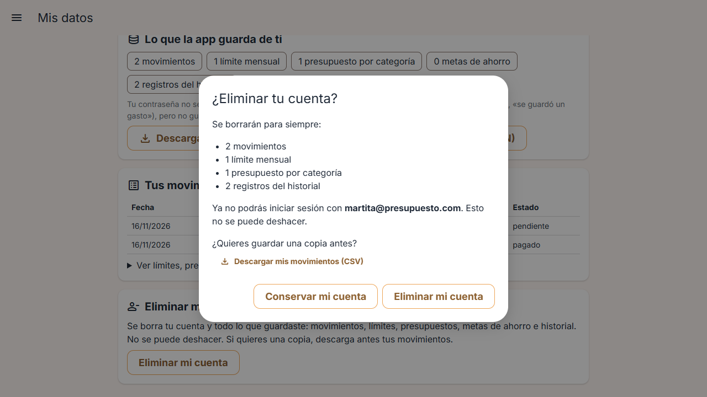

| Lo que pide la clase | Cómo lo cumple el diálogo |
|---|---|
| **Botones del mismo tamaño** | «Conservar mi cuenta» y «Eliminar mi cuenta» usan la misma clase (`btn btn-outlined`): mismo tamaño, color y peso. Ninguno se destaca. |
| **Consecuencias explicadas** | Lista **con los números reales** de la persona (por ejemplo, *2 movimientos, 1 límite mensual, 1 presupuesto por categoría, 2 registros del historial*), solo de lo que tiene, y dice: *«Ya no podrás iniciar sesión con martita@… Esto no se puede deshacer.»* |
| **Sin culpa** | Sin «¿Estás seguro?», «te extrañaremos» ni «perderás todo». Texto neutral que informa. |
| **Sin pasos de más** | **Un solo diálogo y un toque.** No pide escribir «ELIMINAR», ni la contraseña, ni pasar por soporte, ni una encuesta. «Conservar» cierra y listo, sin otro «¿seguro?». |
| **Salida segura con foco** | «Conservar mi cuenta» recibe el foco: un Enter sin leer no borra nada. |

**Salir tan fácil como entrar:**

| Crear la cuenta | Eliminar la cuenta |
|---|---|
| Inicio → «Crear una cuenta» → correo y contraseña → «Registrarse» | Menú → «Mis datos» → «Eliminar mi cuenta» → «Eliminar mi cuenta» |

## 4. Revisión de los seis patrones en toda la app

Recorrimos todas las pantallas (inicio, registro, login, movimientos, metas, presupuesto por categoría, historial, analítica, cambiar contraseña y Mis datos) con la checklist de la Clase 22.

| # | Patrón | Lo que encontramos | Lo que corregimos | Lo que queda pendiente |
|---|---|---|---|---|
| 1 | **Opciones preseleccionadas** | Nada marcado por defecto: un gasto nuevo es «no se repite» y no hay casillas de aceptar marcadas. | — (sin patrón) | — |
| 2 | **Confirmaciones engañosas** | Aviso de límite (corregido en la Clase 22). Además, **4 diálogos** de acciones irreversibles destacaban el botón destructivo: eliminar movimiento (`btn-elevated`), cancelar movimiento (`btn-elevated`), eliminar meta (`btn-elevated btn-danger`) y eliminar presupuesto (botón rojo frente a un «Cancelar» de solo texto). En eliminar movimiento, «Cancelar» se confundía con *cancelar un movimiento*. | Los 4 diálogos usan **botones iguales** (`btn-outlined`), nombres que dicen lo que hacen (**«Conservar movimiento / Eliminar movimiento»**, **«Conservar meta / Eliminar meta»**, **«Conservar presupuesto / Eliminar presupuesto»**, **«Volver / Cancelar movimiento»**) y la **consecuencia explicada** (*desaparecerá de tu lista y de tus totales*; *dejará de contar en tus totales y presupuestos*). La salida segura recibe el foco. | — |
| 3 | **Urgencia, culpa o escasez falsas** | El mensaje del límite mensual decía *«No se puede registrar… (**llevas gastando** X Bs)»*: tono de reproche. | Ahora: *«No se registró: este gasto supera tu límite mensual de 500.0 Bs. **Te quedan 460.0 Bs disponibles** este mes.»* Informa con el dato útil, sin culpa. | — |
| 4 | **Datos expuestos sin necesidad** | Cada usuario ve solo sus datos y la analítica no guarda `user_id` ni correo. Faltaba que la persona pudiera **ver qué se guarda** de ella. | Pantalla **Mis datos** con todo lo guardado y descarga. La exportación no incluye la contraseña ni ids internos, y los eventos nuevos solo aceptan valores de listas fijas (el backend rechaza el correo con `422`). | El **panel de Analítica** se ve desde el menú de cualquier usuario. No muestra datos personales, pero es una herramienta de desarrollo: debería ocultarse en producción. |
| 5 | **Salir más difícil que entrar** | Crear la cuenta tomaba 1 toque, pero **no existía forma de eliminarla** (ni en la interfaz ni en la API). | **Eliminar mi cuenta** en Mis datos, con una sola confirmación honesta, en la misma cantidad de pasos que registrarse. «Cerrar sesión» sigue a mano en el menú. | — |
| 6 | **Permisos sin explicar** | La app no pide ningún permiso del navegador (ubicación, notificaciones, cámara). | — (sin patrón) | Si en el futuro se agregan recordatorios de pagos (notificaciones), pedir el permiso **al activar el recordatorio** y explicar para qué. |

## 5. Eventos de la Tarea 9 (sin datos personales)

Se agregó el **flujo 8 · Eliminar cuenta (Tarea 10)** al plan de eventos y al panel `/analitica`.

| Evento | Tipo | Propiedades (listas fijas) | Dónde | Pregunta que responde |
|---|:---:|---|---|---|
| `cuenta_eliminacion_iniciada` | 🟢 inicio | — | `MisDatosScreen.vue` · `abrirEliminar()` | ¿Cuántos abren el diálogo de eliminar? |
| `cuenta_eliminada` | 🟢 éxito | — | **Servidor**: `backend/app/routers/cuenta.py` | ¿Cuántos terminan de eliminarla? |
| `cuenta_eliminacion_frenada` | 🔴 salida / bloqueo | `motivo`: `conservo_la_cuenta`, `rechazado_por_servidor` | `MisDatosScreen.vue` · `conservar()` y `eliminar()` | ¿Se arrepienten o algo los bloquea? |
| `datos_descargados` | 🟢 | `formato`: `json`, `csv` | `MisDatosScreen.vue` · `descargarCsv()` y `descargarJson()` | ¿Cuántos descargan sus datos y en qué formato? |

**Por qué `cuenta_eliminada` lo guarda el servidor:** después de borrar la cuenta el navegador ya no tiene sesión y no podría enviar el evento. El servidor lo guarda en la misma transacción, **solo con el nombre y la fecha** (`props = {}`): ni correo, ni id, ni cuántos datos tenía.

**Doble control:** `validar_evento()` rechaza con `422` cualquier propiedad que no esté en la lista (por ejemplo, `email`) y cualquier valor fuera de ella (por ejemplo, `formato: "pdf"`).

## 6. Pruebas

### E2E del recorrido · `frontend/e2e/mis_datos.spec.ts`

| Prueba | Qué demuestra |
|---|---|
| `Martita ve lo que la app guarda de ella` | Resumen (2 movimientos, 1 límite, 1 presupuesto, 0 metas, 2 historial) y la tabla con «Pasaje de micro» y «Mesada». |
| `descarga sus movimientos en CSV y todos sus datos en JSON` | **La descarga de los datos**: se abre cada archivo descargado y se revisa su contenido; el JSON no trae la contraseña; los eventos solo llevan el formato. |
| `confirmación honesta: consecuencias reales, botones iguales y conservar no cambia nada` | Consecuencias con números reales, botón de descarga en el diálogo, sin campos de texto (sin pasos de más), botones de igual clase y altura, sin frases de culpa, foco en «Conservar», y al conservar todo sigue igual. Eventos: inicio y salida con `conservo_la_cuenta`. |
| `eliminación completa: la cuenta ya no puede iniciar sesión y las demás no se tocan` | **La eliminación completa**: vuelve al inicio con el mensaje, el token viejo da `401`, el login es rechazado, Pablo entra normal, y el panel muestra el embudo «Eliminar cuenta (Tarea 10)» al **100 %** (inicio del navegador + éxito del servidor). Ningún evento enviado contiene el correo. |

### E2E de la revisión de patrones · `frontend/e2e/etica.spec.ts`

| Prueba | Qué comprueba |
|---|---|
| `eliminar un movimiento: botones iguales y la consecuencia explicada` | «Conservar movimiento» y «Eliminar movimiento» con la misma clase, foco en la salida segura, consecuencia explicada. |
| `cancelar un movimiento: la acción irreversible no es el botón destacado` | «Volver» y «Cancelar movimiento» iguales. |
| `eliminar un presupuesto por categoría: botones iguales` | «Conservar presupuesto» y «Eliminar presupuesto» iguales. |
| `eliminar una meta de ahorro: botones iguales` | «Conservar meta» y «Eliminar meta» iguales. |
| `el mensaje del límite mensual es neutral y dice cuánto queda` | Dice cuánto queda y no contiene «llevas gastando». |

### Backend · `backend/tests/test_cuenta.py`

Ver todos los datos y solo los propios · sin confirmar no se borra nada (`422`) · eliminar borra todo, el login y el token viejo dan `401`, las otras cuentas siguen intactas y el correo queda libre · el evento `cuenta_eliminada` se guarda sin datos personales · los eventos nuevos solo aceptan listas fijas.

### Unitarias · `frontend/tests/unit/misDatos.test.js`

CSV con cabecera en español, comillas, BOM y sin fórmulas · nombre del archivo con la fecha · consecuencias con los números reales (y sin lista si la cuenta está vacía).

### Resultados

```powershell
cd backend;  .venv\Scripts\python -m pytest            # backend
cd frontend; pnpm test                                 # unitarias
$env:E2E_CHANNEL="msedge"; pnpm test:e2e               # E2E (con PostgreSQL encendido)
$env:FOTOS_TAREA10="1"; pnpm exec playwright test e2e/mis_datos.spec.ts   # vuelve a sacar las capturas
```

| Suite | Antes (Clase 22 + nuevo diseño + recuperar con código de 4 dígitos) | Después (Tarea 10) |
|---|---|---|
| Backend (pytest) | 63 passed | **70 passed** |
| Frontend (vitest) | 62 passed | **69 passed** |
| E2E (Playwright) | 79 passed | **88 passed**, sin regresiones |

## 7. Capturas

Las capturas las saca la propia E2E (`FOTOS_TAREA10=1`), así que muestran exactamente lo que se probó.

| 1. Mis datos: cuenta, resumen y movimientos | 2. Descarga del CSV |
|:---:|:---:|
| 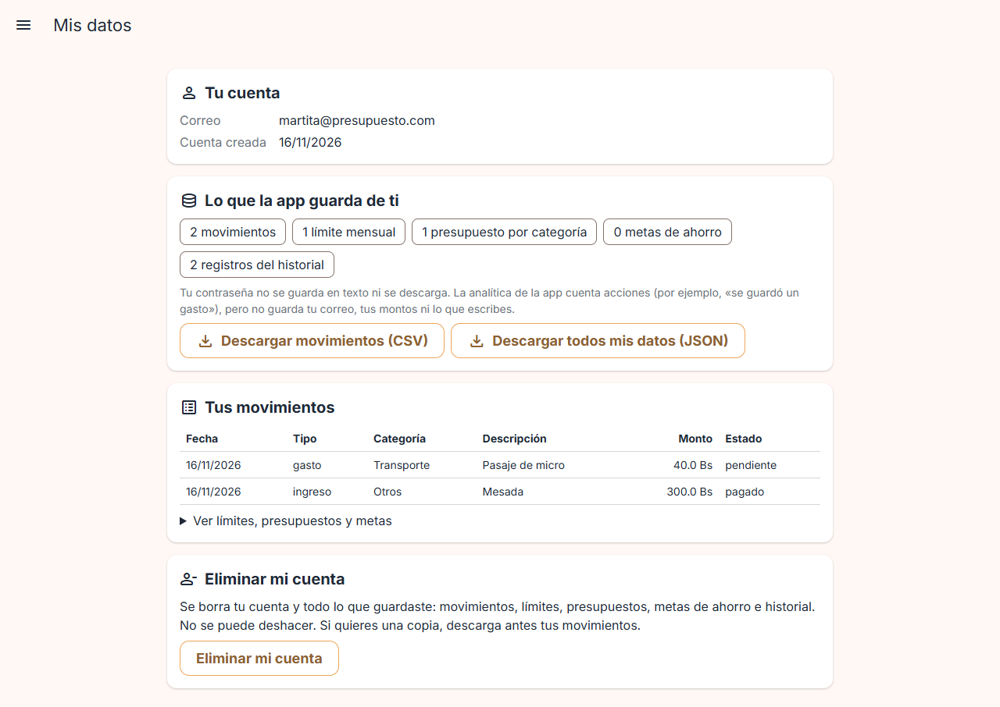 | 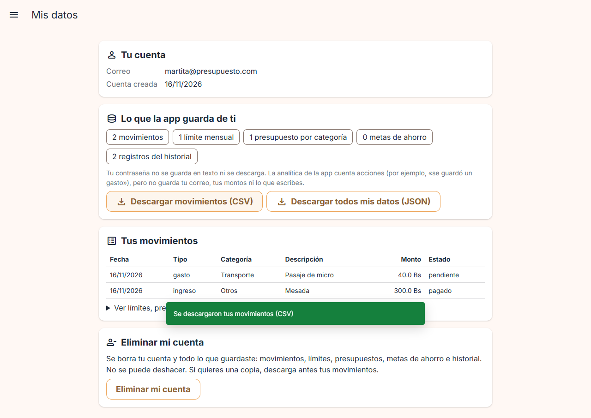 |

| 3. Confirmación honesta | 4. Cuenta eliminada: vuelve al inicio con el mensaje |
|:---:|:---:|
|  |  |

| 5. Ya no puede iniciar sesión | 6. Panel: embudo «Eliminar cuenta (Tarea 10)» |
|:---:|:---:|
| 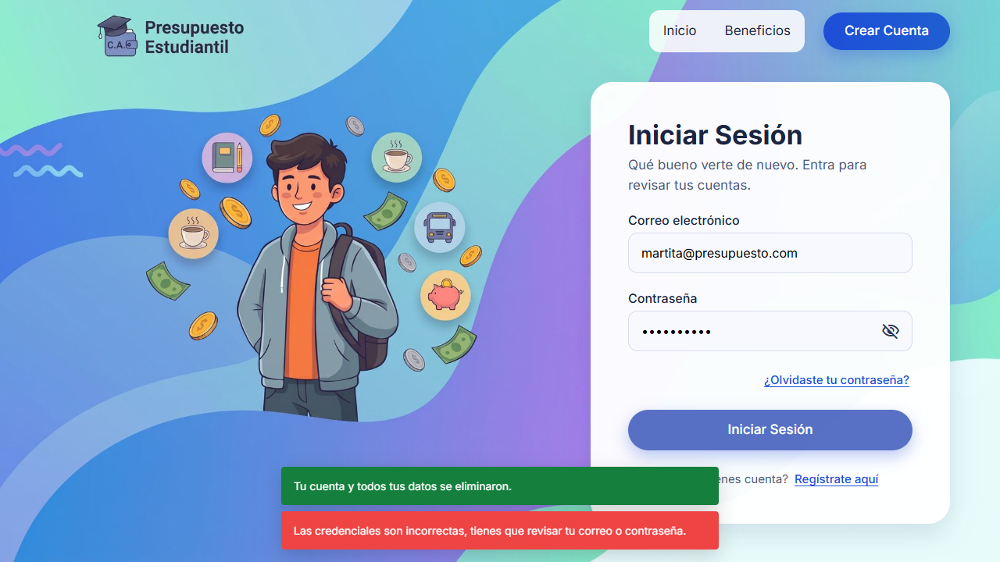 | 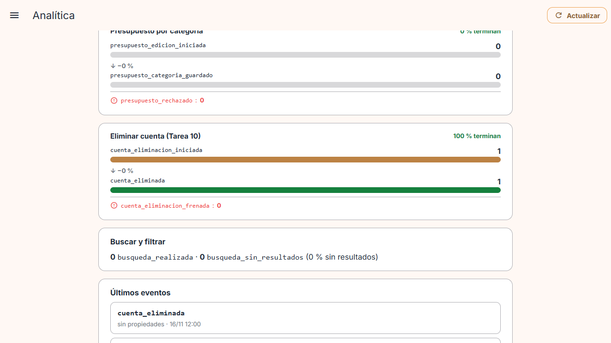 |

## 8. Antes y después

Las fotos del **antes** y las del **después** se sacaron con el código. Se usó el mismo recorrido y los mismos datos de la semilla.

| | Antes | Después |
|---|:---:|:---:|
| **Menú:** no había forma de ver los datos ni de eliminar la cuenta → ahora está **«Mis datos»** | 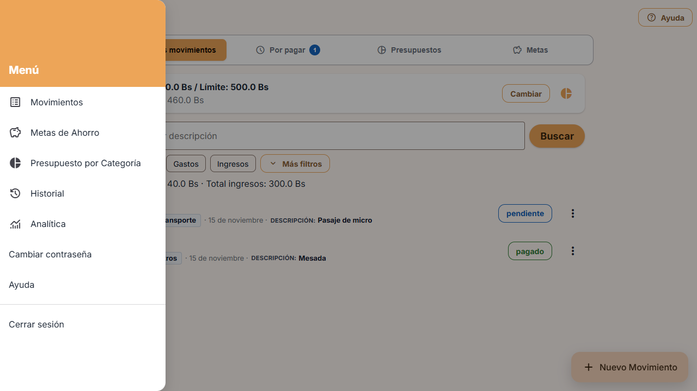 | 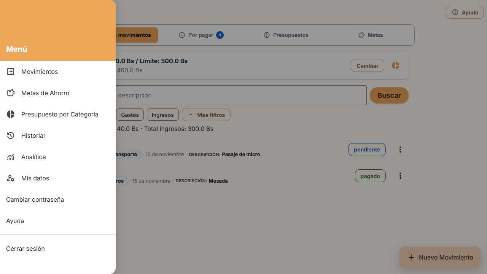 |
| **Eliminar movimiento:** «Eliminar» destacado y «Cancelar» confuso → botones iguales y la consecuencia explicada | 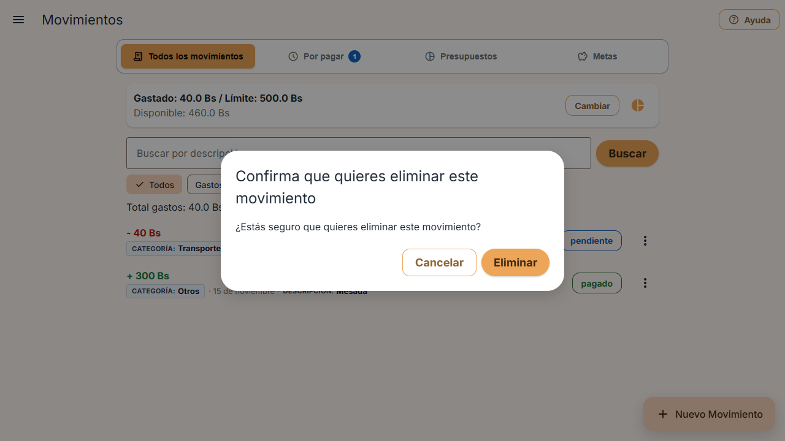 | 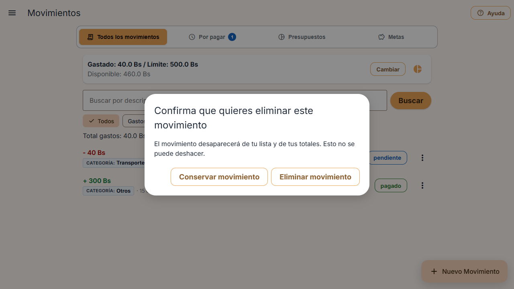 |
| **Cancelar movimiento:** la acción irreversible era el botón destacado → botones iguales | 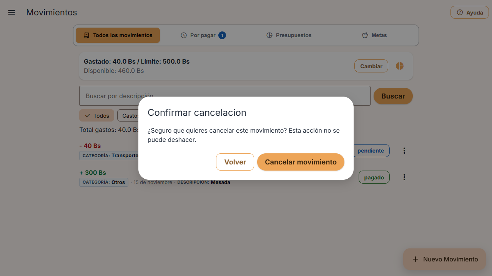 | 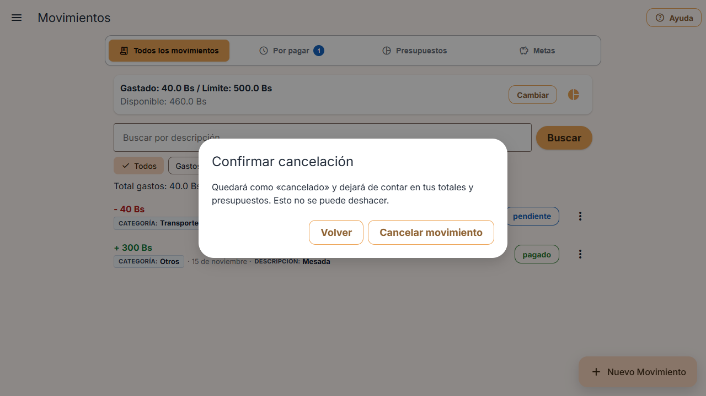 |
| **Eliminar presupuesto:** botón rojo frente a un «Cancelar» de solo texto → botones iguales | 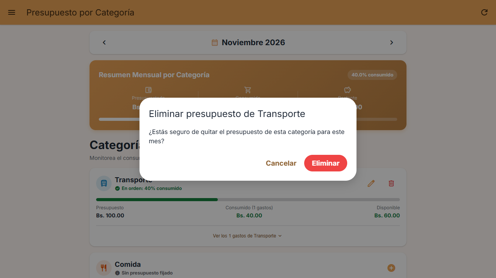 | 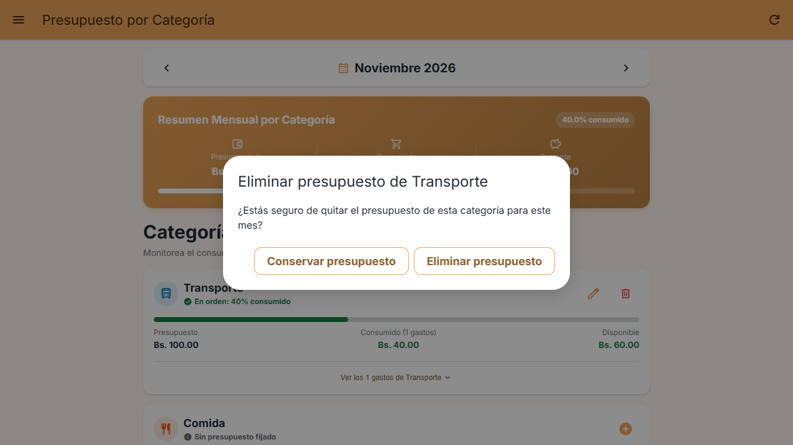 |
| **Eliminar meta:** «Eliminar meta» relleno y rojo → botones iguales | 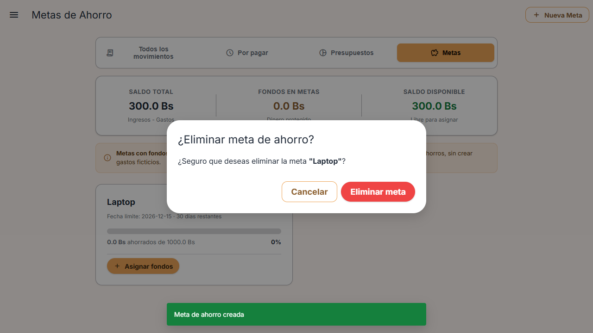 | 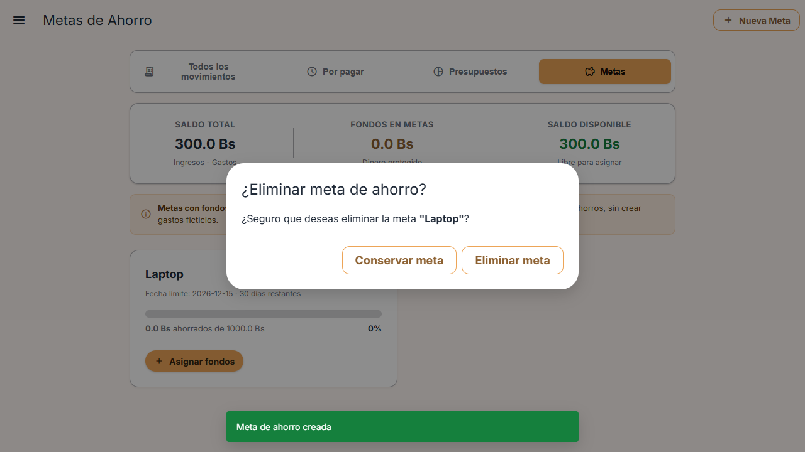 |
| **Límite mensual:** «llevas gastando» (reproche) → «Te quedan X Bs disponibles» | 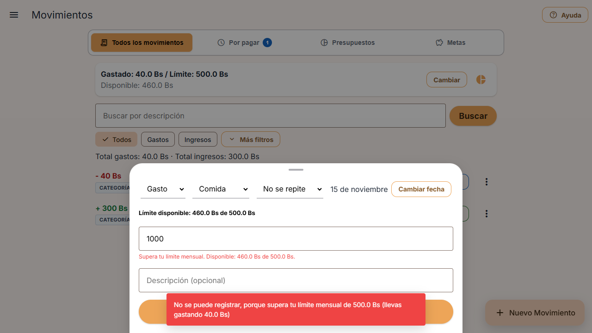 | 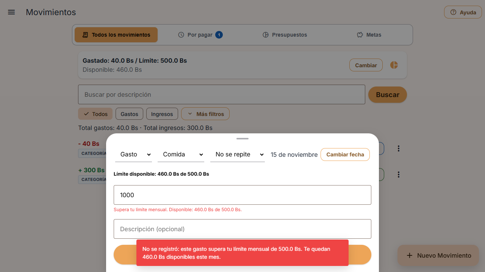 |

## 9. Archivos afectados

### Backend
- `backend/app/routers/cuenta.py` (nuevo): `GET /api/cuenta/datos` y `DELETE /api/cuenta`.
- `backend/app/logica/cuenta.py` (nuevo): qué tablas se borran y cómo se exportan.
- `backend/app/schemas.py`: `ConfirmarEliminacion` y `ResultadoEliminacion`.
- `backend/app/main.py`: registra el router `cuenta`.
- `backend/app/logica/analitica.py`: eventos y embudo del flujo 8.
- `backend/tests/test_cuenta.py` (nuevo): 6 pruebas.

### Frontend
- `frontend/src/screens/MisDatosScreen.vue` (nuevo): ver, descargar y eliminar.
- `frontend/src/services/cuentaService.js` (nuevo) y `frontend/src/utils/misDatos.js` (nuevo): CSV, nombre de archivo y consecuencias.
- `frontend/src/router/appRouter.js` y `frontend/src/widgets/AppDrawer.vue`: ruta y opción «Mis datos».
- `frontend/src/widgets/AppDialog.vue`: `data-autofocus` para dar el foco a la salida segura.
- `frontend/src/services/analitica.js` y `frontend/src/screens/AnaliticaScreen.vue`: eventos del flujo 8.
- Revisión de patrones: `MovementsScreen.vue`, `MetasScreen.vue` y `PresupuestoCategoriaScreen.vue`.
- Pruebas: `e2e/mis_datos.spec.ts` (nuevo), `e2e/etica.spec.ts`, `tests/unit/misDatos.test.js` (nuevo); se actualizaron los nombres de botones en `e2e/movimientos.spec.ts` y el mensaje en `e2e/flujo_principal.spec.ts`.
