# Tarea 6 · Toda la app con E2E y una feature grande

- **Materia:** Interacción Humano-Computador (IHC)
- **Proyecto:** Presupuesto Estudiantil (FastAPI + Vue 3 + PostgreSQL)
- **Feature asignada:** Recurrentes. Un gasto puede ser semanal o mensual, la app genera la siguiente ocurrencia y esa ocurrencia cuenta en el presupuesto.
- **La prueba comprueba:** aparece la próxima ocurrencia y el consumo sube.

---

## 1. Cómo se corre

Todo se corre desde `frontend/`, con PostgreSQL encendido y `backend/.env` configurado.

```powershell
pnpm semilla                  # deja la base budget_e2e con datos conocidos
pnpm test:e2e                 # suite completa (levanta backend y frontend de prueba solos)
pnpm test:e2e --headed        # ver el navegador trabajar
pnpm test:e2e --ui            # cada acción, paso a paso
pnpm exec playwright show-report
```

- **Un solo comando:** Playwright levanta su propio backend (puerto 8099) y frontend (puerto 5199) contra la base `budget_e2e`. No toca la base real `budget`.
- **Semilla:** está en `backend/semilla.py`. Corre antes de cada prueba, así cada prueba empieza siempre igual. Solo acepta bases con "e2e" en el nombre, porque borra todo.
- **Pasa desde cero, dos veces:** se comprobó corriendo la suite dos veces seguidas, y las dos dieron 59 passed.

### Usuarios de prueba

| Usuario | Correo | Contraseña | Datos |
|---|---|---|---|
| Martita | `martita@presupuesto.com` | `martita123` | Límite de 500 Bs y presupuesto de Transporte de 100 Bs este mes; gasto "Pasaje de micro" de 40 Bs (pendiente); ingreso "Mesada" de 300 Bs (pagado) |
| Pablo | `pablo@presupuesto.com` | `pablo123` | Cuenta nueva, sin movimientos |

---

## 2. Suite antes y después de la feature

| | Pruebas E2E | Resultado |
|---|---|---|
| **Antes** de la feature (toda la app) | 54 | ✅ 54 passed |
| **Después** de la feature | 59 (+5 de gastos recurrentes) | ✅ 59 passed |

Además hay pruebas unitarias: el backend pasó de 23 a 30 (pytest) y el frontend de 47 a 50 (vitest).

### Antes

| Pantalla | Captura |
|---|---|
| Movimientos | 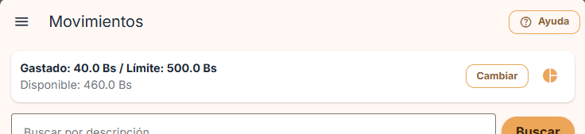 |
| Formulario: no existe la opción "Repetir" | 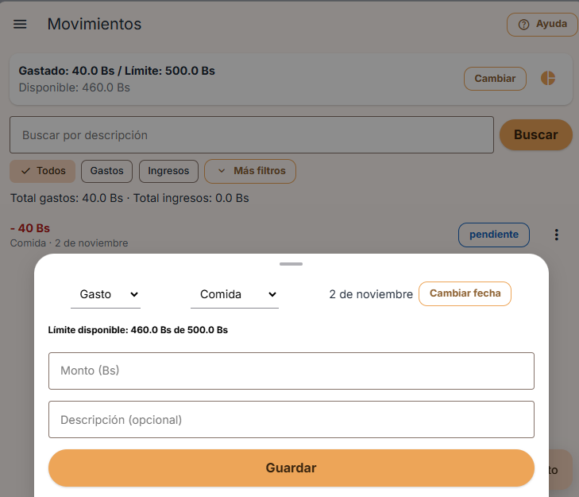 |
| Presupuesto por Categoría | 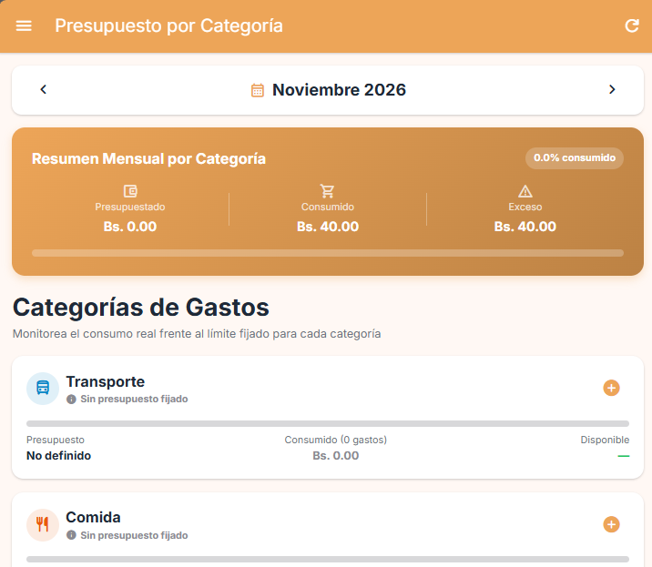 |
| Terminal: `pnpm test:e2e` | 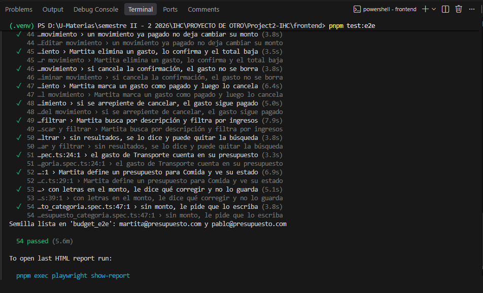 |
| Reporte de Playwright | 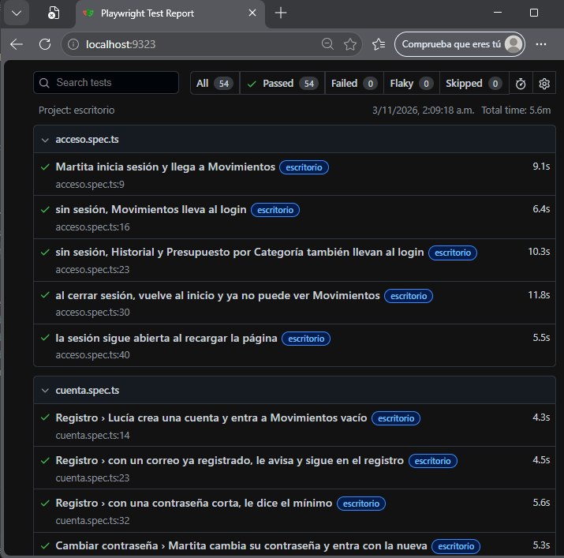 |

### Después

| Pantalla | Captura |
|---|---|
| Movimientos: el gasto recurrente, la próxima ocurrencia y "Gastado" más alto | 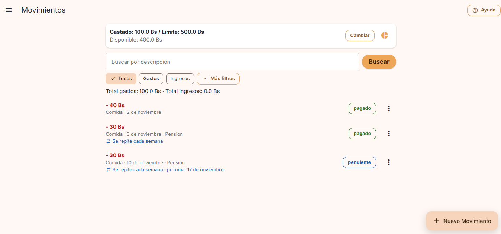 |
| Formulario con "Repetir: Cada semana" | 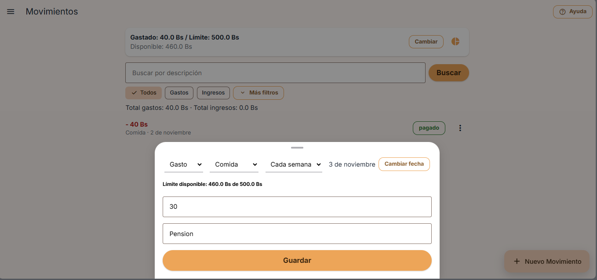 |
| Presupuesto por Categoría: el consumo de Comida sube (resumen) | 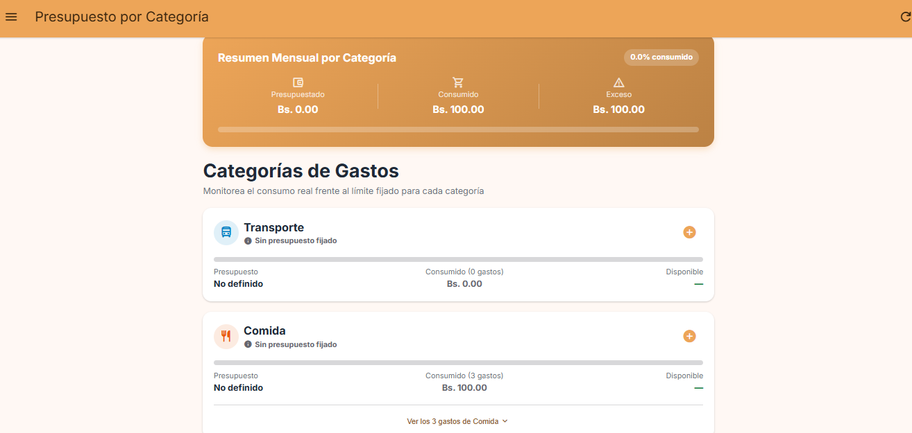 |
| Presupuesto por Categoría: detalle de Comida con los 3 gastos | 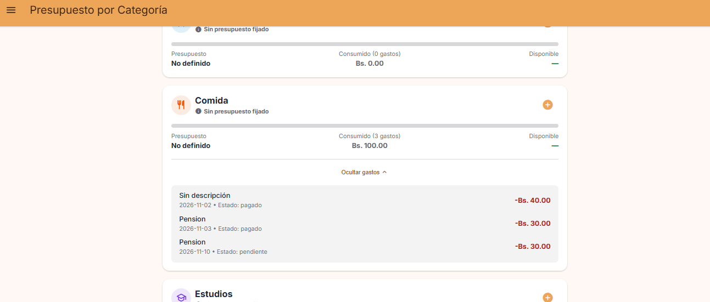 |
| Terminal: `pnpm test:e2e` | 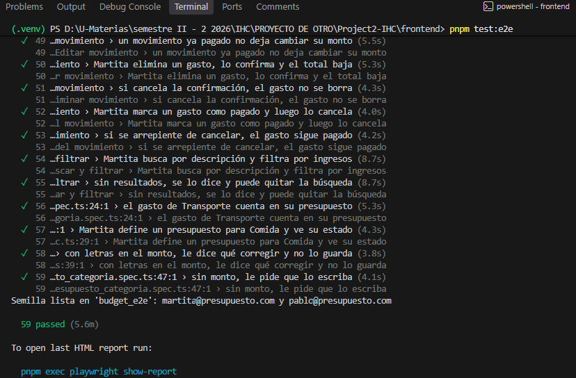 |
| Reporte de Playwright | 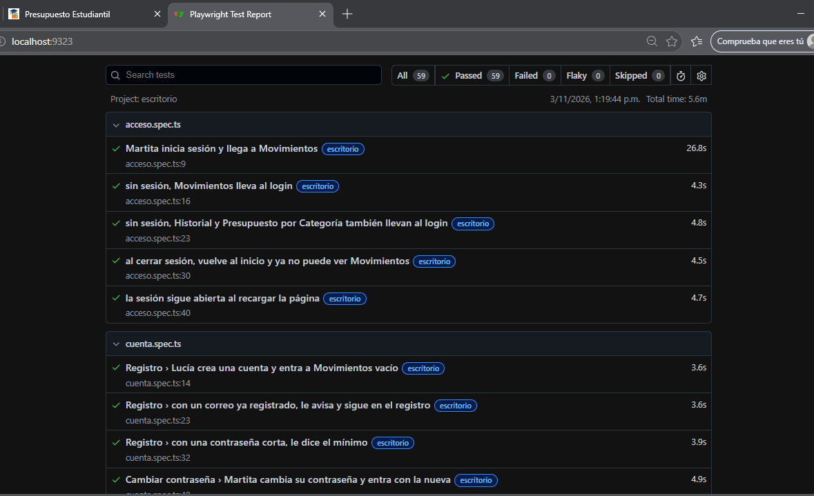 |

---

## 3. Matriz: cada flujo de la app

Cada flujo tiene un **camino feliz** (el usuario hace todo bien) y uno o más **alternativos** (se equivoca o algo no está permitido). Las pruebas buscan por rol, etiqueta y texto, nunca por CSS.

| Flujo | Camino feliz | Camino alternativo | Archivo |
|---|---|---|---|
| Iniciar sesión | Martita inicia sesión y llega a Movimientos | Contraseña incorrecta · correo no registrado · correo mal escrito · campos vacíos | `flujo_principal.spec.ts` |
| **Registrar gasto (reto de clase)** | Martita registra un gasto y el total cambia (y sigue al recargar) | Supera el límite · sin monto · letras en el monto | `flujo_principal.spec.ts` |
| Permisos y sesión | La sesión sigue al recargar · cerrar sesión vuelve al inicio | Sin sesión, las rutas privadas llevan al login | `acceso.spec.ts` |
| Relación entre usuarios | Pablo no ve los gastos de Martita | Pablo sin datos ve el estado vacío con una acción | `flujo_principal.spec.ts` |
| Registro | Lucía crea una cuenta y entra a Movimientos vacío | Correo ya registrado · contraseña corta | `cuenta.spec.ts` |
| Cambiar contraseña | Martita la cambia y entra con la nueva | Las contraseñas no coinciden | `cuenta.spec.ts` |
| Recuperar contraseña | Pide el enlace y la app confirma el envío | Sin correo | `cuenta.spec.ts` |
| Editar movimiento | Corrige el monto y el total cambia | Uno pagado no deja cambiar el monto | `movimientos.spec.ts` |
| Eliminar movimiento | Confirma y el total baja | Cancela la confirmación y no se borra | `movimientos.spec.ts` |
| Estados | pendiente → pagado → cancelado (el cancelado deja de contar) | Se arrepiente de cancelar y sigue pagado | `movimientos.spec.ts` |
| Buscar y filtrar | Busca por descripción y filtra por ingresos | Sin resultados: mensaje y botón para quitar la búsqueda | `movimientos.spec.ts` |
| Límite mensual | Sube el límite y el disponible cambia | Menor a lo ya gastado · letras | `limite_mensual.spec.ts` |
| Presupuesto por categoría | El gasto cuenta en su categoría · define un presupuesto y ve su estado | Letras · vacío | `presupuesto_categoria.spec.ts` |
| Historial | Lo que hace Martita aparece en su historial | Búsqueda sin resultados · Pablo con historial vacío | `historial.spec.ts` |
| **Gastos recurrentes (feature)** | Semanal y mensual: al pagarlo aparece la próxima ocurrencia y el consumo sube | Supera el límite: no se genera y avisa · un gasto que no se repite no genera otro · un ingreso no ofrece repetir | `gastos_recurrentes.spec.ts` |

### Visual y accesibilidad (`diseno.spec.ts`)

| Tipo | Qué se comprueba |
|---|---|
| **Visual (H4)** | `toHaveScreenshot()` de inicio, login, registro y recuperar contraseña. Son las pantallas que no cambian con la fecha ni con los datos. |
| **Accesibilidad (axe)** | Ninguna violación en las 10 pantallas: inicio, login, registro, recuperar, Movimientos, formulario de movimiento (con "Repetir"), límite mensual, Presupuesto por Categoría, Historial y Cambiar contraseña. |
| **Fitts** | `boundingBox()`: "Abrir menú", "Nuevo Movimiento" y "Guardar" miden al menos 44 × 44 px. |

### Qué comprueba cada `expect` (estados reales, slide 8)

| Estado | Ejemplo en las pruebas |
|---|---|
| **Éxito:** mensaje y dato nuevo | "Gasto registrado" + "Total gastos: 65.5 Bs" |
| **Vacío:** mensaje y acción | "Aún no tienes movimientos…" + botón "Nuevo Movimiento" |
| **Error:** qué corregir | "El campo no puede estar vacío", "Las contraseñas no coinciden" |
| **Permiso:** sin sesión, al login | `/movements`, `/history`, `/presupuestos-categoria` → `/login` |
| **Persistencia:** sigue al recargar | `page.reload()` y el total sigue en 65.5 Bs |
| **Relación:** lo que ve el otro usuario | Pablo no ve "Pasaje de micro" de Martita |

---

## 4. La feature: gastos recurrentes

### Reglas

1. Al registrar un **gasto**, el selector **"Repetir"** ofrece *No se repite / Cada semana / Cada mes*. Un ingreso no muestra esta opción.
2. Cuando un gasto recurrente se marca como **pagado**, la app genera la **siguiente ocurrencia**: un gasto **pendiente** con el mismo monto, categoría y descripción.
   - **Semanal:** 7 días después.
   - **Mensual:** el mismo día del mes siguiente. Si ese día no existe, usa el último día del mes (31 de enero → 28 de febrero).
3. La ocurrencia nueva **cuenta en el presupuesto**: suma en "Gastado", en el límite mensual y en el presupuesto por categoría de **su** mes.
4. Si la ocurrencia nueva **superaría el límite** de su mes, no se genera y la app explica por qué. Es la misma regla de bloqueo que al registrar un gasto.
5. La lista muestra "Se repite cada semana · próxima: 8 de noviembre". La fecha próxima aparece solo mientras el gasto está pendiente.
6. La ocurrencia generada queda en el **historial**.

**Decisión de diseño:** la siguiente ocurrencia se genera **al pagar** y no al crear el gasto. Así la lista no se llena de gastos futuros que el estudiante todavía no hizo, y cada gasto se confirma uno por uno.

### Qué comprueba la prueba E2E (`gastos_recurrentes.spec.ts`)

El gasto se registra el día 1 del mes actual. Así la prueba da el mismo resultado sin importar qué día se corra.

| Prueba | `expect` principales |
|---|---|
| Martita paga un gasto semanal | Antes de pagar: "próxima: 8 de …". Después: "Se generó el próximo gasto", aparece la fila del día 8 **pendiente**, **"Gastado: 100.0 Bs"** (antes 70.0) y Comida en el presupuesto con "Consumido (2 gastos)" y "Bs. 60.00" |
| Martita paga un gasto mensual | Aparece la fila del mes siguiente, "Total gastos: 100.0 Bs", y en el presupuesto del **mes siguiente** Comida tiene "Bs. 30.00" |
| Supera el límite | 290 + 250 > 500: aviso "No se generó el gasto… supera tu límite mensual", sigue habiendo **una** fila y "Gastado: 290.0 Bs" |
| Gasto que no se repite | Al pagarlo, sigue habiendo una sola fila y el gasto no cambia |
| Ingreso | El selector "Repetir" desaparece |

### Archivos de la feature

| Capa | Archivo |
|---|---|
| Regla de fechas | `backend/app/logica/recurrencia.py` y `frontend/src/utils/recurrencia.js` |
| Base de datos | `database/init/001_esquema.sql` (columna `recurrencia`) y `backend/app/models.py` |
| API | `backend/app/routers/movimientos.py`: al pagar se llama a `_generar_siguiente`; la respuesta trae `siguiente` o `aviso` |
| Pantalla | `frontend/src/screens/MovementsScreen.vue`: selector "Repetir", texto "próxima" y mensajes |
| Pruebas | `frontend/e2e/gastos_recurrentes.spec.ts`, `backend/tests/test_api.py`, `backend/tests/test_logica.py`, `frontend/tests/unit/recurrencia.test.js` |

---

## 5. Problemas de diseño que encontraron las pruebas

Como en el caso de Trueque U, **se arregló la interfaz, no la prueba**.

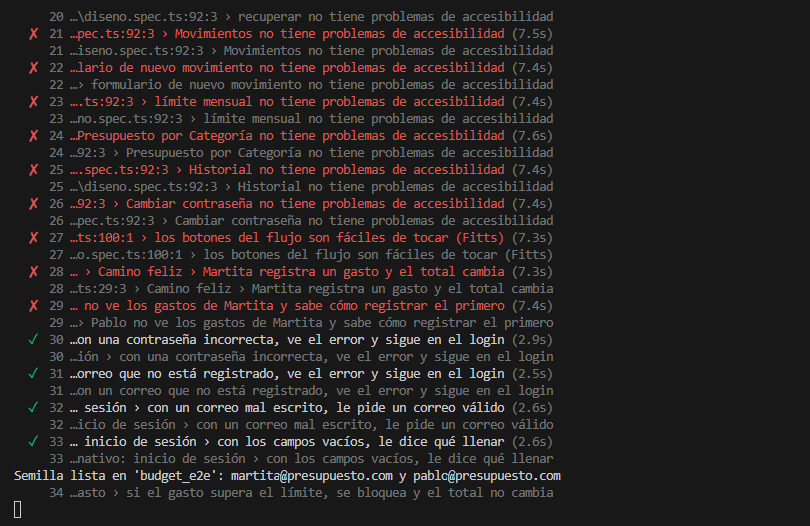

| Prueba | Encontró | Arreglo en la app |
|---|---|---|
| axe | Texto blanco sobre el botón naranja: contraste 2.07 (mínimo 4.5) | Texto oscuro en los botones naranjas |
| axe | Estados "pendiente", "pagado" y "cancelado" con poco contraste | Tonos más oscuros |
| axe | Presupuesto por Categoría: título blanco sobre naranja y textos verde, amarillo y gris claros | Título oscuro y tonos oscuros para el texto |
| axe | Etiqueta "Nuevo límite" gris claro | Gris más oscuro |
| `getByRole('dialog')` | El formulario de movimiento no tenía nombre | `aria-label`: "Nuevo gasto o ingreso" |
| `boundingBox()` · Fitts | Botón "Abrir menú" de 40 px | 44 px |
| Éxito (H1) | Al guardar un gasto, eliminarlo o cambiar el límite no aparecía ningún mensaje | "Gasto registrado: 25.5 Bs", "Movimiento eliminado", "Límite actualizado a 800.0 Bs" |
| Vacío | Una cuenta nueva veía "No hay movimientos que coincidan con la búsqueda" | "Aún no tienes movimientos. Registra el primero con 'Nuevo Movimiento'." |
| `toHaveScreenshot()` | Después de los arreglos, la captura del login cambió | Era intencional (el color del botón): se aceptó con `--update-snapshots` |

---

## 6. Herramientas

Se usaron Playwright 1.64 y `@axe-core/playwright`. Todo se instaló con pnpm, sin npm.
