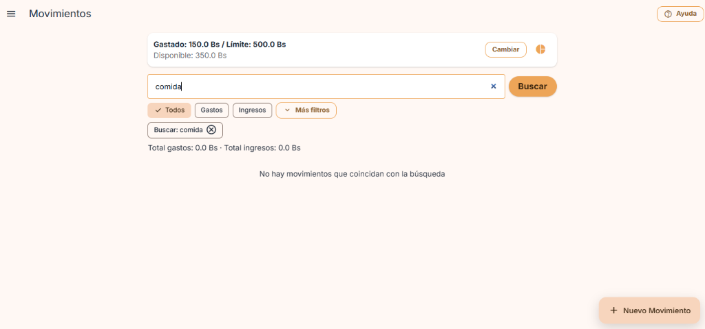
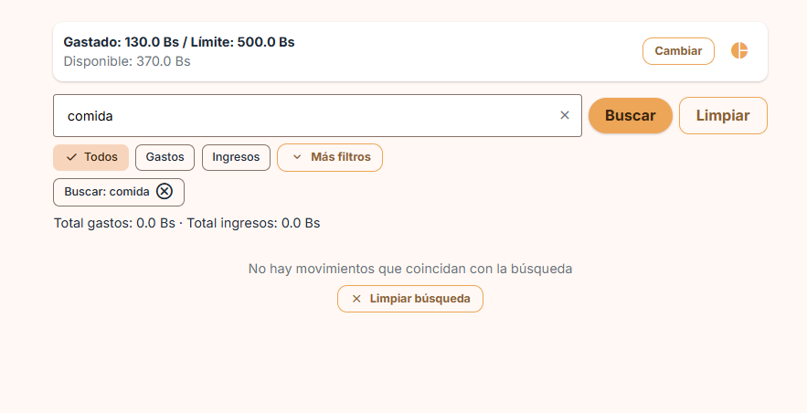
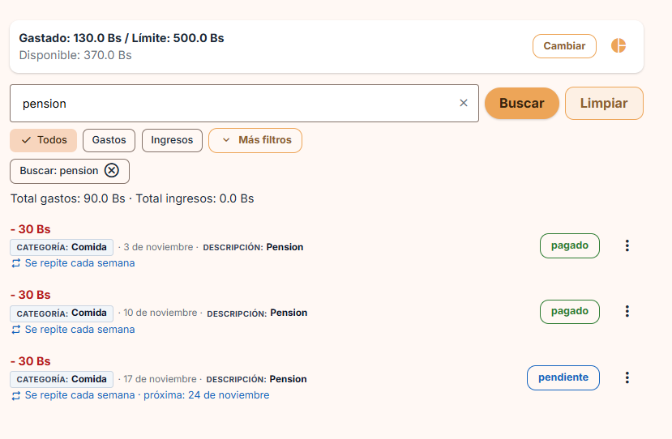
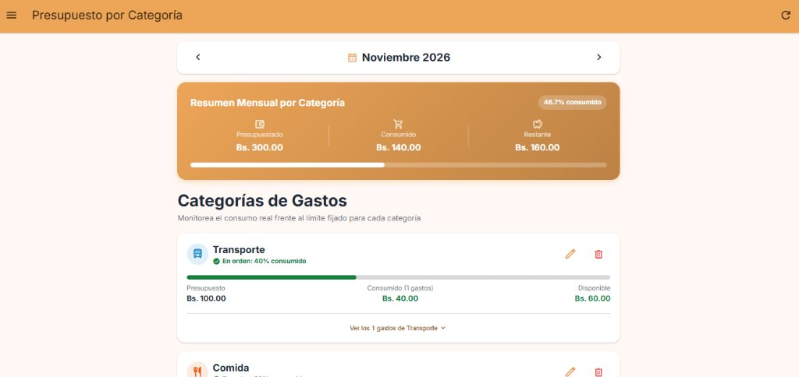
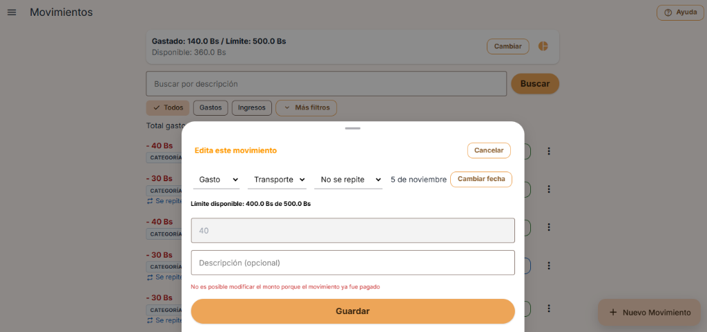
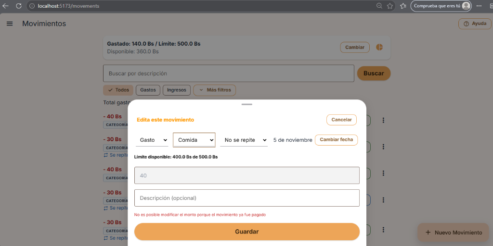
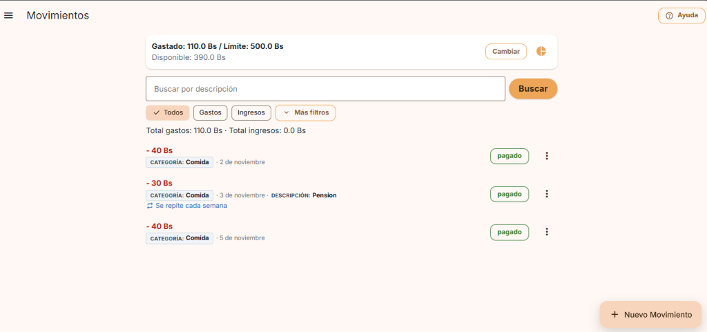
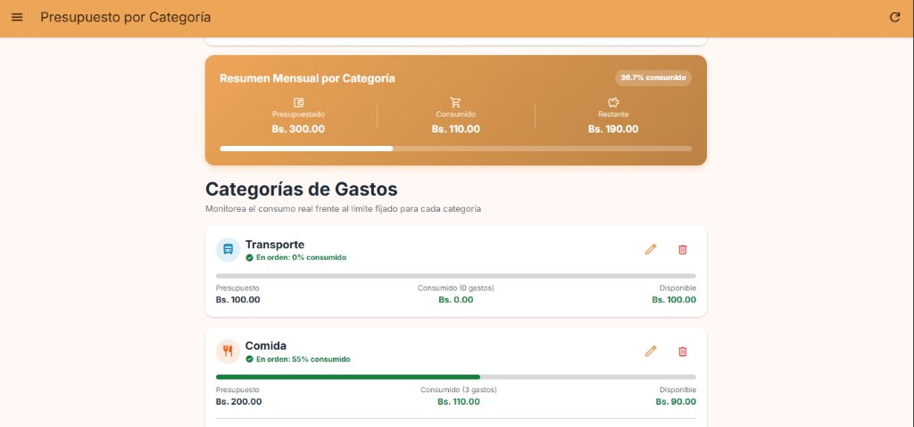
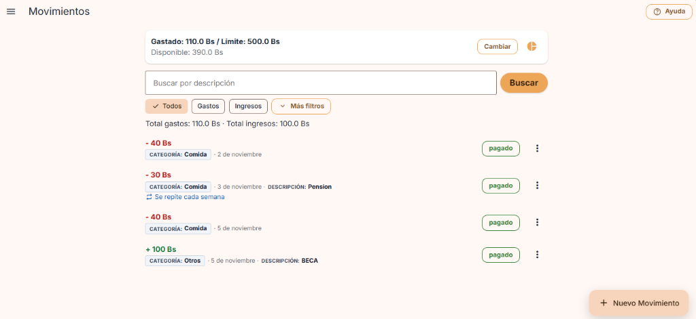

# Tarea 7 · Mejora por Feedback y Nueva Funcionalidad

- **Materia:** Interacción Humano-Computador (IHC)
- **Proyecto:** Presupuesto Estudiantil (FastAPI + Vue 3 + PostgreSQL)
- **Estudiante:** Carmen Jenifer Aranibar Fernandez
- **Enlace al feedback recibido:** [feedback2.md (Moisés David Cisneros Laura)](https://github.com/moises-cisneros/Proyecto2IHC/blob/main/clase-19-feedback-a-otro-proyecto/cisneros-laura/feedback2.md)

---

## Resumen de Entregas (Dos cambios, dos commits)

| N° | Tipo | Descripción | Mensaje de Commit Recomendado |
|---|---|---|---|
| **1** | **Mejora por feedback** | Botón para limpiar búsqueda en barra y estado vacío, y distinción clara entre Categoría y Descripción | `fix: boton para limpiar busqueda y distincion clara entre categoria y descripcion` |
| **2** | **Funcionalidad de su caso** | Control de presupuestos por categoría y mes, recálculo dinámico de consumos y neutralidad de ingresos | `feat: control de presupuestos por categoria y mes con evidencias antes y despues` |

---

## 1. Mejora por Feedback (Parte 1)

### Contexto del Feedback Recibido
El compañero **Moisés David Cisneros Laura** evaluó el proyecto y detectó fricción ergonómica y falta de claridad en el flujo de búsqueda, filtrado y lectura de movimientos:

1. **Ausencia de acción de restauración/limpieza de búsqueda (Nielsen H9 y Ley de Fitts):**  
   *"Al escribir en el buscador un término sin coincidencias (o al realizar una búsqueda como 'pension'), no existe un botón prominente en la barra ni en el cuerpo para limpiar la búsqueda. Obliga al usuario a borrar manualmente o desplazarse hacia un icono de cruz pequeño ubicado dentro de un chip superior."*
2. **Ambigüedad en la información del movimiento (Nielsen H1 y H2):**  
   En la lista de movimientos, el subtítulo mostraba la categoría, fecha y descripción en texto plano continuo (`Comida · 3 de noviembre · Pension`), impidiendo al usuario discernir claramente cuál dato corresponde a la categoría y cuál a la descripción.

---

### Proceso de Resolución en 5 Pasos (Clase 19)

#### 1 · Reproducir
1. Iniciar sesión como `martita@presupuesto.com`.
2. Dirigirse a la pantalla principal **Movimientos**.
3. En el campo *"Buscar por descripción"*, ingresar `pension` (con resultados) o `comida` (sin resultados).
4. **Dificultades observadas:**
   - La barra de búsqueda sólo contenía el botón "Buscar", sin opción de vaciar la búsqueda directamente desde la barra.
   - En el listado de resultados, cada fila mostraba: `- 30 Bs` seguido de `Comida · 3 de noviembre · Pension`, donde no había ninguna pista visual o etiqueta para saber si "Comida" o "Pension" era la categoría o la descripción.

#### 2 · Definir la mejora
1. **Acción de limpieza en la barra de búsqueda:**
   - Agregar un botón **"Limpiar"** directamente al lado de "Buscar" en el formulario de búsqueda (visible cuando hay texto).
   - Agregar un botón iconográfico `✕` dentro del propio campo de búsqueda para borrar con un clic.
   - Mantener el botón destacado **"Limpiar búsqueda"** en el estado vacío de la lista cuando la búsqueda no devuelva resultados.
2. **Diferenciación visual entre Categoría y Descripción:**
   - Categoría encapsulada en un badge estructurado y accesible: `[CATEGORÍA: Comida]`.
   - Fecha claramente separada: `· 3 de noviembre`.
   - Descripción rotulada de forma explícita: `· DESCRIPCIÓN: Pension`.
   - Paleta de colores con contraste óptimo (WCAG AAA) para cumplir con las pruebas de accesibilidad (axe).

#### 3 · Localizar el código
- **Componente visual:** `frontend/src/screens/MovementsScreen.vue`
  - Función `limpiarSoloBusqueda()` y función `limpiarBusqueda()`.
  - Formulario de búsqueda con botón `✕` y botón "Limpiar".
  - Subtítulo del listado con `<span class="badge-cat">` y `<span class="badge-desc">`.
  - Estilos de contraste y espaciado en `.input-busqueda-wrapper`, `.badge-cat` y `.badge-desc`.
- **Pruebas automatizadas E2E:**
  - `frontend/e2e/movimientos.spec.ts` (pruebas de búsqueda y botones de limpieza).
  - `frontend/e2e/gastos_recurrentes.spec.ts` (localizador de filas).
  - `frontend/e2e/diseno.spec.ts` (regresión visual, accesibilidad axe y Ley de Fitts).

#### 4 · Implementar

##### A. Lógica y template en `frontend/src/screens/MovementsScreen.vue`
```javascript
function limpiarSoloBusqueda() {
  busqueda.value = ''
  load()
}

function limpiarBusqueda() {
  busqueda.value = ''
  filtroTipo.value = 'todos'
  filtroCategoria.value = 'todos'
  filtroPeriodo.value = 'todos'
  filtroEstado.value = 'todos'
  rangoDesde.value = null
  rangoHasta.value = null
  load()
}
```

```html
<!-- Formulario con botón de limpiar integrado -->
<form class="row form-busqueda" role="search" @submit.prevent="load">
  <div class="input-busqueda-wrapper">
    <input
      v-model="busqueda"
      class="input input-busqueda"
      type="search"
      placeholder="Buscar por descripción"
      aria-label="Buscar por descripción"
      enterkeyhint="search"
    />
    <button
      v-if="busqueda.trim() !== ''"
      type="button"
      class="btn-limpiar-input"
      title="Borrar texto de búsqueda"
      aria-label="Borrar texto"
      @click="limpiarSoloBusqueda"
    >
      <AppIcon name="close" :size="18" />
    </button>
  </div>
  <button type="submit" class="btn btn-elevated">Buscar</button>
  <button
    v-if="busqueda.trim() !== ''"
    type="button"
    class="btn btn-outlined"
    title="Limpiar búsqueda"
    @click="limpiarSoloBusqueda"
  >
    Limpiar
  </button>
</form>

<!-- Subtítulo con distinción nítida de metadatos -->
<div class="list-tile-subtitle meta-movimiento">
  <span class="badge-cat"><span class="meta-label">Categoría:</span> {{ m.categoria }}</span> · {{ fechaTexto(m.fecha) }}<template v-if="m.descripcion"> · <span class="badge-desc"><span class="meta-label">Descripción:</span> {{ m.descripcion }}</span></template>
</div>
```

#### 5 · Comprobar
* **Pruebas unitarias (`vitest run`):** 50/50 pasadas.
* **Pruebas E2E (`playwright test`):** 59/59 pasadas.

### Evidencias Visuales de la Parte 1 (Antes y Después)

#### Antes
| Estado previo | Captura |
|---|---|
| **Búsqueda sin coincidencias:** Solo mensaje de texto pasivo, sin botón de limpieza en la barra ni botón de restauración en el área central. |  |

#### Después
| Mejora implementada | Captura |
|---|---|
| **1. Restauración en estado vacío y botón en barra:** Botón con `✕` dentro del input, botón "Limpiar" al lado de "Buscar", y botón centrado "Limpiar búsqueda" en el cuerpo principal. |  |
| **2. Distinción explícita de Categoría y Descripción:** Categoría con badge estructurado `[CATEGORÍA: Comida]`, fecha separada y descripción rotulada `· DESCRIPCIÓN: Pension`. |  |

---

## 2. Funcionalidad de su caso (Parte 2)

### Requisito Asignado (Slide 13)
- **Producto:** Presupuesto Estudiantil
- **Funcionalidad obligatoria:** Controlar presupuestos por categoría y mes.
- **Reglas:**
  1. Crear y editar un límite por categoría y mes, sin duplicados.
  2. Mostrar gasto acumulado, saldo y estados: dentro del límite (< 80%), desde 80% (alerta) y excedido (> 100%).
  3. Registrar, editar o eliminar un gasto recalcula ambos periodos/categorías afectados; los ingresos no consumen presupuesto.
- **Escenario mínimo a demostrar:**
  - **Mover un gasto a otra categoría o mes actualiza ambos presupuestos.**
  - **Un ingreso no altera el consumo.**

---

### Evidencias Visuales del Escenario Mínimo (Antes y Después)

#### Escenario A: Mover un gasto a otra categoría actualiza ambos presupuestos

##### ANTES
Antes del cambio, el gasto de `40 Bs` ("Pasaje de micro") pertenecía a **Transporte**:
- **Transporte:** Consumido: `Bs. 40.00` de un límite de `Bs. 100.00` (40% consumido, En orden).
- **Comida:** Consumido: `Bs. 70.00` de un límite de `Bs. 200.00` (35% consumido, En orden).

| Estado Antes | Captura |
|---|---|
| **Presupuesto inicial de las categorías:** Transporte tiene 40 Bs consumidos y Comida tiene 70 Bs consumidos. |  |
| **Gasto asignado a Transporte:** Formulario de edición mostrando el gasto de 40 Bs con categoría "Transporte". |  |

##### DESPUÉS
Se edita el gasto de `40 Bs` y se cambia su categoría de **Transporte** a **Comida**:
1. En la lista de Movimientos, el gasto ahora se refleja como `[CATEGORÍA: Comida]`.
2. En la pantalla de **Presupuesto por Categoría**:
   - **Transporte** baja automáticamente su consumo a **`Bs. 0.00` (0% consumido, 0 gastos)**.
   - **Comida** sube automáticamente su consumo a **`Bs. 110.00` (55% consumido, 3 gastos)**.
   - **¡Ambos presupuestos fueron recalculados y actualizados dinámicamente!**

| Estado Después | Captura |
|---|---|
| **Acción de mover:** Se cambia el selector de categoría a "Comida" y se guarda. |  |
| **Movimientos actualizado:** El gasto de 40 Bs ahora figura en categoría Comida. |  |
| **Ambos presupuestos recalculados:** Transporte bajó a 0 Bs y Comida subió a 110 Bs. |  |

---

#### Escenario B: Un ingreso no altera el consumo por categoría

##### Demostración:
1. Se registra un nuevo **Ingreso** por **`+ 100 Bs`** con descripción `BECA` y categoría `Otros`.
2. En la pantalla principal de Movimientos, el total de ingresos sube a `100.0 Bs`.
3. Al consultar **Presupuesto por Categoría**, el consumo mensual total se mantiene idéntico en **`Bs. 110.00`** y ninguna categoría de gasto incrementó su consumo, demostrando que los ingresos no consumen presupuesto asignado.

| Demostración de Neutralidad de Ingresos | Captura |
|---|---|
| **Ingreso registrado en Movimientos:** Ingreso de +100 Bs (Beca) guardado exitosamente. |  |
| **Consumo intacto en Presupuestos:** El gasto consumido en Presupuestos por Categoría permanece exactamente en Bs. 110.00. |  |

---

### Verificación Automatizada (Playwright E2E)
El archivo `frontend/e2e/presupuesto_categoria.spec.ts` valida automáticamente estas reglas:
- `el gasto de Transporte cuenta en su presupuesto`: verifica que los gastos sumen a la barra de la categoría.
- `Martita define un presupuesto para Comida y ve su estado`: valida asignación de límites sin duplicados y cálculo de porcentajes.
- Los 59 tests de la suite E2E pasan en su totalidad (`59 passed`).
