# Evidencia · Tarea 8: Incremento del Producto — Metas con Fondos Disponibles

- **Materia:** Interacción Humano-Computador (IHC)
- **Proyecto:** Presupuesto Estudiantil (FastAPI + Vue 3 + PostgreSQL)
- **Tema Asignado:** *Presupuesto · Metas con fondos disponibles*
- **Fecha de Entrega:** Martes 10/11/2026, 18:00
- **Estudiante / Integrante:** Carmen Jenifer Aranibar Fernandez

---

## 1. Identificación y Requerimientos de la Tarea 8 

### Funcionalidad Asignada 
1. **Metas de ahorro:** Creación de metas con nombre, monto objetivo y fecha límite.
2. **Gestión de fondos:** Asignación de dinero desde el saldo disponible, retiro de fondos de vuelta al saldo disponible y transferencias directas entre metas.
3. **Cálculo de Fondos:**
   $$\text{Disponible} = \text{Ingresos pagados} - \text{Gastos pagados} - \text{Fondos reservados en metas}$$
4. **Conservación de Movimientos:** Las asignaciones a metas **no generan ingresos ni gastos ficticios** en la tabla de movimientos contables.
5. **Prevención de Errores (Nielsen H5):** Rechazo inmediato ante operaciones sin fondos suficientes (asignar más del disponible o retirar/transferir más de lo ahorrado), conservando el saldo total intacto en todo momento.
6. **Demostración obligatoria:** Dos metas creadas, una transferencia, un retiro y un intento bloqueado por falta de fondos.

---

## 2. Decisiones de Interacción y Arquitectura de Información

| Decisión | Justificación IHC / Usabilidad |
|---|---|
| **Integración en el App Map y Navegación** | Se incorporó el acceso directo a *«Metas de Ahorro»* tanto en el menú lateral (**Drawer**) como en la barra superior de pestañas persistentes (`role="tablist"`), manteniendo la coherencia de la Arquitectura de Información (Clase 20). |
| **Resumen Financiero Tripartito (H1: Visibilidad del Estado)** | La cabecera presenta tres indicadores prominentes: **Saldo Total** (Ingresos - Gastos), **Fondos en Metas** (dinero protegido) y **Saldo Disponible Real** (libre para asignar o gastar), permitiendo al estudiante comprender su salud financiera de un vistazo. |
| **Prevención de Errores en Vivo (H5)** | Los modales de asignación, transferencia y retiro evalúan el monto ingresado en tiempo real. Si el usuario intenta asignar más de su saldo disponible o transferir más de lo que tiene la meta, el botón de confirmación se deshabilita y se muestra un mensaje explicativo antes de enviar la petición. |
| **Retorno Automático de Fondos al Eliminar** | Si el estudiante decide eliminar una meta con fondos ahorrados, el sistema le notifica explícitamente que dicho dinero se libera y regresa de inmediato al saldo disponible, evitando la pérdida de fondos. |
| **El dinero reservado está protegido de verdad** | Una vez apartado en una meta, el dinero ya no se puede gastar por otro camino: si pagar un gasto, cancelar o eliminar un ingreso pagado o editar un movimiento dejaría el saldo disponible en negativo, el backend lo rechaza (409) explicando cuánto hay reservado y sugiriendo retirar fondos de una meta. Si el usuario no tiene metas, las reglas de las tareas 6 y 7 siguen intactas. |
| **Historial comprensible (H2: Lenguaje del usuario)** | Las operaciones de metas se registran en el Historial con etiquetas e íconos propios (*Meta de ahorro creada*, *Fondos asignados a meta*, *Fondos retirados de meta*, *Fondos transferidos entre metas*, *Meta de ahorro eliminada*) en lugar de códigos internos. |

---

## 3. Cadena de Valor Implementada ( `Interfaz -> Reglas -> Datos -> E2E`)

```
┌─────────────────────────┐
│     INTERFAZ (Vue 3)    │  MetasScreen.vue, AppDrawer.vue, pestañas y modales AppDialog
└────────────┬────────────┘
             │ HTTP REST
┌────────────▼────────────┐
│   REGLAS (FastAPI / Py) │  metas.py: validación de saldo disponible, transferencias y retiros
└────────────┬────────────┘
             │ SQLAlchemy ORM
┌────────────▼────────────┐
│   DATOS (PostgreSQL)    │  metas_ahorro: restricciones CHECK (monto_objetivo > 0, monto_ahorrado >= 0)
└────────────┬────────────┘
             │ Playwright
┌────────────▼────────────┐
│      PRUEBAS E2E        │  metas.spec.ts: recorrido completo, restricciones y suite anterior (63 tests)
└─────────────────────────┘
```

---

## 4. Archivos Afectados y Modificados

### Backend (FastAPI + PostgreSQL):
- `database/init/001_esquema.sql`: Tabla `metas_ahorro` con llaves foráneas en cascada y restricciones `CHECK`.
- `backend/app/models.py`: Modelo SQLAlchemy `MetaAhorro`.
- `backend/app/schemas.py`: Esquemas Pydantic `MetaWrite`, `MetaUpdate`, `MetaRead`, `MontoOperacion`, `TransferenciaMetas`, `ResumenFondos`.
- `backend/app/logica/metas.py`: Funciones puras de cálculo de saldo disponible, validaciones de fondos, protección de fondos reservados (`validar_reservas_intactas`) y cálculo de porcentajes.
- `backend/app/routers/metas.py`: Endpoints REST (`GET /api/metas`, `GET /api/metas/resumen-fondos`, `POST /api/metas`, `PUT /api/metas/{id}`, `DELETE /api/metas/{id}`, `POST /api/metas/{id}/asignar`, `POST /api/metas/{id}/retirar`, `POST /api/metas/{id}/transferir`).
- `backend/app/main.py`: Registro del router de metas.
- `backend/app/routers/movimientos.py`: Al cambiar de estado, editar o eliminar un movimiento se valida que no se gaste dinero reservado en metas.
- `backend/tests/conftest.py`: Desactiva el envío de correos (SMTP) durante las pruebas.
- `backend/tests/test_metas.py`: 6 pruebas automatizadas de lógica pura, flujo completo API y protección de fondos reservados.

### Frontend (Vue 3 + Vite):
- `frontend/src/services/metasService.js`: Cliente de comunicación con la API de metas.
- `frontend/src/utils/metas.js`: Funciones auxiliares para validación de formularios en vivo, porcentaje de avance y cálculo de días restantes.
- `frontend/src/screens/MetasScreen.vue`: Pantalla principal con tarjetas de balance, barras de progreso, badges y diálogos modales.
- `frontend/src/widgets/AppDrawer.vue`: Opción «Metas de Ahorro» con ícono temático.
- `frontend/src/screens/MovementsScreen.vue`: Pestaña «Metas» integrada en la cabecera.
- `frontend/src/router/appRouter.js`: Registro de la ruta privada `/metas`.
- `frontend/src/screens/HistoryScreen.vue`: Etiquetas e íconos para los eventos de metas en el Historial.
- `frontend/tests/unit/metas.test.js`: Pruebas unitarias en Vitest (2 pruebas).

### Pruebas E2E (Playwright):
- `frontend/e2e/metas.spec.ts`: Recorrido completo, restricción de fondos insuficientes en metas y restricción de no gastar dinero reservado al pagar un gasto.

---

## 5. Comparativa Visual: Antes y Después

### Capturas del ANTES (Sin Metas ni Fondos Reservados)

| Menú lateral sin acceso a metas | Panel de movimientos sin saldo disponible para metas |
|:---:|:---:|
| 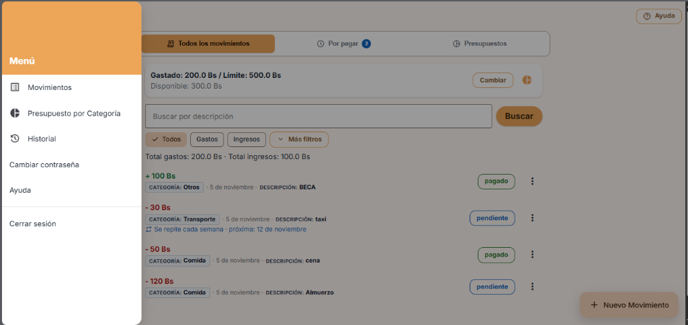 | 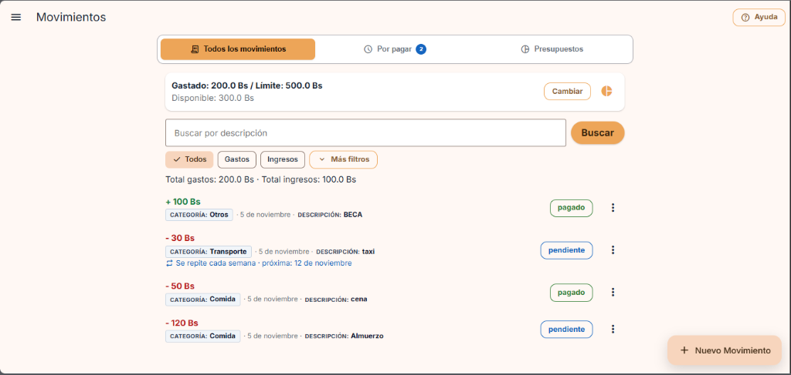 |

* **Diagnóstico del Antes:** El menú no contempla el concepto de ahorro estructurado. Todo el saldo entre ingresos y gastos queda libre en bruto, exponiendo al estudiante a gastar dinero que deseaba ahorrar y obligándolo a llevar cuentas mentales.

---

### Capturas del DESPUÉS (Metas con Fondos Disponibles)

Recorrido real hecho a mano en la aplicación, en orden: dos metas, una asignación, un retiro, una transferencia y un intento sin fondos. El mismo escenario lo reproduce automáticamente la prueba E2E `metas.spec.ts` con los datos de la semilla.

| 1. Menú lateral y pestañas con acceso a «Metas de Ahorro» | 2. Crear la primera meta (nombre, monto objetivo y fecha) |
|:---:|:---:|
| 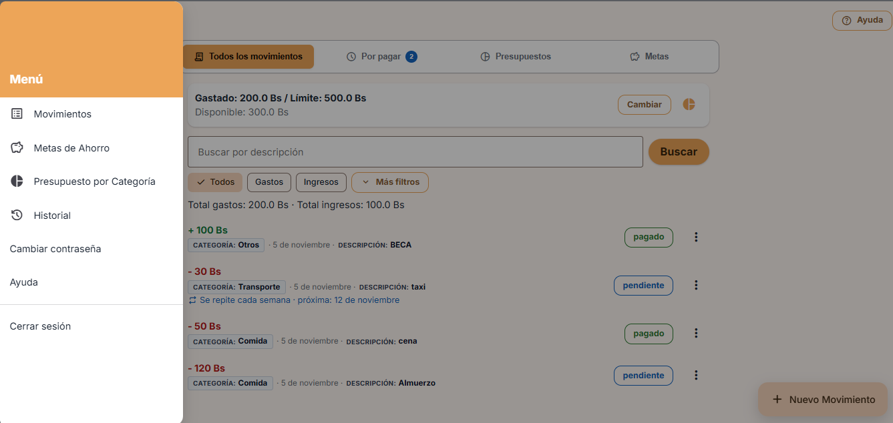 | 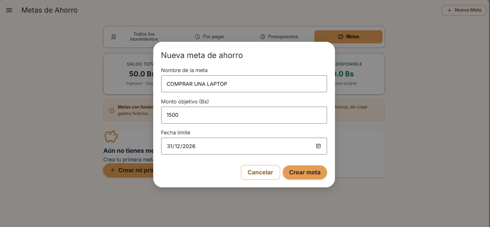 |

| 3. Meta creada: saldo total 50 Bs, todo disponible | 4. Asignar 40 Bs del saldo disponible |
|:---:|:---:|
| 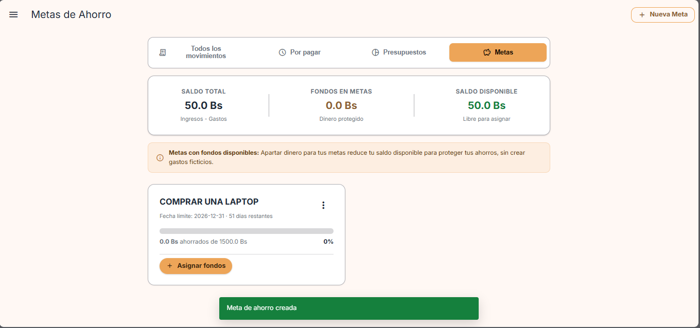 | 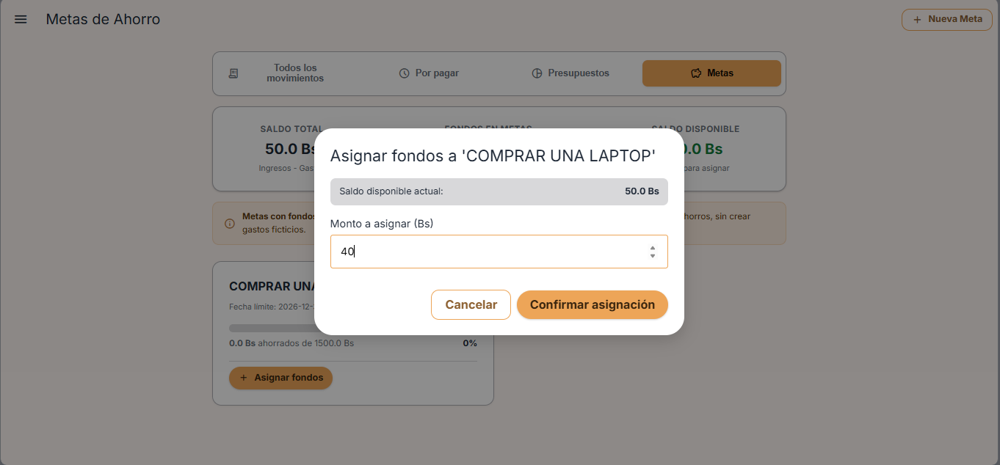 |

| 5. Resultado: 40 Bs en metas, 10 Bs disponibles, el total sigue en 50 Bs | 6. Retirar 10 Bs de la meta hacia el disponible |
|:---:|:---:|
| 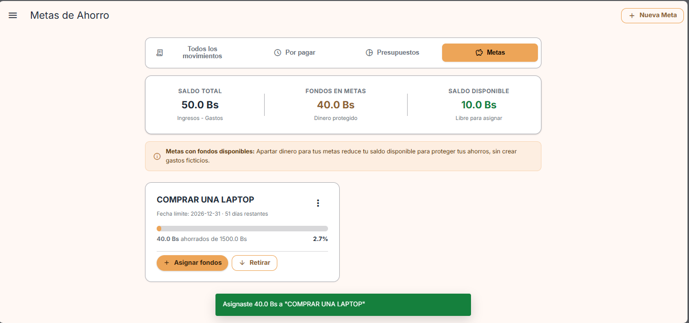 | 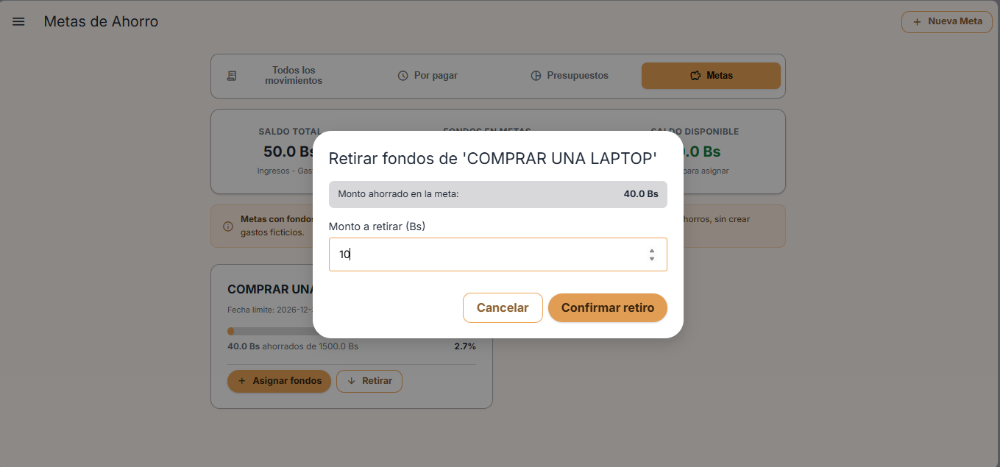 |

| 7. Segunda meta «Pago de matrícula» con 10 Bs asignados | 8. Transferir 10 Bs entre metas |
|:---:|:---:|
| 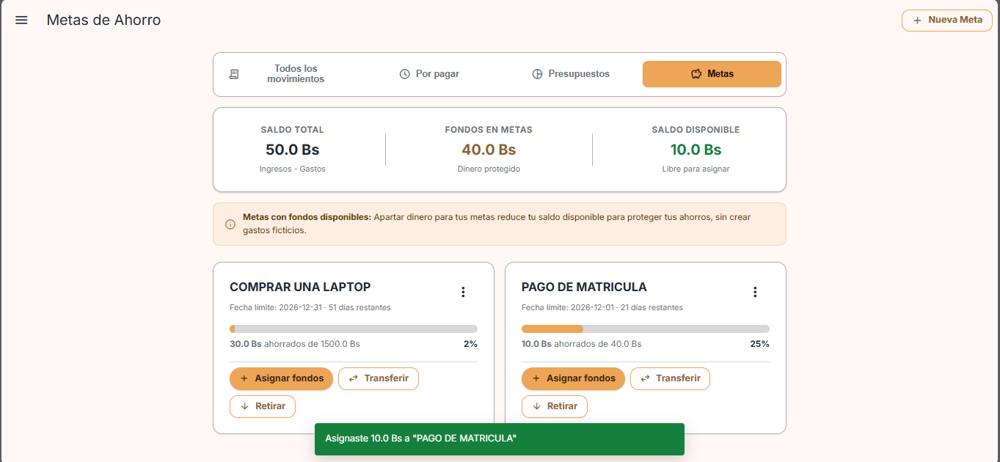 | 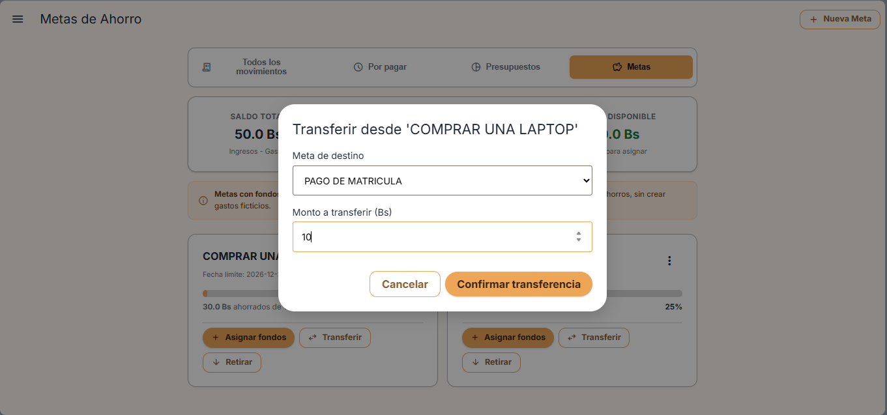 |

| 9. Resultado: 20 Bs y 20 Bs, el total y el disponible no cambian | 10. **Intento sin fondos:** disponible 0 Bs, se bloquea la asignación |
|:---:|:---:|
| 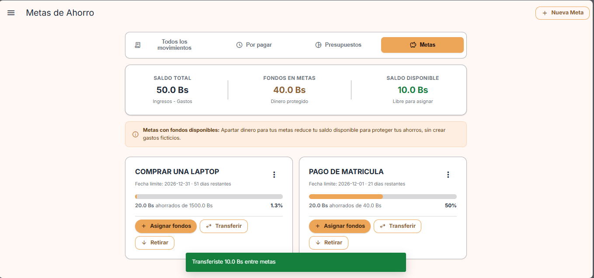 | 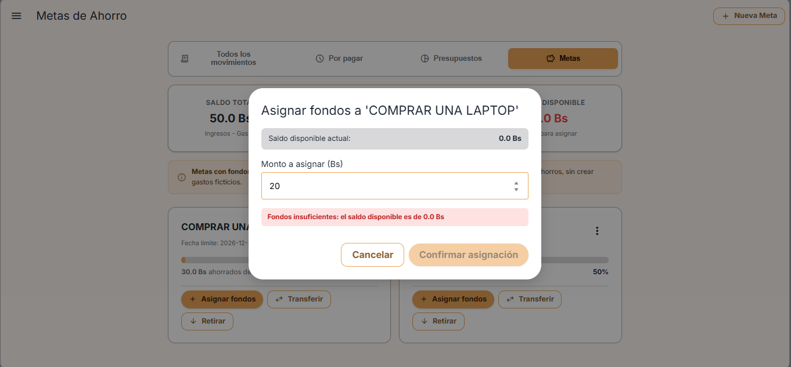 |

| 11. Se registra un ingreso real de 100 Bs («BECA», pagado) | 12. Estado final: total 150 Bs (50 + 100), 50 Bs protegidos en metas y 100 Bs disponibles; una meta completada |
|:---:|:---:|
| 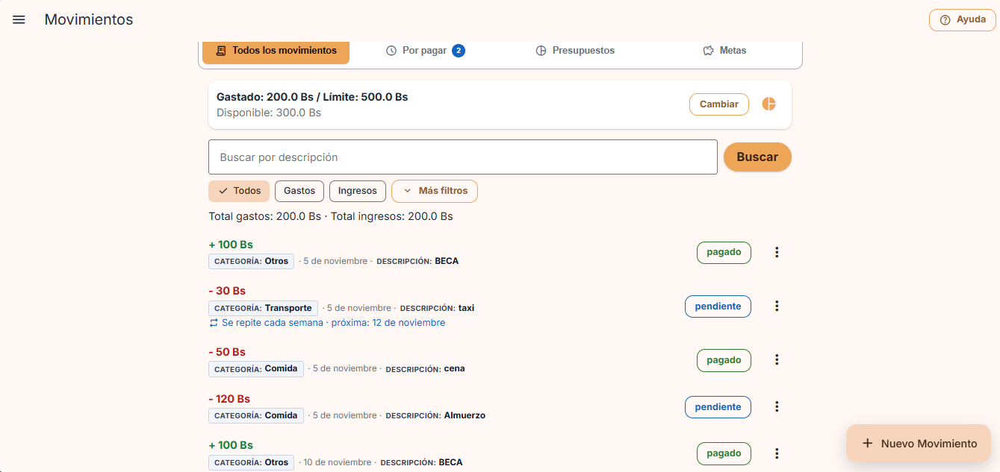 | 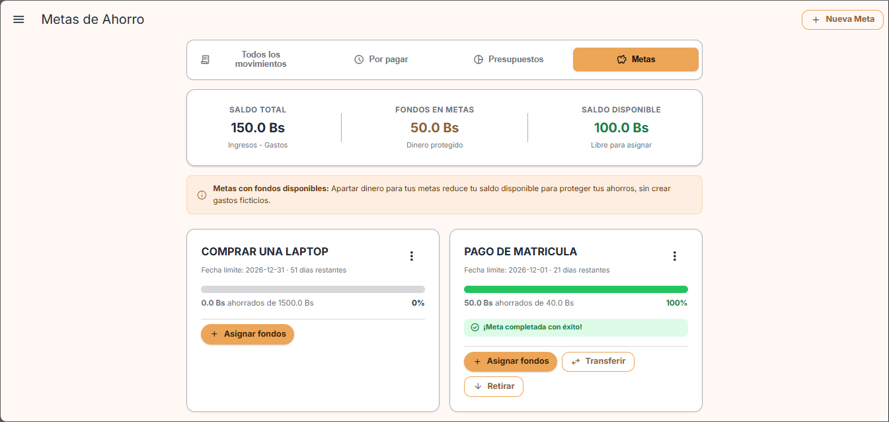 |

> El saldo total solo cambia con movimientos reales (como el ingreso de la captura 11). Asignar, retirar y transferir entre metas nunca lo modifican (capturas 5 y 9).

---

## 6. Ejecución de Pruebas Automatizadas 

### Comandos de ejecución:

```powershell
# 1. Pruebas Unitarias del Backend (pytest)
cd backend
.venv\Scripts\pytest -v

# 2. Pruebas Unitarias del Frontend (vitest)
cd frontend
npm run test

# 3. Pruebas E2E Automatizadas (Playwright)
cd frontend
$env:E2E_CHANNEL="msedge"; npm run test:e2e
```

### Resultados de las Suites:

* **Backend (pytest):** **36 passed** (100% aprobado, incluyendo `test_metas.py`).
* **Frontend (vitest):** **52 passed** (100% aprobado en 7 archivos, incluyendo `metas.test.js`).
* **Playwright E2E:** **63 passed, suite completa sin regresiones** (incluyendo `metas.spec.ts` y todas las pruebas previas de acceso, cuentas, movimientos, límites, categorías y gastos recurrentes).
* **Fallos pendientes:** ninguno.

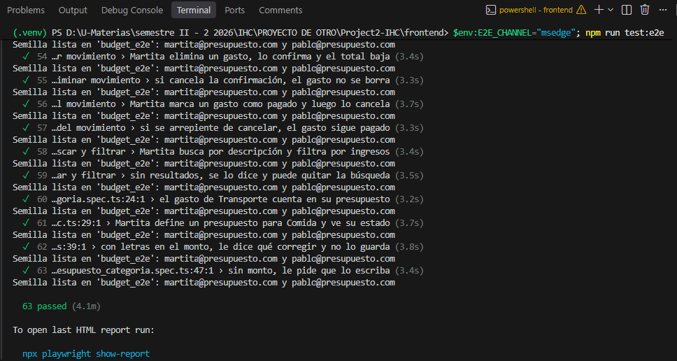

---

## 7. Enlace al Commit

- **Enlace al commit:**  
  `feat: metas de ahorro con fondos disponibles, transferencias y pruebas E2E (tarea 8)`

