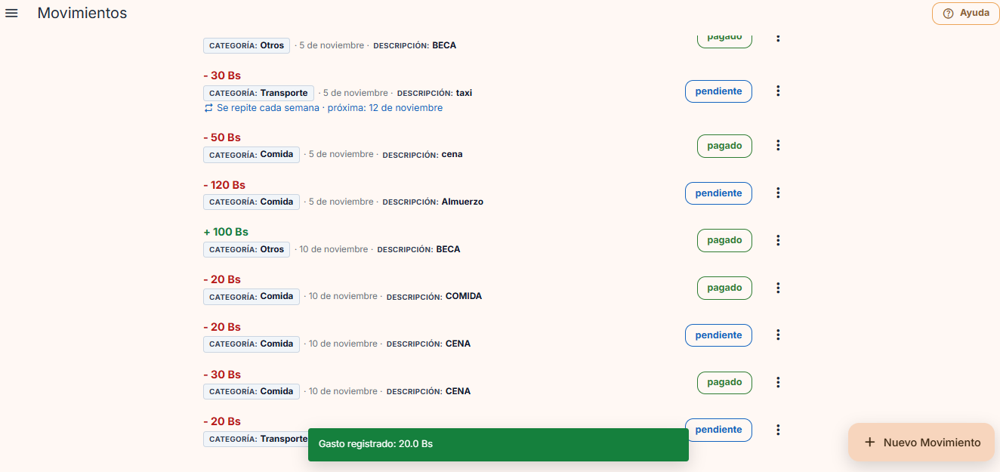
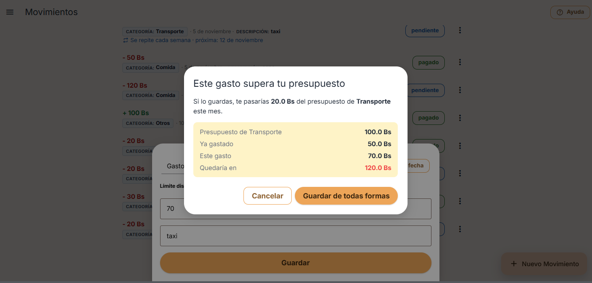
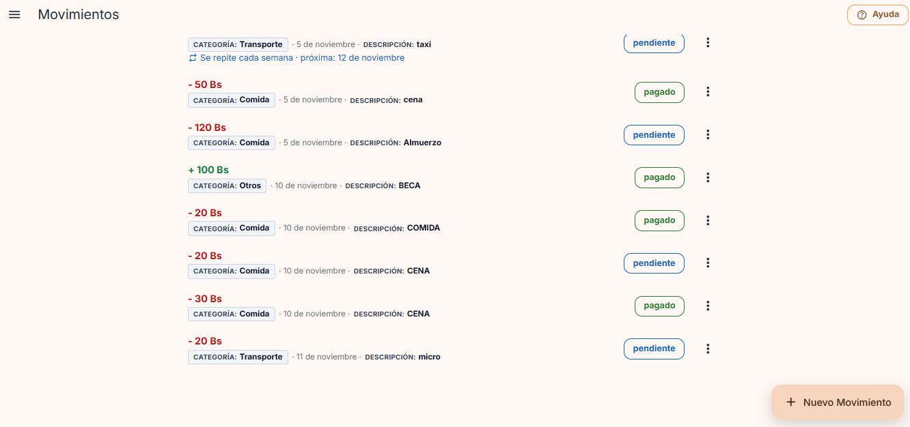
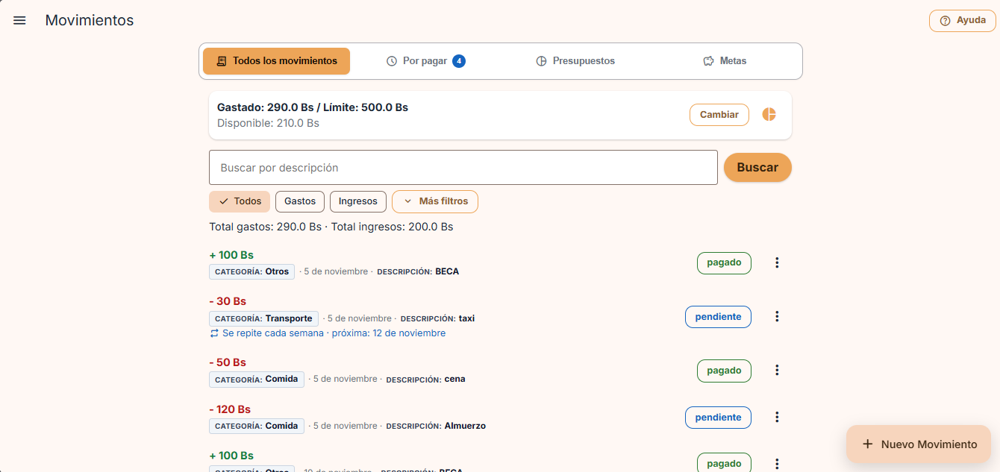
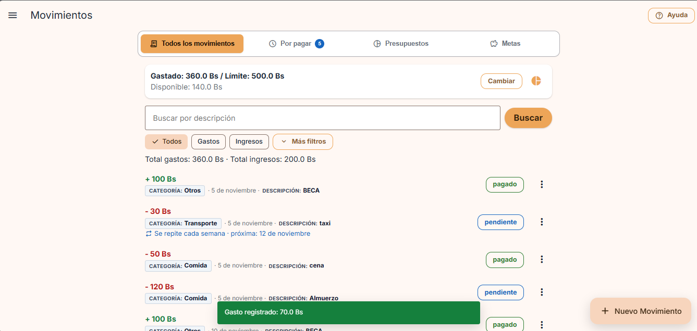
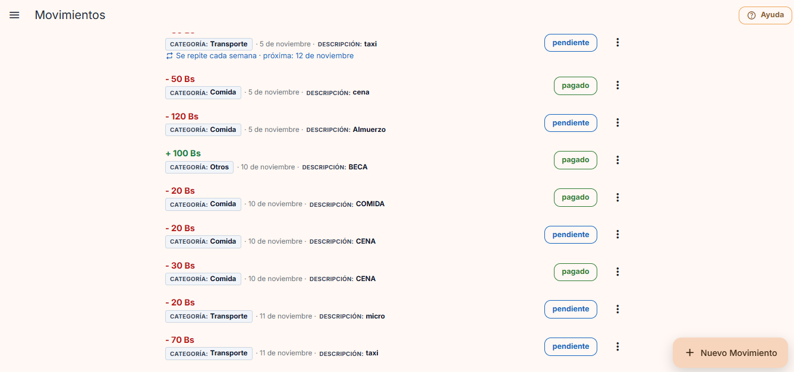
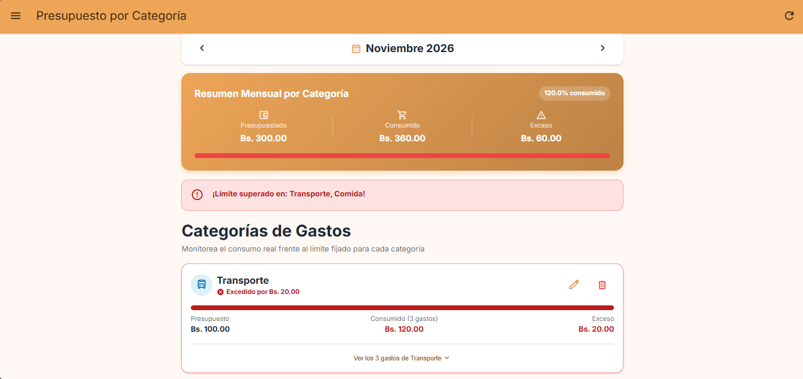
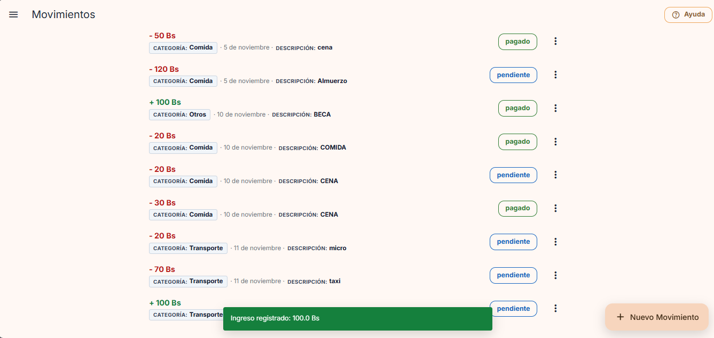
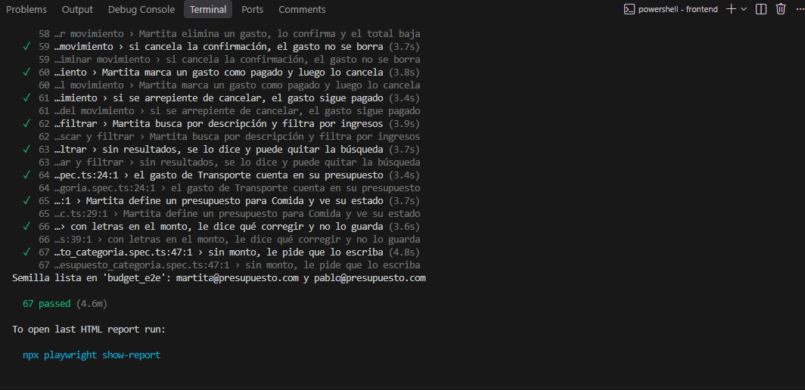

# Evidencia · Tarea 9: Analítica en todo el producto + Aviso antes de superar el límite

- **Materia:** Interacción Humano-Computador (IHC)
- **Proyecto:** Presupuesto Estudiantil (FastAPI + Vue 3 + PostgreSQL)
- **Fecha de entrega:** Jueves 12/11/2026, 18:00
- **Integrantes:**
  - Carmen Jenifer Aranibar Fernandez

| Parte | Contenido | Commit |
|---|---|---|
| **A · Analítica en todo el producto** | Plan de eventos, embudos por flujo, errores y búsquedas sin resultados | *(pendiente)* |
| **B · Funcionalidad** | Aviso antes de superar el límite de la categoría | *(pendiente)* |

---

# Parte B · Aviso antes de superar el límite

## B.1 Funcionalidad asignada (Presupuesto Estudiantil)

> Si un gasto **nuevo o editado** haría pasar el límite de **su categoría y mes**, la app muestra **cuánto se pasaría** y pide **confirmación**. **Confirmar** guarda; **cancelar** no cambia nada. Los **ingresos** no generan aviso.

**Demostración pedida:** un gasto sin aviso, uno con aviso cancelado (todo igual) y otro confirmado (queda excedido).

## B.2 Reglas implementadas

| Regla | Cómo se cumple |
|---|---|
| Solo gastos | Si el movimiento es un **ingreso**, no se calcula ningún aviso. |
| Categoría **y** mes | Se suma lo gastado (no cancelado) en esa categoría durante el mes de la fecha del gasto, y se compara con el presupuesto de esa categoría y ese mes. Sin presupuesto, no hay aviso. |
| Nuevo **o editado** | Al editar, se descuenta el monto anterior del propio gasto. Solo se avisa si la edición **aumenta** el gasto de la categoría (cambiar solo la descripción no avisa). |
| Mostrar cuánto se pasaría | El aviso muestra: presupuesto, ya gastado, este gasto, **en cuánto quedaría** y **cuánto te pasarías**. |
| Confirmar guarda | Se reenvía el mismo gasto con `confirmar_exceso: true` y se guarda; la categoría queda **excedida**. |
| Cancelar no cambia nada | No se guarda nada. El formulario sigue abierto para que pueda ajustar el monto. |
| La regla no se puede saltar | La decisión está en el **backend**: sin `confirmar_exceso`, la API responde `409` con los datos del aviso y **no guarda**. |

## B.3 Decisiones de interacción

| Decisión | Justificación IHC |
|---|---|
| **Prevenir antes que lamentar** (Nielsen H5) | El aviso aparece **antes** de guardar, no cuando el presupuesto ya está roto. |
| **Mostrar el número exacto** (H1: visibilidad del estado) | No solo dice «te pasas»: muestra **cuánto** (por ejemplo, *te pasarías 20.0 Bs*) y el detalle de la cuenta. |
| **Control y libertad del usuario** (H3) | No se bloquea: el estudiante decide. **«Cancelar»** es la salida segura y **«Guardar de todas formas»** confirma de forma explícita. |
| **Cancelar no pierde lo escrito** | Al cancelar, el formulario conserva los datos para bajar el monto o cambiar la categoría. |

## B.4 Flujo

```
«Guardar» → POST/PUT /api/movimientos
   ├─ ¿es ingreso o no pasa el presupuesto? ─────────────► se guarda (201/200)
   └─ ¿pasaría el presupuesto de su categoría y mes?
          └─ 409 { codigo: "supera_presupuesto_categoria", presupuesto, gastado, monto, nuevo_total, exceso }
                 └─ Diálogo «Este gasto supera tu presupuesto»
                        ├─ Cancelar ──────────────► no se guarda nada
                        └─ Guardar de todas formas ─► se reenvía con confirmar_exceso: true → se guarda (queda excedido)
```

## B.5 Archivos afectados

### Backend
- `backend/app/logica/aviso_presupuesto.py`: regla pura `calcular_aviso_presupuesto()` (cuándo avisar y cuánto se pasaría).
- `backend/app/routers/movimientos.py`: `_gasto_categoria_mes()` y `_avisar_si_supera_presupuesto()`, llamadas al crear (`create`) y al editar (`update`).
- `backend/app/schemas.py`: campo `confirmar_exceso` en `MovimientoWrite`.
- `backend/tests/test_aviso_presupuesto.py`: 6 pruebas (regla pura, sin aviso, cancelado, confirmado, ingresos y edición).

### Frontend
- `frontend/src/services/api.js`: el error conserva los datos del aviso (`ApiError.datos`).
- `frontend/src/services/movementsService.js`: envía `confirmar_exceso`.
- `frontend/src/screens/MovementsScreen.vue`: diálogo «Este gasto supera tu presupuesto» con Cancelar y Guardar de todas formas.
- `frontend/e2e/aviso_presupuesto.spec.ts`: E2E de la funcionalidad.

## B.6 Demostración (E2E `aviso_presupuesto.spec.ts`)

Datos de la semilla: Martita tiene un **presupuesto de Transporte de 100 Bs** y ya gastó **40 Bs** (Pasaje de micro).

| # | Acción | Resultado |
|---|---|---|
| 1 | **Gasto sin aviso:** Transporte 30 Bs (40 + 30 = 70 de 100) | Se guarda directo. Total gastos: 70 Bs. |
| 2 | **Aviso cancelado:** Transporte 50 Bs (70 + 50 = 120 de 100) | Aparece el aviso: *te pasarías 20.0 Bs*, quedaría en 120 Bs. Se toca **Cancelar**: **todo igual**; tras recargar sigue en 70 Bs y no existe el gasto «Taxi». |
| 3 | **Aviso confirmado:** el mismo gasto de 50 Bs → **Guardar de todas formas** | Se guarda. Total gastos: 120 Bs. En *Presupuesto por Categoría*, Transporte muestra **«Excedido por Bs. 20.00»** (persiste al recargar). |
| 4 | **Ingreso** de 500 Bs en Transporte | No aparece ningún aviso; se guarda directo. |

## B.7 Capturas (recorrido manual en la app)

Datos de partida en noviembre: **Transporte** tiene un presupuesto de **100 Bs** y ya lleva gastados **30 Bs**. Todos los gastos de Transporte cuentan aunque estén *pendientes*: el presupuesto suma todo gasto no cancelado.

| 1. Gasto **sin aviso**: Transporte 20 Bs «micro» (30 + 20 = 50 de 100) | 2. **Aviso**: Transporte 70 Bs «taxi» → te pasarías 20 Bs (quedaría en 120) |
|:---:|:---:|
|  |  |

| 3a. **Aviso cancelado**: la lista termina en «micro»; no se guardó «taxi» | 3b. **Todo igual**: total de gastos 290 Bs, el mismo de antes del intento |
|:---:|:---:|
|  |  |

| 4a. **Aviso confirmado** («Guardar de todas formas»): «Gasto registrado: 70.0 Bs» y total 360 Bs | 4b. «taxi» de 70 Bs ya aparece en la lista |
|:---:|:---:|
|  |  |

| 5. **Queda excedido**: Transporte «Excedido por Bs. 20.00» (consumido 120 de 100) | 6. **Los ingresos no generan aviso**: «Ingreso registrado: 100.0 Bs» en Transporte |
|:---:|:---:|
|  |  |

| 7. Suite E2E completa: **67 passed** |
|:---:|
|  |

---

# Parte A · Analítica en todo el producto

*(En construcción)*

---

# Pruebas y resultados

```powershell
# Backend
cd backend
.venv\Scripts\python -m pytest -v

# Frontend unitarias
cd ..\frontend
npm run test

# E2E (con PostgreSQL encendido)
$env:E2E_CHANNEL="msedge"; npm run test:e2e
```

| Suite | Resultado (Parte B) |
|---|---|
| Backend (pytest) | 47 passed |
| Frontend (vitest) | 57 passed |
| E2E (Playwright) | 67 passed, sin regresiones |
| Fallos pendientes | Ninguno |
