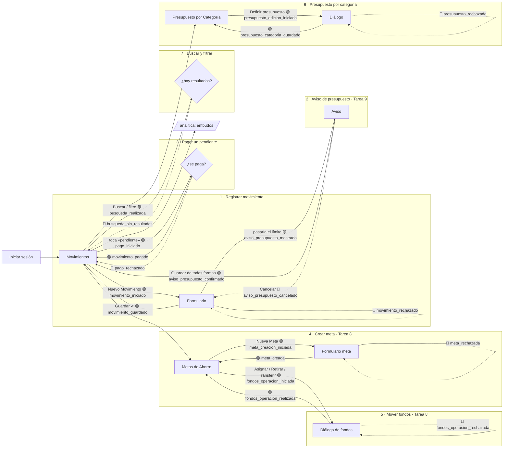
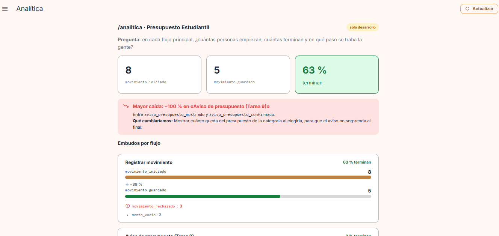
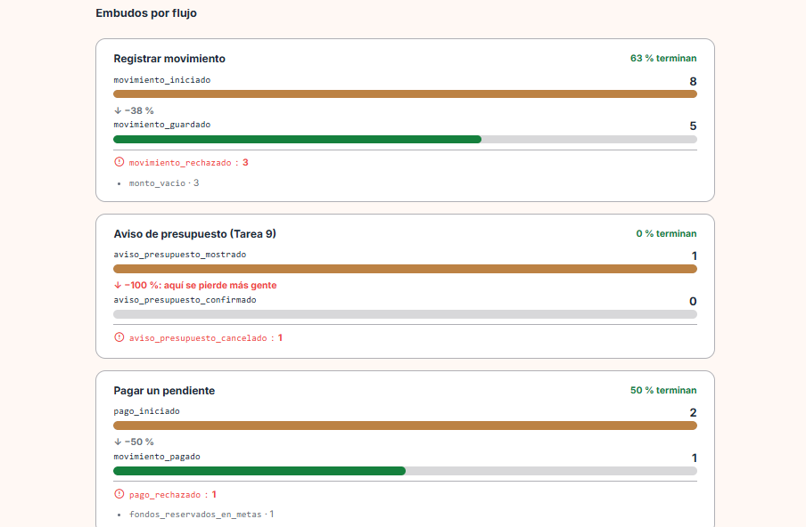
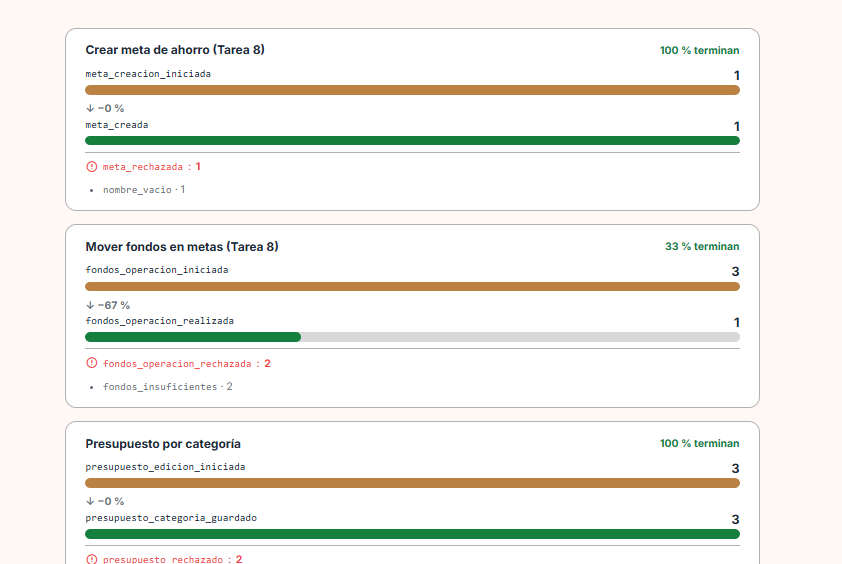
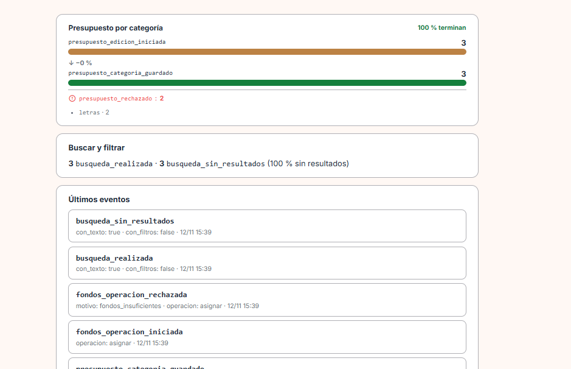
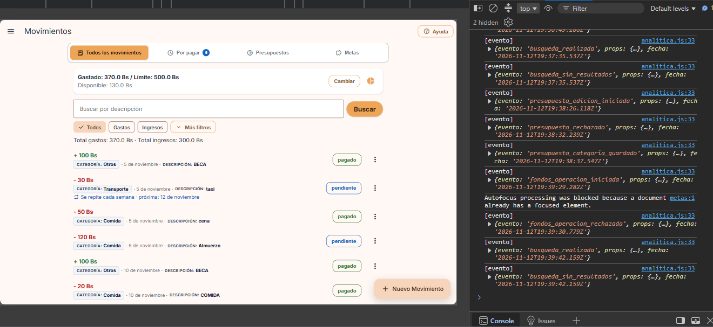
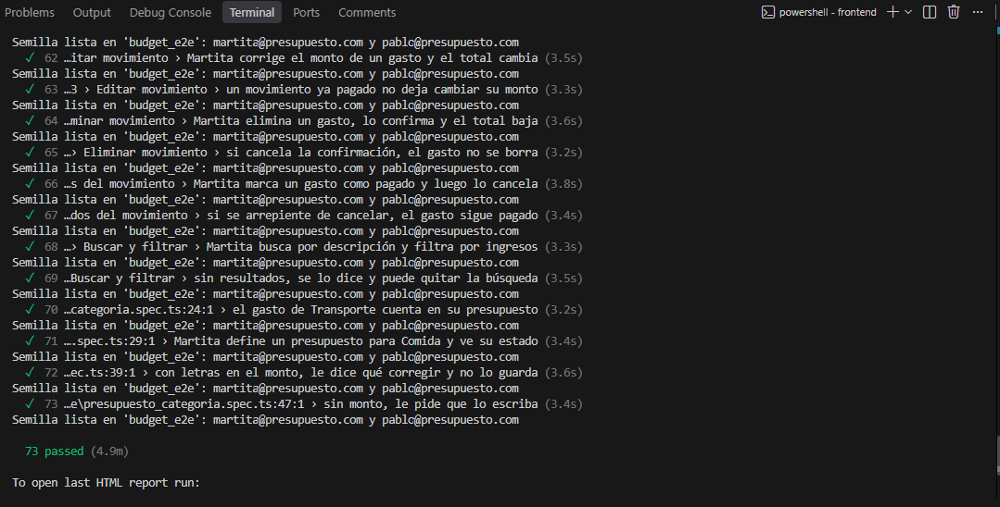

# Evidencia · Tarea 9: Analítica en todo el producto + Aviso antes de superar el límite

- **Materia:** Interacción Humano-Computador (IHC)
- **Proyecto:** Presupuesto Estudiantil (FastAPI + Vue 3 + PostgreSQL)
- **Fecha de entrega:** Jueves 12/11/2026, 18:00
- **Integrantes:**
  - Carmen Jenifer Aranibar Fernandez

| Parte | Contenido | Commit |
|---|---|---|
| **A · Analítica en todo el producto** | Plan de eventos, embudos por flujo, errores y búsquedas sin resultados | [`a1d3840`](https://github.com/Carmen21-A/FORK-PROYECTO2-IHC/commit/a1d3840) |
| **B · Funcionalidad** | Aviso antes de superar el límite de la categoría | [`6894110`](https://github.com/Carmen21-A/FORK-PROYECTO2-IHC/commit/6894110) |

---

# Parte B · Aviso antes de superar el límite

## B.1 Funcionalidad asignada (Presupuesto Estudiantil)

> Si un gasto **nuevo o editado** haría pasar el límite de **su categoría y mes**, la app muestra **cuánto se pasaría** y pide **confirmación**. **Confirmar** guarda; **cancelar** no cambia nada. Los **ingresos** no generan aviso.

**Demostración pedida:** un gasto sin aviso, uno con aviso cancelado (todo igual) y otro confirmado (queda excedido).

## B.2 Reglas implementadas

| Regla | Cómo se cumple |
|---|---|
| Solo gastos | Si el movimiento es un **ingreso**, no se calcula ningún aviso. |
| Categoría **y** mes | Se suma lo gastado (no cancelado) en esa categoría durante el mes de la fecha del gasto, y se compara con el presupuesto de esa categoría y ese mes. Sin presupuesto, no hay aviso. |
| Nuevo **o editado** | Al editar, se descuenta el monto anterior del propio gasto. Solo se avisa si la edición **aumenta** el gasto de la categoría (cambiar solo la descripción no avisa). |
| Mostrar cuánto se pasaría | El aviso muestra: presupuesto, ya gastado, este gasto, **en cuánto quedaría** y **cuánto te pasarías**. |
| Confirmar guarda | Se reenvía el mismo gasto con `confirmar_exceso: true` y se guarda; la categoría queda **excedida**. |
| Cancelar no cambia nada | No se guarda nada. El formulario sigue abierto para que pueda ajustar el monto. |
| La regla no se puede saltar | La decisión está en el **backend**: sin `confirmar_exceso`, la API responde `409` con los datos del aviso y **no guarda**. |

## B.3 Decisiones de interacción

| Decisión | Justificación IHC |
|---|---|
| **Prevenir antes que lamentar** (Nielsen H5) | El aviso aparece **antes** de guardar, no cuando el presupuesto ya está roto. |
| **Mostrar el número exacto** (H1: visibilidad del estado) | No solo dice «te pasas»: muestra **cuánto** (por ejemplo, *te pasarías 20.0 Bs*) y el detalle de la cuenta. |
| **Control y libertad del usuario** (H3) | No se bloquea: el estudiante decide. **«Cancelar»** es la salida segura y **«Guardar de todas formas»** confirma de forma explícita. |
| **Cancelar no pierde lo escrito** | Al cancelar, el formulario conserva los datos para bajar el monto o cambiar la categoría. |

## B.4 Flujo

```
«Guardar» → POST/PUT /api/movimientos
   ├─ ¿es ingreso o no pasa el presupuesto? ─────────────► se guarda (201/200)
   └─ ¿pasaría el presupuesto de su categoría y mes?
          └─ 409 { codigo: "supera_presupuesto_categoria", presupuesto, gastado, monto, nuevo_total, exceso }
                 └─ Diálogo «Este gasto supera tu presupuesto»
                        ├─ Cancelar ──────────────► no se guarda nada
                        └─ Guardar de todas formas ─► se reenvía con confirmar_exceso: true → se guarda (queda excedido)
```

## B.5 Archivos afectados

### Backend
- `backend/app/logica/aviso_presupuesto.py`: regla pura `calcular_aviso_presupuesto()` (cuándo avisar y cuánto se pasaría).
- `backend/app/routers/movimientos.py`: `_gasto_categoria_mes()` y `_avisar_si_supera_presupuesto()`, llamadas al crear (`create`) y al editar (`update`).
- `backend/app/schemas.py`: campo `confirmar_exceso` en `MovimientoWrite`.
- `backend/tests/test_aviso_presupuesto.py`: 6 pruebas (regla pura, sin aviso, cancelado, confirmado, ingresos y edición).

### Frontend
- `frontend/src/services/api.js`: el error conserva los datos del aviso (`ApiError.datos`).
- `frontend/src/services/movementsService.js`: envía `confirmar_exceso`.
- `frontend/src/screens/MovementsScreen.vue`: diálogo «Este gasto supera tu presupuesto» con Cancelar y Guardar de todas formas.
- `frontend/e2e/aviso_presupuesto.spec.ts`: E2E de la funcionalidad.

## B.6 Demostración (E2E `aviso_presupuesto.spec.ts`)

Datos de la semilla: Martita tiene un **presupuesto de Transporte de 100 Bs** y ya gastó **40 Bs** (Pasaje de micro).

| # | Acción | Resultado |
|---|---|---|
| 1 | **Gasto sin aviso:** Transporte 30 Bs (40 + 30 = 70 de 100) | Se guarda directo. Total gastos: 70 Bs. |
| 2 | **Aviso cancelado:** Transporte 50 Bs (70 + 50 = 120 de 100) | Aparece el aviso: *te pasarías 20.0 Bs*, quedaría en 120 Bs. Se toca **Cancelar**: **todo igual**; tras recargar sigue en 70 Bs y no existe el gasto «Taxi». |
| 3 | **Aviso confirmado:** el mismo gasto de 50 Bs → **Guardar de todas formas** | Se guarda. Total gastos: 120 Bs. En *Presupuesto por Categoría*, Transporte muestra **«Excedido por Bs. 20.00»** (persiste al recargar). |
| 4 | **Ingreso** de 500 Bs en Transporte | No aparece ningún aviso; se guarda directo. |

## B.7 Capturas (recorrido manual en la app)

Datos de partida en noviembre: **Transporte** tiene un presupuesto de **100 Bs** y ya lleva gastados **30 Bs**. Todos los gastos de Transporte cuentan aunque estén *pendientes*: el presupuesto suma todo gasto no cancelado.

| 1. Gasto **sin aviso**: Transporte 20 Bs «micro» (30 + 20 = 50 de 100) | 2. **Aviso**: Transporte 70 Bs «taxi» → te pasarías 20 Bs (quedaría en 120) |
|:---:|:---:|
|  |  |

| 3a. **Aviso cancelado**: la lista termina en «micro»; no se guardó «taxi» | 3b. **Todo igual**: total de gastos 290 Bs, el mismo de antes del intento |
|:---:|:---:|
|  |  |

| 4a. **Aviso confirmado** («Guardar de todas formas»): «Gasto registrado: 70.0 Bs» y total 360 Bs | 4b. «taxi» de 70 Bs ya aparece en la lista |
|:---:|:---:|
|  |  |

| 5. **Queda excedido**: Transporte «Excedido por Bs. 20.00» (consumido 120 de 100) | 6. **Los ingresos no generan aviso**: «Ingreso registrado: 100.0 Bs» en Transporte |
|:---:|:---:|
|  |  |

| 7. Suite E2E completa: **67 passed** |
|:---:|
|  |

---

# Parte A · Analítica en todo el producto

> **Que toda la app nos diga dónde se traba la gente.** Se extendió la analítica de la Clase 21 (un solo flujo) a **todos los flujos principales**, incluidas las funcionalidades de la **Tarea 8** (metas) y la **Tarea 9** (aviso de presupuesto).

## A.1 Mapa de la app con los eventos (antes de programar)

🟢 = evento de inicio o de éxito · 🔴 = evento de error (validación o permiso) · 🟡 = paso intermedio



## A.2 Plan de eventos

Todos los eventos pasan por la misma función `track()` de [`frontend/src/services/analitica.js`](../frontend/src/services/analitica.js) (línea 26), que los envía a la tabla `eventos`.

| Evento | Flujo | Tipo | Propiedades (listas fijas) | `archivo:línea` | Pregunta que responde |
|---|---|:---:|---|---|---|
| `movimiento_iniciado` | 1 · Registrar movimiento | 🟢 inicio | — | `MovementsScreen.vue:508` | ¿Cuántos empiezan a registrar un movimiento? |
| `movimiento_guardado` | 1 · Registrar movimiento | 🟢 éxito | `tipo`, `categoria` | `MovementsScreen.vue:440` → `analitica.js:47` | ¿Cuántos terminan de guardarlo? |
| `movimiento_rechazado` | 1 · Registrar movimiento | 🔴 error | `motivo`: `monto_vacio`, `monto_invalido`, `supera_limite_mensual`, `rechazado_por_servidor` | `MovementsScreen.vue:413`, `:422`, `:465` | ¿Qué validación frena más el registro? |
| `aviso_presupuesto_mostrado` | 2 · Aviso (Tarea 9) | 🟡 paso | `categoria` | `MovementsScreen.vue:462` | ¿Cuántos gastos llegan al aviso del límite? |
| `aviso_presupuesto_confirmado` | 2 · Aviso (Tarea 9) | 🟢 éxito | `categoria` | `MovementsScreen.vue:399` | ¿Cuántos deciden pasarse igual? |
| `aviso_presupuesto_cancelado` | 2 · Aviso (Tarea 9) | 🔴 salida | `categoria` | `MovementsScreen.vue:392` | ¿El aviso logra que se arrepientan? ¿En qué categoría? |
| `pago_iniciado` | 3 · Pagar un pendiente | 🟢 inicio | `tipo` | `MovementsScreen.vue:562` | ¿Cuántos intentan pagar un pendiente? |
| `movimiento_pagado` | 3 · Pagar un pendiente | 🟢 éxito | `tipo` | `MovementsScreen.vue:566` | ¿Cuántos lo logran? |
| `pago_rechazado` | 3 · Pagar un pendiente | 🔴 permiso | `motivo`: `fondos_reservados_en_metas`, `rechazado_por_servidor` | `MovementsScreen.vue:579` | ¿Cuántos pagos frena la regla de las metas (Tarea 8)? |
| `meta_creacion_iniciada` | 4 · Crear meta (Tarea 8) | 🟢 inicio | — | `MetasScreen.vue:78` | ¿Cuántos empiezan a crear una meta? |
| `meta_creada` | 4 · Crear meta (Tarea 8) | 🟢 éxito | — | `MetasScreen.vue:135` | ¿Cuántos la terminan de crear? |
| `meta_rechazada` | 4 · Crear meta (Tarea 8) | 🔴 error | `motivo`: `nombre_vacio`, `objetivo_invalido`, `fecha_vacia`, `rechazado_por_servidor` | `MetasScreen.vue:103`, `:109`, `:114`, `:141` | ¿Qué campo del formulario de metas falla más? |
| `fondos_operacion_iniciada` | 5 · Mover fondos (Tarea 8) | 🟢 inicio | `operacion`: `asignar`, `retirar`, `transferir` | `MetasScreen.vue:173`, `:187`, `:202` | ¿Cuántos intentan mover dinero y con qué operación? |
| `fondos_operacion_realizada` | 5 · Mover fondos (Tarea 8) | 🟢 éxito | `operacion` | `MetasScreen.vue:256` | ¿Cuántos lo logran? |
| `fondos_operacion_rechazada` | 5 · Mover fondos (Tarea 8) | 🔴 error | `operacion`, `motivo`: `fondos_insuficientes`, `rechazado_por_servidor` | `MetasScreen.vue:227`, `:260` | ¿Cuántos se traban por falta de fondos? |
| `presupuesto_edicion_iniciada` | 6 · Presupuesto por categoría | 🟢 inicio | `categoria` | `PresupuestoCategoriaScreen.vue:95` | ¿Cuántos empiezan a definir un presupuesto? |
| `presupuesto_categoria_guardado` | 6 · Presupuesto por categoría | 🟢 éxito | `categoria`, `supera_limite` (sí/no) | `PresupuestoCategoriaScreen.vue:127` | ¿Cuántas categorías se guardan cuando ya superaron su límite? *(ejemplo de clase)* |
| `presupuesto_rechazado` | 6 · Presupuesto por categoría | 🔴 error | `motivo`: `vacio`, `letras`, `menor_o_igual_a_cero`, `rechazado_por_servidor` | `PresupuestoCategoriaScreen.vue:108`, `:135` | ¿Qué error de escritura frena más? |
| `busqueda_realizada` | 7 · Buscar y filtrar | 🟢 | `con_texto`, `con_filtros` (sí/no) | `MovementsScreen.vue:215` → `analitica.js:109` | ¿Cuánto se usa la búsqueda? |
| `busqueda_sin_resultados` | 7 · Buscar y filtrar | 🔴 | `con_texto`, `con_filtros` (sí/no) | `MovementsScreen.vue:215` → `analitica.js:110` | ¿Cuántas búsquedas no encuentran nada? |

**Cuándo se dispara cada uno:** el de inicio, al **empezar** (abrir el formulario o el diálogo); el de éxito, **solo después de que el backend confirma** que se guardó; el de error, en el momento en que la validación o el permiso **frenan** la tarea.

**Ajuste para poder medir:** el formulario de metas usaba `required`, y el navegador bloqueaba el envío **antes** de la validación propia: el error no se medía y el mensaje era el genérico del navegador. Se le agregó `novalidate`, igual que al formulario de movimientos, para mostrar el mensaje propio y registrar el motivo.

## A.3 Dónde sí y dónde no (Slide 11)

| ✅ Dónde sí | ❌ Dónde no |
|---|---|
| Un embudo por flujo principal (7 flujos) | Cada clic o cada pantalla abierta: no hay `boton_clic` ni `pantalla_abierta` |
| Funcionalidades de la Tarea 8 (metas y fondos) y de la Tarea 9 (aviso) | Datos personales: no se guarda email, nombre ni `user_id` |
| Errores que frenan la tarea, con el motivo de una lista fija | Texto escrito por el usuario: ni descripción, ni nombre de la meta, ni el texto buscado |
| Búsquedas o filtros sin resultados | Montos: la pregunta es dónde se traba la gente, no cuánto gasta |
| | Eventos sin pregunta: cada evento de la tabla A.2 responde una |

**Doble control de privacidad:** el backend (`backend/app/logica/analitica.py`, `validar_evento`) **rechaza con 422** cualquier evento desconocido, cualquier propiedad no definida y cualquier valor fuera de su lista fija. Por ejemplo, `motivo: "el usuario escribió mal"` o `texto: "taxi a casa de Juan"` no se guardan.

## A.4 Panel `/analitica` con embudos

Se entra desde el menú lateral, en **«Analítica»**. Para cada flujo muestra:
- **Barras por paso**, con cuántos llegan a cada uno.
- La **caída entre pasos** (por ejemplo, *↓ −50 %*).
- El **% que termina**.
- Los **errores agrupados por motivo**.

Además, el panel muestra:
- **La mayor caída de toda la app**, resaltada en rojo, junto con **qué cambiaríamos**.
- **Buscar y filtrar:** búsquedas realizadas y sin resultados.
- Los últimos eventos y el aviso de privacidad.

El backend cuenta con `SELECT evento, COUNT(*) FROM eventos GROUP BY evento`, y arma los embudos en `armar_embudos()` y la mayor caída en `mayor_caida()` (`backend/app/logica/analitica.py`).

**Cómo llega cada evento a la tabla:** cada `track()` del navegador se envía al backend como `POST /api/eventos`. El backend lo valida con `validar_evento()` y, si cumple, lo guarda en la tabla `eventos` de la misma base PostgreSQL de la app (responde `201 Created`); si trae datos no permitidos, responde `422` y no se guarda.

## A.5 El paso con la mayor caída y qué cambiaríamos

Datos reales del panel (capturas A1, A2 y A3), obtenidos usando la app como Martita:

| Flujo | Inicio → Éxito | Caída | Errores por motivo |
|---|:---:|:---:|---|
| Registrar movimiento | 8 → 5 | −38 % | `monto_vacio` · 3 |
| **Aviso de presupuesto (Tarea 9)** | **1 → 0** | **−100 %** | 1 cancelado |
| Pagar un pendiente | 2 → 1 | −50 % | `fondos_reservados_en_metas` · 1 |
| Crear meta (Tarea 8) | 1 → 1 | 0 % | `nombre_vacio` · 1 |
| Mover fondos (Tarea 8) | 3 → 1 | −67 % | `fondos_insuficientes` · 2 |
| Presupuesto por categoría | 3 → 3 | 0 % | `letras` · 2 |
| Buscar y filtrar | 3 búsquedas | 100 % sin resultados | — |

> **Mayor caída: −100 % en «Aviso de presupuesto (Tarea 9)»**, entre `aviso_presupuesto_mostrado` y `aviso_presupuesto_confirmado`: todas las personas que vieron el aviso decidieron **no** pasarse del presupuesto.

**Qué cambiaríamos:** que el aviso no llegue por sorpresa al final. Mostraríamos **cuánto queda del presupuesto de la categoría al momento de elegirla** en el formulario (por ejemplo, *«Transporte: te quedan 0 Bs este mes»*), para que la persona ajuste el monto o la categoría **antes** de tocar «Guardar».

**Cómo lo leemos:** en este flujo, una caída alta **no es mala señal**. El aviso de la Tarea 9 está hecho para frenar gastos que rompen el presupuesto, y el −100 % muestra que lo logra. Lo que sí revela es que el estudiante **se entera tarde**: llena todo el formulario y recién al final descubre que no le alcanza. Por eso el cambio propuesto es avisar **antes**.

**Segunda señal:** en «Mover fondos» se pierde el **67 %** (3 → 1), siempre por `fondos_insuficientes`: la persona escribe un monto mayor al disponible. Mostrar el máximo que se puede mover y un botón «Usar todo» evitaría ese intento. En «Registrar movimiento» se repite `monto_vacio` (3 veces); validar el monto mientras se escribe evitaría tocar «Guardar» con el campo vacío.

## A.6 Pruebas de la Parte A

| Prueba | Qué comprueba |
|---|---|
| **E2E** [`frontend/e2e/analitica_flujos.spec.ts`](../frontend/e2e/analitica_flujos.spec.ts) | **Cada flujo registra sus eventos** y el panel los muestra. Registrar (con error por monto vacío), aviso (cancelado y confirmado), metas (error por nombre vacío), fondos (error por fondos insuficientes), pago rechazado por dinero reservado, pago exitoso, presupuesto (error por letras), y una búsqueda sin resultados que no guarda el texto buscado. |
| **E2E** [`frontend/e2e/analitica.spec.ts`](../frontend/e2e/analitica.spec.ts) | El flujo de la Clase 21 sigue funcionando: 2 iniciados, 1 guardado, 50 %. |
| **Unitarias** [`frontend/tests/unit/analitica.test.js`](../frontend/tests/unit/analitica.test.js) | Cada error se traduce a un motivo de la lista fija, la búsqueda no envía el texto y no aparece ningún dato personal. |
| **Backend** [`backend/tests/test_analitica.py`](../backend/tests/test_analitica.py) | Cada paso de cada embudo está definido, se rechazan motivos o valores fuera de la lista, se calculan los embudos y la mayor caída, y el panel devuelve todo. |

## A.7 Archivos afectados (Parte A)

### Backend
- `backend/app/logica/analitica.py`: eventos permitidos con valores de listas fijas, 6 flujos con sus pasos, `armar_embudos()`, `caida_entre_pasos()` y `mayor_caida()`.
- `backend/app/routers/analitica.py`: el panel devuelve embudos, errores por motivo, mayor caída y búsquedas.
- `backend/app/schemas.py`: `PasoEmbudo`, `MotivoError`, `Embudo`, `MayorCaida` y `ResumenBusquedas`.
- `backend/tests/test_analitica.py`: pruebas de la Parte A.

### Frontend
- `frontend/src/services/analitica.js`: catálogo `EVENTOS`, traductores de motivo y `trackBusqueda()`.
- `frontend/src/screens/MovementsScreen.vue`: eventos de registrar, aviso, pagar y buscar.
- `frontend/src/screens/MetasScreen.vue`: eventos de crear meta y mover fondos, y `novalidate` en el formulario.
- `frontend/src/screens/PresupuestoCategoriaScreen.vue`: eventos del presupuesto por categoría.
- `frontend/src/screens/AnaliticaScreen.vue`: panel con embudos, mayor caída, errores y búsquedas.
- `frontend/tests/unit/analitica.test.js` y `frontend/e2e/analitica_flujos.spec.ts`: pruebas.

## A.8 Capturas

| A1. Panel: flujo principal y **mayor caída (−100 % en el aviso) con qué cambiaríamos** |
|:---:|
|  |

| A2. Embudos: Registrar movimiento, Aviso de presupuesto y Pagar un pendiente |
|:---:|
|  |

| A3. Embudos: Crear meta y Mover fondos (Tarea 8) | A3b. Presupuesto por categoría, Buscar y filtrar y últimos eventos |
|:---:|:---:|
|  |  |

| A4. Consola del navegador (F12): cada `track()` imprime `[evento]` con su nombre, propiedades y fecha |
|:---:|
|  |

| A5. Suite E2E completa: **73 passed** (incluye `analitica_flujos.spec.ts` y `aviso_presupuesto.spec.ts`) |
|:---:|
|  |

---

# Tarea 8 y Tarea 9 se conservan

La Parte A **no cambia ninguna regla**: solo agrega `track()` después de que cada acción ya ocurrió. La suite completa, con todas las pruebas de las tareas 6, 7, 8 y 9, sigue pasando.

---

# Pruebas y resultados

```powershell
# Backend
cd backend
.venv\Scripts\python -m pytest -v

# Frontend unitarias
cd ..\frontend
npm run test

# E2E (con PostgreSQL encendido)
$env:E2E_CHANNEL="msedge"; npm run test:e2e
```

| Suite | Parte B | Parte A + B (final) |
|---|---|---|
| Backend (pytest) | 47 passed | **52 passed** |
| Frontend (vitest) | 57 passed | **62 passed** |
| E2E (Playwright) | 67 passed | **73 passed**, sin regresiones |
| Fallos pendientes | Ninguno | **Ninguno** |
